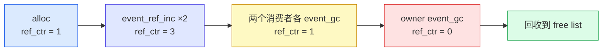

概述：事件驱动框架里的零拷贝，核心不是 DMA，而是事件对象与 payload 只在固定池中构造一次，后续提交、排队、派发和回收全程传递同一个 `Event*`。零堆分配提供稳定地址，引用计数管理共享生命周期，所有权转移则规定谁能继续访问。

## 事件系统中的零拷贝边界

先划清边界。传统"零拷贝"指网卡/磁盘 DMA 绕过 CPU 把数据直写到用户态缓冲区，省的是内核态到用户态的 `memcpy`。coact 是一个面向 MCU/SoC 的 C++17 事件驱动框架，它面对的不是内核态拷贝，而是另一类拷贝：一个事件从 ISR/任务投递到目标活动对象（Active Object，AO）手里，中间要经过协调器、暂存队列、派发器好几站，如果每一站都把事件或 payload 复制一份，MCU/SoC 的 RAM 和 CPU 都不够用。

coact 的答案是把"复制事件"这个动作彻底删掉，靠三件事：事件池让对象只有唯一一块存储，引用计数让多个目标共享同一块而不复制，整条链路只传指针。


图中分岔对应直发的两个前提：目标 AO 空闲（执行租约处于 `Idle`，没有线程正在跑它），且调用方不在派发线程（派发线程内直发会在同一栈上内联执行，栈深无界）。任一不满足就入队。

## 稳定存储与共享生命周期

零拷贝要成立，先得保证事件有一块稳定、唯一的存储。如果每次投递都 `malloc` 一块新内存再 `memcpy` 内容，那恰恰是"有拷贝"。coact 用 `EventPool`（固定容量事件池）把这块存储预先锁定。

池里的每个事件块就是一个带头的原始字节区，事件头 `Event` 只有四个字段：

```
struct Event {
    uint16_t signal;   // Event signal.
    uint8_t pool_id;   // 0 for static events; otherwise a 1-based pool index.
    uint8_t ref_ctr;   // Starts at 1; extra posts increment it; zero reclaims.
};
```

`EventPool::init(void* storage, size_t bytes)` 接收一块外部静态缓冲区，按固定步长切成若干块，用空闲链表串起来。分配时 `alloc(signal)` 在空块上 placement-new 出 `Event`，返回 `Event*`。这块存储在整个生命周期里地址不变，所以指针可以安全地在 ISR、任务、派发线程之间传递，谁拿到都指向同一块物理内存。

对带 payload 的事件，`alloc_typed` 用组合布局把事件头、应用元数据、payload 塞进同一个块：

```
template <typename Meta, size_t PayloadBytes, size_t PayloadAlign>
struct EventBlockLayout {
    Event event;
    Meta meta;
    alignas(PayloadAlign) std::byte payload[PayloadBytes];
};
```

事件头和 payload 连续存放，一次 allocation 就位，之后移动指针即移动整个事件，无需任何二次拷贝。

池的空闲链表头是一个 32 位压缩字：低 16 位是空闲块索引，高 16 位是 ABA 标签。每次分配/回收都让标签自增，即使发生 ABA 竞争，陈旧操作也不会误判头节点。同步后端在编译期二选一：

* `RttSingleCoreProfile`：单核 100MHz 产品，claim/reclaim/used/高水位全部在一条关中断临界区内完成，不做 CAS、不带 ABA 标签回退。
* `HostSmpProfile`：SMP/TSan 验证语义，带 ABA 标签的 CAS + acquire/release 发布，要求 32 位无锁 CAS，热点以 32 字节 cache line 隔离。

无论哪种后端，池的公共生命周期语义一致，只是内部同步算法不同。这个池是零拷贝的物理前提：块地址稳定，指针才敢跨线程、跨 ISR 传递而不失效。

### 引用计数让多个目标共享同一事件

零拷贝的第二个机制是引用计数（reference counting）。一个事件要同时投递给多个 AO 时，朴素的实现会为每个目标复制一份。coact 不复制，它让所有目标共享同一个 `Event*`，用 `ref_ctr` 计数：每多投递一个目标 `event_ref_inc` 加一，每个消费者处理完 `event_gc` 减一，最后一个减到零的那个消费者把块还给池。

```
inline void event_ref_inc(Event* e) noexcept {
    if (e->pool_id != 0U) {   // Static events are never reclaimed.
        ++e->ref_ctr;
    }
}

inline void event_gc(Event* e) noexcept {
    if (e->pool_id == 0U) return;          // Static event.
    if (--e->ref_ctr == 0U) {
        record->reclaim(e);                 // Return the zero-ref block to the free list.
    }
}
```

`pool_id == 0` 表示静态事件（编译期就存在的常量事件），它不来自池、也永不回收。这个区分让"零堆"和"池回收"两条路径互不干扰。



引用计数的代价是"最后一个消费者负责回收"的语义：投递方把所有权转移出去之后就不能再碰这个事件，否则会 double free。coact 在协调器接口上明确了这个契约，`submit_*` 返回后调用方不得再访问事件。

## 从提交到回收只传递指针

有了唯一的池块和引用计数，就可以把"传指针"贯彻到底。看暂存队列的槽位结构 `StagingSlot`：

```
struct StagingSlot {
    TargetId target;
    Event* event;        // Owned reference transferred to the dispatcher.
    uint64_t enqueue_ns; // Enqueue time used for low-priority aging.
};
```

整个暂存队列里存的是 `Event*`（加目标 id 和时间戳），不是事件内容。事件从协调器 `submit()` 入队，到派发器出队，到 AO 的 `Hsm::dispatch` 处理，再到最后 `event_gc` 回收，这条链路上流转的一直是这个指针。payload 始终停在池块里未移动。

这里要区分两个"复制"。队列在 push/pop 时确实移动了 `StagingSlot` 本身，但那是三个标量字段（指针 + 目标 + 时间戳）的 move，是固定几字节的指针搬运，不是事件数据的复制。零拷贝指的是"事件 payload 零复制"，不是"连指针都零移动"。

### 直发路径省去队列与线程切换

队列路径已经零拷贝，但 coact 还有一条更短的路径：直发（direct dispatch）。当目标 AO 空闲、调用方不在派发线程、且嵌套深度未超限时，协调器不入队，直接在调用栈上跑完目标 handler。

```
// coordinator.hpp: direct-dispatch predicate, excerpt.
if (!from_isr
    && !force_staging
    && !PalT::in_dispatcher_thread()
    && (pal_.current_context().direct_depth < StagingT::ConfigType::kMaxDirectDepth)
    && ao->direct_eligible()
    && target_breaker.direct_allowed(target)) {
    if (AoRunState::Idle == ao->lease().state()) {
        pal_.enter_direct();
        const bool taken = ao->dispatch_direct(*e);   // Run the handler in place.
        pal_.leave_direct();
        if (taken) {
            event_gc(e);                              // Reclaim after completion.
            return {SubmitDisposition::Direct, 0U};
        }
    }
}
```

直发路径里事件既不入队也不排空，从 `submit()` 到 handler 执行之间没有中间存储，也没有任何一次复制。它把零拷贝做到最短路径：连指针在队列里的进出都省了。代价是这条路径只在任务上下文、目标空闲时成立，ISR 或竞争失败时自动回落到队列路径，语义不变。

直发省掉的不只是拷贝。对比两条路径的完整步骤：队列路径要 `enqueue` 入队、`request_dispatcher_wake` 触发唤醒、PAL 发信号、派发线程醒来后 `dequeue` 出队、再抢 `RunningDispatcher` 租约、最后跑 handler；直发路径只有 `enter_direct`、`dispatch_direct`、`event_gc` 三步，没有跨线程交接，也没有唤醒信号。所以直发既省一次队列进出，也省一次线程调度，对实时控制类事件是关键的确定性来源。

直发只是协调器 `submit()` 的几种去向之一。完整的 `SubmitDisposition` 枚举列出所有去向：`Direct`（直发）、`Queued`（入队）、`Merged`（合并，v1 未实现）、`DroppedPolicy`/`DroppedRateLimit`/`DroppedOverload`（按策略/限流/过载丢弃）、`RejectedFull`/`RejectedState`（队列满/目标未绑定拒绝）。无论落到哪条路径，被接受的事件都只按指针流转，丢弃和拒绝时也只是 `event_gc` 一次，不存在"复制一份再处理"的分支。

## 有界队列只搬运句柄

即便走队列路径，coact 的队列本身也设计成"槽位就地构造、无堆"。三个队列后端共享同一个思路：预分配 `alignas` 对齐的原始字节槽，push 时 placement-new 构造对象，pop 时 `std::move` 取走再析构。

```
// Slot storage shared by queue.hpp and spsc_ring.hpp.
template <typename T>
struct alignas(alignof(T)) SlotStorage {
    std::byte bytes[sizeof(T)];
};
```

`BoundedMpscQueue`（SMP 多生产者单消费者）、`SingleCoreCriticalRing`（单核中断临界区保护）、`SpscRing`（无锁单生产者单消费者）三个后端，槽位里放的都不是原始事件，而是 `StagingSlot` 这类轻量句柄。pop 时的 `std::move` 搬走的是几个标量字段，事件数据仍在池块里未移动。

三个后端解决同一个问题（有界、无堆、只搬句柄），但同步手段按场景分化：

```
// BoundedMpscQueue cell: Writing is exclusive, then published as Ready.
template <typename T>
struct alignas(32) MpscCell {
    SlotStorage<T> storage;
    std::atomic<uint32_t> state{0U};   // Free / Writing / Ready / Consuming.
    std::atomic<uint64_t> ticket{0U};
};
```

* `BoundedMpscQueue` 面向 SMP 多生产者单消费者。每个单元有一个四态原子 `state`，生产者先 CAS 抢占一个 Free 单元进入 Writing，构造完 payload 再发布为 Ready；消费者扫描固定单元集，取最早 Ready 的发布。全程无锁。
* `SingleCoreCriticalRing` 面向单核 ISR 生产者，注入关中断临界区（`rt_hw_interrupt_disable/enable`），在临界区内完成容量检查、payload move、水位读取，一步搞定，不做 CAS。
* `SpscRing` 是无锁单生产者单消费者环，用两条单调递增的 `uint16_t` 序号（生产者 head、消费者 tail）对 2 的幂个槽取模，release 发布、acquire 观察，满条件 `head - tail == Capacity`，不浪费哨兵槽。

这个设计还带来一个副产品：因为槽位是编译期定容的原始字节，队列全程不碰 `malloc`/`free`，配合事件池，整条链路实现了零堆分配。MCU/SoC 上既省了拷贝的开销，也消除了堆碎片和分配失败这两个实时隐患。

## 所有权契约、容量边界与代价

零拷贝不是免费的，它的成立建立在几个硬约束上。

**事件必须 trivially copyable 且 trivially destructible。** 池回收时不会调用 payload 的析构函数，因为回收路径只有"把块链回空闲链表"，没有"析构对象"这一步。所以放进池的事件和 payload 只能是平凡类型，靠 `static_assert` 在编译期把关，带析构逻辑（如持锁、持资源）的对象进不了池。

**所有权是转移式的。** 引用计数要求"最后一个消费者回收"，因此投递方在 `submit_*` 返回后不能再碰事件。多线程下这个契约靠纪律和注释维系，出错就是 use-after-free，没有运行时检查兜底。

**容量是编译期固定的。** 池耗尽时 `alloc` 返回 `nullptr`，队列满时入队返回 `false`，协调器按策略丢弃或拒绝。零拷贝换来了确定性，代价是必须预先估计事件和队列容量，估小了会丢事件，估大了浪费 RAM。

**共享即耦合。** 多目标共享一个事件意味着消费者不能原地修改 payload（否则影响其他消费者）。需要每个消费者各有不同数据时，就得回到复制，零拷贝不适用。

所以零拷贝适合的是：事件 payload 相对小、共享只读、生命周期短、吞吐和延迟敏感的 MCU/SoC 场景。需要每个消费者独立数据、或 payload 含非平凡析构的场景，复制反而是更简单正确的选择。coact 把零拷贝做成默认路径，把选择权交给容量和类型约束，完整实现与选择理由见 [github.com/DeguiLiu/coact](https://github.com/DeguiLiu/coact)。
