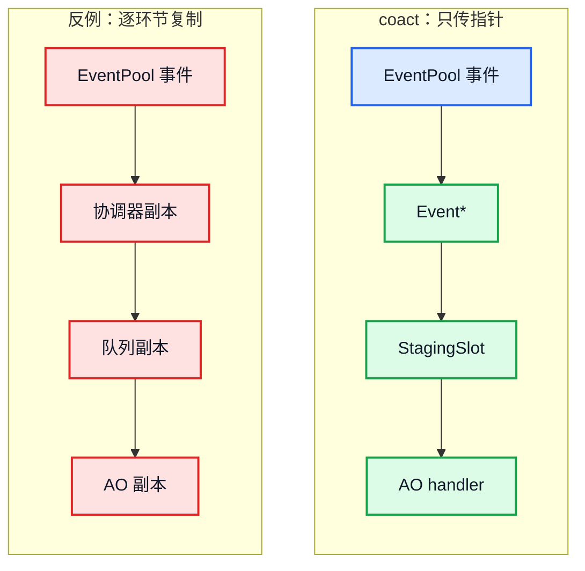
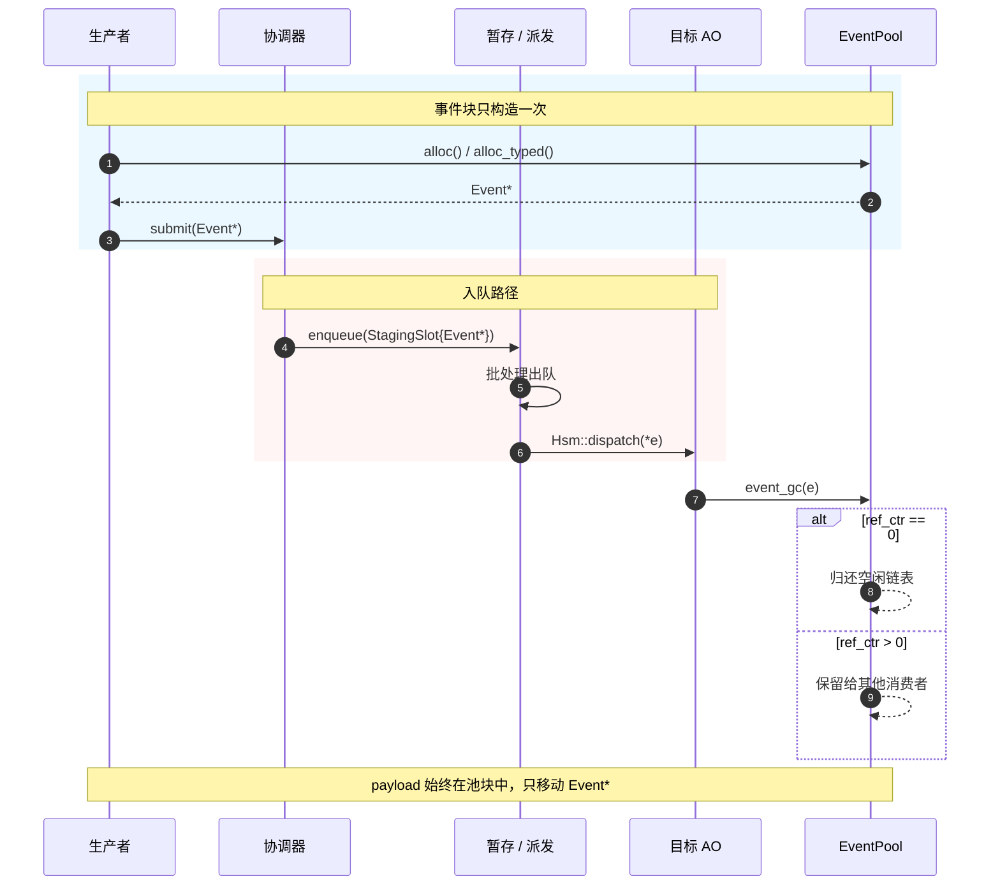

> [coact](https://github.com/DeguiLiu/coact) 是一个面向 RT-Thread（嵌入式实时操作系统）单核 MCU（单片机）的 C++17 事件框架，核心组件包括事件池、协调器、暂存/派发器和活动对象（AO），目标是在不使用堆分配的情况下完成事件调度。
>  本文只讨论两个性质：零堆和零拷贝。零堆指运行期不调用 `malloc/free` 这类动态内存分配；零拷贝指事件 payload 不复制。队列 push/pop 仍会移动 `Event*`、目标 ID 和时间戳，这不属于 payload 拷贝。

**一句话结论：事件和 payload 只构造一次；后续链路只传 `Event*`；多个 AO 共享时靠引用计数，最后一个消费者归还池块。**

先明确几个词：

| 词 | 含义 |
| --- | --- |
| 事件 | 一条待处理的消息，例如“收到一帧数据”或“定时器到期” |
| payload | 事件携带的数据本身 |
| 事件池 | 预先切好的固定大小内存块，运行期不向堆申请内存 |
| `Event*` | 指向事件块的指针，不复制事件内容 |
| 描述符/句柄 | 记录“数据在哪、有多长、还有谁在用”的小结构 |
| AO | 活动对象（Active Object），有自己处理逻辑的接收者 |
| ISR | 中断服务程序，硬件事件触发的那段代码 |
| 引用计数 | 还有几个使用者要这块数据 |
## 1. 零堆零拷贝是什么

**本章要点：coact 要省的是事件在 ISR、队列和 AO 之间重复复制的成本，同时避免运行期堆分配。**

在嵌入式系统里，事件是“发生了什么”的记录。它可能来自中断服务程序（ISR），也可能来自普通任务；目标通常是活动对象（Active Object，AO），也就是有自己处理逻辑的接收者。事件从生产者到 AO，通常要经过协调器、暂存队列和派发器。

假设传感器中断收到一帧数据，要同时通知显示 AO 和日志 AO。如果每个目标各复制一份，一帧数据就变成两份；目标越多，内存和复制次数越多。coact 的做法是让两个 AO 拿到同一个 `Event*`，数据只保留一份。

传统“零拷贝”通常指 DMA 绕过 CPU，把网卡或磁盘数据直接写入用户态缓冲区，省掉内核态到用户态的 `memcpy`。coact 处理的是另一条链路：事件在 ISR、任务、队列和 AO 之间传递。它要省掉的不是 DMA 那一段，而是事件在每个环节被重复复制的成本。

零堆和零拷贝是两件事，但在这里互相依赖：

| 问题 | 机制 | 结果 |
| --- | --- | --- |
| 地址不能变 | `EventPool` 固定块 | 池块地址稳定，指针可跨上下文传递 |
| 不能向堆申请 | 事件池 + 预分配队列 | 运行期没有 `malloc/free` |
| 多个目标共享 | `ref_ctr` 引用计数 | 多个 AO 持有同一个 `Event*` |
| 谁负责回收 | 所有权转移 | 最后一个消费者调用 `event_gc` 归还池块 |

因此，零拷贝不是单一函数，而是三个约束共同作用的结果：地址稳定、共享生命周期、所有权明确。

### 1.1 lwIP 和 libev 的零拷贝位置

lwIP 的零拷贝主要发生在 pbuf 层。pbuf 是网络包描述符，记录一段 payload 的地址、长度和下一段；多个 pbuf 可以串成一个包，协议栈转发时只移动描述符或调整 payload 指针，不复制整包。`PBUF_REF` 让 pbuf 直接引用外部缓冲区，`PBUF_ROM` 引用只读数据，`pbuf_cat`/`pbuf_chain` 只链接描述符，`tcp_write` 不带 `TCP_WRITE_FLAG_COPY` 时也直接引用应用缓冲区。这样做的原因是网络包经常由多段数据组成，复制到连续内存会增加 CPU 和 RAM 开销；代价是缓冲区生命周期必须覆盖 pbuf。

libev 没有数据层的零拷贝实现；它避免的是把 payload 复制进事件队列。`ev_io`、`ev_timer`、`ev_async` 是 watcher，只记录 fd、定时器或通知，不保存 payload；事件循环的 pending 队列只放 watcher。回调执行时，数据仍在应用缓冲区或环形队列里，由应用读取。这样做的原因是事件循环要同时管理大量事件，如果每个事件都携带 payload，就需要额外分配和复制；代价是应用必须自己管理缓冲区生命周期，且 `read` 时可能发生一次内核到用户缓冲区的复制。

| 系统 | 零拷贝发生点 | 避免的复制 | 为什么 |
| --- | --- | --- | --- |
| lwIP | pbuf 链、`PBUF_REF`/`PBUF_ROM`、`tcp_write` 不带 COPY | 协议层间 payload 复制，分片合并到连续内存 | 包常由多段组成，减少 CPU 和 RAM 开销 |
| libev | watcher 和 pending 队列只保存观察项 | 不把 payload 复制进事件队列 | 一个循环管理大量事件，数据由应用缓冲区管理 |

## 2. 复制和堆分配的成本

**本章要点：每个环节都复制会让内存和延迟随环节数、目标数增长；堆分配还会带来失败和碎片。**

生产者构造事件后，如果协调器、暂存队列、派发器每个环节都复制一份：

```text
生产者 -> 构造 Event
协调器 -> 复制 Event
暂存队列 -> 复制 Event
派发器 -> 复制 Event
AO -> 处理副本
```

这条路径有三个直接成本：

- 每次复制都要占用 RAM，payload 越大，峰值占用越高；
- 复制发生在中断或调度路径上，增加延迟和抖动；
- 多目标投递时，目标数乘以复制次数，内存和 CPU 成本一起放大。

如果改用运行期 `malloc` 分配事件，还会引入另一组问题：

- 分配可能失败，失败后事件无法投递；
- 长时间运行后可能产生堆碎片；
- 每个副本都要单独释放，所有权容易混乱；
- 释放时机错误会导致泄漏、重复释放，或者对象已经归还却还有指针在用它，也就是 use-after-free。

下图以 coact 为例对比两种路径：复制路径每经过一个环节就产生一份新数据；指针路径始终指向同一个事件块。



*图 1：coact 的两种事件传递方式。左侧是逐环节复制的反例，右侧是只传 `Event*` 的实现。*

lwIP 和 libev 的选择正好对应这两种成本。lwIP 如果每个协议层都复制 pbuf，分片和转发会在每层产生一次 payload 复制；libev 如果把 payload 放进 watcher 或 pending 队列，事件循环就要为每个事件分配和复制数据。两者都选择只传描述符或通知，把数据留在原缓冲区。代价是生命周期管理从“复制后各自负责”变成“共享缓冲区，必须约定谁读、谁释放”。

因此，问题不只是“复制慢”，而是复制把存储、生命周期和所有权同时复杂化了。coact 需要的是另一种结构：事件只有一块存储，所有消费者共享它，最后由引用计数决定何时归还。

## 3. 一次构造与指针链路

**本章要点：池块保证地址不变，队列只保存事件指针等句柄，整条链路不复制 payload。**

### 3.1 固定池块与事件布局

零拷贝要成立，先要保证事件有一块稳定、唯一的存储。`EventPool` 用外部静态缓冲区初始化，按固定步长切成事件块，再用空闲链表串起来。分配时在空块上 placement-new 出事件头，返回 `Event*`；这块存储的地址在整个生命周期内不变。placement-new 是在一块已经准备好的内存上构造对象，不会再向堆申请空间。

事件头只有四个字段：

```cpp
struct Event {
    uint16_t signal;   // Event signal.
    uint8_t pool_id;   // 0 for static events; otherwise a 1-based pool index.
    uint8_t ref_ctr;   // Starts at 1; extra posts increment it; zero reclaims.
};
```

事件头字段的含义如下：

- `signal`：事件类型；
- `pool_id`：来自哪个池块，`0` 表示静态事件；
- `ref_ctr`：还有几个使用者要这个事件。

带 payload 的事件使用组合布局，把事件头、应用元数据和 payload 放进同一个块：

```cpp
template <typename Meta, size_t PayloadBytes, size_t PayloadAlign>
struct EventBlockLayout {
    Event event;
    Meta meta;
    alignas(PayloadAlign) std::byte payload[PayloadBytes];
};
```

事件头和 payload 连续存放，一次分配就位。生产者把数据写入池块属于首次构造或填充；后续提交、排队、派发和回收不再复制 payload。事件块用 `std::byte` 和 `alignas` 固定布局，队列句柄用 `std::move` 移动；这些机制让事件和队列都不需要额外堆分配。

池的同步后端在编译期二选一：单核产品使用关中断临界区，多核验证环境使用 CAS。同步方式只影响池的并发实现，不改变“块地址稳定”这一前提。

### 3.2 暂存队列只搬运句柄

事件块地址固定后，队列中保存什么？暂存队列的槽位不保存事件内容，只保存目标、指针和时间戳：

```cpp
struct StagingSlot {
    TargetId target;
    Event* event;        // Owned reference transferred to the dispatcher.
    uint64_t enqueue_ns; // Enqueue time used for low-priority aging.
};
```

`StagingSlot` 包含目标 AO、事件指针和入队时间。队列中保存的是这些句柄，不是事件内容。

从协调器 `submit()` 入队，到派发器出队，再到 AO 的 `Hsm::dispatch` 处理，链路上流转的一直是 `Event*`。队列 push/pop 会移动 `StagingSlot` 本身，但移动的是几个标量字段，不是 payload。零拷贝指 payload 零复制，不是连指针都零移动。

队列本身也不向堆申请内存；它预先分配固定大小的存储槽，push/pop 只在槽位中构造、移动或析构句柄。不同队列后端分别服务单核 ISR、单生产者单消费者和多生产者单消费者，同步方式不同，但都只搬运句柄。直发路径只是省掉队列；即使直发，payload 也不复制。

下图给出一个事件从分配到回收的完整时序。



*图 2：coact 的入队路径只传递 `Event*`；引用计数归零后才归还池块。*

## 4. 所有权模型：引用计数与回收

**本章要点：coact 用侵入式引用计数表达共享所有权；这比 `shared_ptr` 更适合零堆和确定性场景。**

### 4.1 为什么不用 shared_ptr 和 unique_ptr

`std::shared_ptr` 表达共享所有权，但需要独立控制块。`make_shared` 可以把对象和控制块合在一次分配里，但仍然是堆分配；引用计数更新使用通用原子操作，删除器也带类型擦除。对 MCU 和 ISR 路径，这些成本和不确定性都不合适。

`std::unique_ptr` 没有额外控制块，适合独占所有权；但它不能把一个事件同时交给多个 AO。把 `unique_ptr` move 进队列只适合单消费者场景，无法表达多目标共享。

coact 采用侵入式引用计数：`ref_ctr` 直接放在 `Event` 里，不需要独立控制块，也不需要堆分配。它相当于一个最小化的侵入式智能指针语义，接口是 `event_ref_inc` 和 `event_gc`。

### 4.2 引用计数与所有权转移

一个事件投递给多个 AO 时，朴素实现会为每个目标复制一份。coact 让所有目标共享同一个 `Event*`，用 `ref_ctr` 记录共享引用数：每增加一个目标加一，每个消费者处理完减一，最后一个归零时归还池块。

```cpp
inline void event_ref_inc(Event* e) noexcept {
    if (e->pool_id != 0U) {   // Static events are never reclaimed.
        ++e->ref_ctr;
    }
}

inline void event_gc(Event* e) noexcept {
    if (e->pool_id == 0U) return;          // Static event.
    if (--e->ref_ctr == 0U) {
        record->reclaim(e);                 // Return the zero-ref block.
    }
}
```

`pool_id == 0` 表示编译期就存在的静态事件；它不来自池，也永不回收。池事件从 `ref_ctr == 1` 开始，每多投递一个目标加一；每个消费者处理完调用一次 `event_gc`，最后一个把计数减到零的消费者负责归还池块。

这也是所有权契约的一部分：投递方在 `submit_*` 返回后不能再访问事件。事件已经被转移给协调器，后续由消费者和引用计数管理。多线程下这条契约主要靠接口约定和代码评审维持，没有运行期兜底。

### 4.3 所有权对照

第 1 节已经说明 lwIP 和 libev 的零拷贝位置；这里只比较所有权。lwIP pbuf 与 coact 都使用侵入式引用计数，最后一个 `pbuf_free`/`event_gc` 释放存储；libev watcher 不拥有 payload，生命周期由应用管理。coact 的 `Event*` 是拥有所有权的句柄，`StagingSlot` 转移所有权，最后一个消费者归还池块。

| 机制 | 所有权 | 引用计数位置 | 存储来源 | 适用场景 |
| --- | --- | --- | --- | --- |
| coact | 转移式共享 | `Event::ref_ctr` | `EventPool` | 固定事件、多个 AO |
| lwIP pbuf | 共享 | `pbuf::ref` | pool、RAM、外部 REF/ROM | 网络包分片与转发 |
| libev watcher | 非拥有 | 无 | 应用缓冲区 | readiness 与通知 |

| 需求 | 更合适的机制 |
| --- | --- |
| 固定大小事件、多个 AO 共享、零堆 | coact |
| 网络包分片、拼接、动态协议头 | lwIP pbuf |
| 只关心 fd 可读/可写或跨线程通知 | libev |

## 5. 边界：何时不该零拷贝

**本章要点：零拷贝用生命周期契约换复制成本，适合共享只读的小 payload，不适合每个消费者独立数据。**

### 5.1 类型约束

事件必须可平凡复制且可平凡析构。直白说，就是这块数据可以按字节复制，销毁时也不需要额外动作，比如释放锁、关闭文件。池回收只把块链回空闲链表，不调用 payload 的析构函数，因此带锁、持有资源或需要析构逻辑的对象不能放进池，通常由 `static_assert` 在编译期拦截。`static_assert` 是编译期检查，类型不满足就直接编译不过。

### 5.2 容量约束

容量是编译期固定的。池耗尽时 `alloc` 返回 `nullptr`，队列满时入队失败，协调器按策略丢弃或拒绝。零拷贝换来了确定性，但必须预先估计事件数和队列深度；估小了会丢事件，估大了浪费 RAM。

### 5.3 共享只读与计数上限

共享意味着耦合。多个消费者拿到同一个事件时，不能原地修改 payload，否则会影响其他消费者。需要每个消费者拥有不同数据时，按目标复制反而更简单，零拷贝不适用。

所有权契约在第 4 章已经说明；违反它会导致 use-after-free，当前没有运行期检查。`ref_ctr` 是 `uint8_t`，共享目标数也需要控制在 8 位计数能表示的范围内。

因此，零拷贝适合 payload 较小、共享只读、生命周期短、吞吐和延迟敏感的 MCU/SoC 场景。需要每个消费者独立数据、或 payload 含非平凡析构时，复制是更简单且更安全的选择。coact 把零拷贝作为默认路径，把选择权交给容量和类型约束；完整实现见 [github.com/DeguiLiu/coact](https://github.com/DeguiLiu/coact)。

相关实现与文章：

- [coact GitHub 项目](https://github.com/DeguiLiu/coact)
- [lwIP pbuf API](https://www.nongnu.org/lwip/2_1_x/group__pbuf.html)
- [lwIP tcp_write 与 TCP_WRITE_FLAG_COPY](https://www.nongnu.org/lwip/2_1_x/group__tcp__raw.html)
- [单线程事件循环的内核设计：libev 机制与 RT-Thread 移植](https://deguiliu.github.io/tech-notes/posts/architecture/event_loop_internals_and_rtthread_port/)
- [libev 作为中断下半部](https://deguiliu.github.io/tech-notes/posts/practice/event_loop_as_bottom_half/)
- [编译期 AOP：把横切不变式收进循环骨架](https://deguiliu.github.io/tech-notes/posts/pattern/compile_time_aop_invariants/)
- [C++ 协程：优化阻塞型任务的调度性能](https://deguiliu.github.io/tech-notes/posts/performance/cpp_coroutine_waiting_task_scheduling/)
