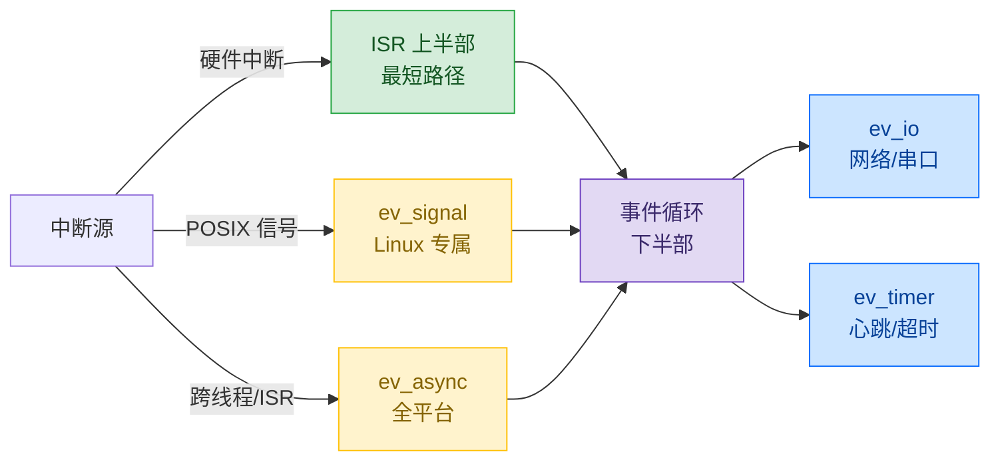

> 原文链接: [CSDN](https://blog.csdn.net/stallion5632/article/details/164593464)

> 结论先行：libev 不碰硬件中断，却为中断驱动的系统提供了完整的「慢事慢办」机制。它的定位可以一句话说清：**下半部调度器**。

## 1. libev 是什么：一个「事件管家」

你同时要等很多事：等网络消息、等定时闹钟、等别的线程干完活喊你。一件件排队等会卡；开一堆线程各等各的，又麻烦又费内存。

libev 的做法：把所有「要等的事」登记给它，哪根线有数据了叫我、几毫秒后叫我、别的线程喊我了叫我。然后一个循环在那儿统一盯着，哪件事发生了就调用你事先写好的处理函数，处理完立刻回来继续盯，绝不停下傻等。于是一个循环能同时处理成百上千件事。

登记的事只有三类，对应三个 watcher：

| watcher | 等什么 | 典型场景 |
|---|---|---|
| `ev_io` | fd 有数据可读 / 可写 | 网络消息、串口数据 |
| `ev_timer` | 定时到期 | 闹钟、心跳、超时 |
| `ev_async` | 别的线程 / ISR 喊你 | 跨线程完成通知 |

## 2. 三个例子看懂「管家」怎么干活

**写文件**：写文件很慢、会卡。主循环自己写的话，等待期间电话、闹钟全接不了。于是让一个「跑腿线程」去写，写完了喊一嗓子，libev 再把「写完了」交给主循环处理。写的过程中闹钟一直响，证明主循环没被卡住。

**串口收数据**：来数据了 libev 通知你去读。真实中断场景里，中断函数只把字节塞进缓冲区就完事，然后戳一下 libev，让主循环慢慢解析。

**网络服务器**：来连接了、连接上有数据了，libev 挨个通知你，不用开一堆线程。

三个例子的共同点，就是那句「**快事快办、慢事慢办**」：真正紧急的（读 FIFO、塞字节）在最短路径上完成，其余耗时的（解析、分发、写盘）全部丢给事件循环慢慢办。

## 3. 硬件中断：管不了，但它是天生的「下半部」

硬件中断由 CPU / 内核 / RTOS 的中断控制器直接跳转到 ISR，有纳秒级实时性要求。libev 的事件循环有调度延迟，不适合 ISR 上下文，**无法接管中断向量**。

但 libev 恰好提供了配套机制，正确模式就是 Linux 内核的「上半部 / 下半部」思想，libev 扮演下半部调度器：

真实产品里，硬件 ISR 只做「读 FIFO → push ring → 触发通知」，其余交给 libev。串口环形缓冲示例演示的正是这个：模拟 ISR 只把字节塞进环形缓冲、再用 `ev_async_send` 戳一下循环，解析、分发这些重活全在事件循环里做。

## 4. 软中断与 ev_async

### 4.1 软中断（POSIX 信号）：ev_signal 能直接托管

`ev_signal` watcher 把异步信号转成事件循环里的一次回调，避免信号打断带来的竞态。网络服务器示例里用 `ev_signal` 托管 Ctrl-C 做优雅退出。

但它只在 Linux 可用：轻量级 RTOS 通常没有 POSIX 信号，`ev_signal` 需在编译期裁剪（`EV_SIGNAL_ENABLE=0`）。所以「软中断托管」是 Linux 专属能力。

### 4.2 ev_async：libev 自己的「应用层软中断」

`ev_async_send` 是 libev 唯一线程安全入口，等价于「从任何线程 / ISR 给事件循环发一个软中断」。它补上了 `ev_signal` 在 RTOS 上的空缺：

- 异步写文件示例：worker 写完，用 `ev_async` 通知主循环。
- 串口环形缓冲示例：ISR 塞完字节，用 `ev_async` 唤醒循环。

至此三层闭环：**硬中断管不了（但配了上下半部模式）、POSIX 信号能托管（`ev_signal`，Linux 限定）、跨线程 / ISR 通知用 `ev_async`（全平台）**。

## 5. 一张图总结：libev 的中断观

libev 的价值不在于接管中断，而在于**把中断里不该做的慢事，接到一个统一、可预测、单线程的循环里慢慢办**。它管的是「下半部」，以及下半部里那成百上千件可以串行处理的小事。

> 一句话：硬件中断负责「快事快办」，libev 负责「慢事慢办」，中间的 `ev_async` / `ev_signal` 就是二者的接线柱。
