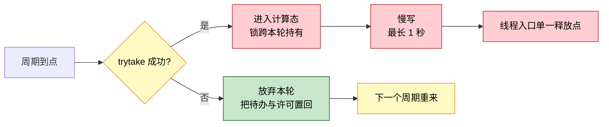
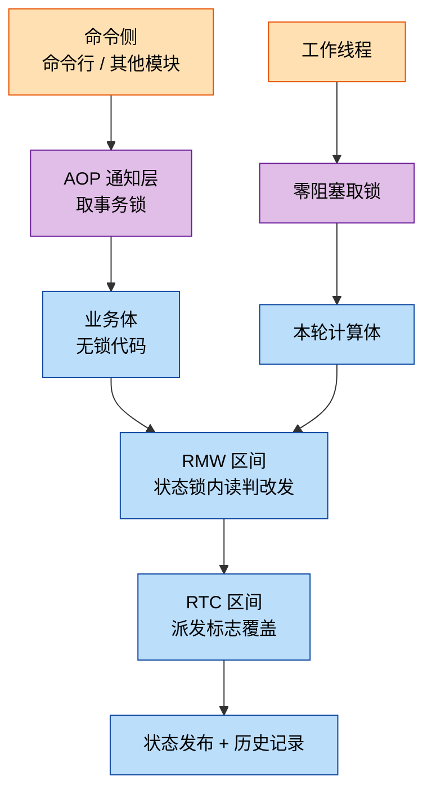

一个工作线程跑周期计算，板载命令行和工况切换模块从另外的线程下发命令，硬件写完之后再由中断回调通知它。这种“一个工作线程 + 多个命令入口 + 一份共享状态”的 MCU 服务很常见。

周期服务很少栽在状态机上：转移是否合法容易查，难防的是**读和写之间被别的线程插了一脚**，判断时依据的输入到发布时可能已经作废。全文只做三件小事：把判据与发布收进同一个临界区（RMW）、挡住派发过程中的重入（RTC）、把锁从业务代码里挪到一层通知里（AOP）。做完之后，并发正确性不再依赖注释提醒，改坏了会编译不过或测试报错。三个机制各自怎么落地、彼此怎么配合、要付什么代价，是下面几节的内容。


## 一、典型场景与失效点

服务本身没什么特别：按固定节拍唤醒，读硬件、算一批系数、把结果写回设备，循环往复。让它变复杂的是外围：命令既能从命令行来，也能从工况切换模块来，一个要它立刻算一次，一个要它换档重新加载；而硬件写完的通知又是从中断里出来的。

于是并发面就出来了：

- 一个工作线程按节拍跑计算；
- 命令行、工况切换模块从**另外的线程**下发命令；
- 硬件写入完成后由**中断回调**通知工作线程；
- 命令、线程、中断三方共享同一份状态与参数。

它的失效点通常集中在四处，都属于平时看不出来、偶发一次才会暴露的类型：

| 问题 | 表现 |
|---|---|
| 关键等待无超时 | 等硬件响应用了无限等待，一旦响应丢失，工作线程永久卡死，周期计算静默停止 |
| 停止操作谎报成功 | 轮询若干部后直接返回成功，实际工作线程还在跑 |
| 状态写入点分散 | 状态字段有 4 处直接赋值，其中两处绕过了合法性校验 |
| 锁代码散落 | 每个长事务各自取放锁，覆盖范围由各分支作者自行决定 |

四条里，前两条是等待与上报的写法问题，后两条是结构问题，也是本文要处理的部分。它们不会立刻暴露，却会持续制造只在特定时序下出现的偶发缺陷。

## 二、读改写原子性与拒绝重入（RMW、RTC）

上面这两条结构问题分属两层：一层是同一线程内部的执行顺序，一层是多入口之间的互斥。RMW 和 RTC 先解决执行顺序这一层。

### 判据与发布之间被插入的窗口

常见的状态校验是逐状态用 `switch` 判断目标态是否可达。这种校验回答的是“这条转移在状态图上是否合法”，却回答不了另一件事：判断时读到的输入，到真正写下去的时候可能已经变了。

看这个服务里的一个具体例子。有个生效值决定服务是否在跑，它由若干输入算出来：全局禁用位、局部意图槽、工况基线。计算和执行是分开的：

```
线程 A: 读快照 → 算出候选值 = 开
线程 B: 改变输入（下发禁用）        ← 插在这里
线程 A: 把候选值 = 开 发布出去      ← 发布了过期结论
```

线程 A 的快照与发布之间隔着若干毫秒（涉及一次数据重载），足够 B 干完活。结果是 A 用一个已经作废的输入，发布了一个"应该开"的结论，把 B 的禁用意图覆盖掉。

### 加一个版本号，把三步圈进同一临界区（RMW）

做法是把“读旧值、判条件、发布”这三步圈进同一个临界区，中途不放锁：

```c
rt_mutex_take(&priv->state_mutex, RT_WAITING_FOREVER);
was_enabled = effective_enable_get();          /* 读旧值 */
if (RT_TRUE == priv->blocked) { enable = RT_FALSE; }          /* 复核一 */
if (in->gen != priv->decision_gen) { ret = MOD_DRV_BUSY; break; }  /* 复核二 */
if (gate_blocks_open(enable, priv->gated, authorized)) { enable = RT_FALSE; } /* 复核三 */
effective_enable_set(enable);                  /* 发布 */
rt_mutex_release(&priv->state_mutex);
```

这就是 RMW（Read-Modify-Write，读-改-写）：同一临界区内完成读、判、改、写。

三段复核里，第二段的设计值得单独说一句：它比较的是一个**版本号**。

```
计算前: 记下当前版本号 gen = 7
计算后: 若 priv->decision_gen 仍为 7 → 输入没变过，可以发布
        若已变成 8          → 中途有人改过输入，本次结论作废
```

之所以选版本号，是因为比较数值时看不出 ABA 回绕：输入变了一圈又回到原值，比值会判成“没变过”，版本号不会。布尔型输入尤其明显：禁用位在快照和发布之间被置起来又清掉，比数值根本察觉不到。

### 派发被打断：历史里出现假迁移

RMW 解决的是并发写，还有一种破坏方式来自重入。RTC（Run-to-Completion，运行到完成）指单次事件的处理从开始到结束不被同类的第二次处理打断。它防的是这种情形：某次派发正在写状态指针和迁移历史，中途被中断回调或另一个线程触发的第二次派发插进来，于是历史记录里出现半成品，或者状态指针被写了两遍。

事后翻日志时，会看到一条不存在的迁移或一条重复的迁移，可是没有任何记录能说明“这两条出自同一次处理”。

### 用派发标志挡住重入（RTC）

RTC 是 UML 状态机本来就有的语义，不是可选项：单次事件的守卫、退出动作、迁移动作、进入动作合在一起，是一个不可分割的步骤。违反它的方式也很固定，最常见的就是**在进入动作里再派发一个事件**，让第二次处理钻到第一次的中间去。

顺带说清一个常见的误解：RTC 约束的只是“同一实例不并发处理两个事件”，它**不**要求处理过程独占 CPU。被更高优先级的任务或中断抢占是允许的，被抢占的处理会在调度回来后从断点继续、最终走完整个步骤，这仍然是 RTC。

分清这一点有实际好处：如果误以为 RTC 要求独占 CPU，就容易去关中断或抬优先级来“保护”处理过程，把整个系统的响应性一起搭进去；分清之后，中断照常跑即可，只要它不碰状态机的私有数据。

实现只需要一个布尔字段，但有两个位置必须放对：

```c
if (RT_TRUE == priv->dispatching)   /* 嵌套或并发派发一律拒绝 */
{
    ret = MOD_INVALID_STATE;
    break;
}
priv->dispatching = RT_TRUE;        /* ① 必须在读旧态之前 */
/* ... 读旧态、查表、发布、写历史 ... */
priv->dispatching = RT_FALSE;       /* ② 必须在写历史之后 */
```

- **置位早于读旧态**：否则读与写之间仍可被插入第二次派发，RMW 的原子性被破坏。
- **清位晚于写历史**：否则历史记录可能被第二次派发覆盖。

这两个顺序看似显然，但属于"改动一行代码即静默失效"的约束，可以固化为测试断言：置位语句的行号必须小于读旧态的行号，清位语句必须大于写历史。

### 状态字段的写入收敛到一个派发入口

状态字段需要同样的纪律。把写入收敛到一个派发入口，取值、查表、发布一次做完：

```c
priv->dispatching = RT_TRUE;      /* 进入 RTC 区间 */
old_state = priv->state;          /* 读 */
/* 按 (源态, 事件) 双键匹配转换表 */
new_state = transition->target;
priv->state = new_state;          /* 改 + 写 */
record_state_history(priv, old_state, new_state);
priv->dispatching = RT_FALSE;
```

分散在 4 处的 `priv->state = ...` 收敛成 1 处之后，测试可以断言“状态字段的所有写入必须在这个函数体内”。这是一条能自动执行的约束，不再依赖代码评审时有人记得。

### 被拒绝的派发怎么计数

被拒绝的派发会累加一个计数器，通过诊断接口暴露出来，用来排查“命令为什么没生效”。这里有一处取舍：三类拒绝（参数越界、重入检测、转换表里没有匹配边）合并成一个计数，看到非零值也判断不出是哪一种，得配合日志定位。合并的原因是计数器必须在临界区内自增，而临界区里不适合做串口输出：一次 `printf` 就可能把热路径堵住。诊断分辨率因此变粗，换回来的是临界区内不做输出。

## 三、锁不该写在业务代码里（AOP）

RMW 和 RTC 管的都是同一线程内部的顺序。并发的另一半来自多个入口同时进来：命令侧可能同时在跑两次长事务，而这层“加锁”逻辑不属于任何单个业务函数。

### 锁散落在各分支的三个问题

一种常见做法是让每个长事务分支自行在片段内取放状态锁。问题有三个：

1. 覆盖范围由分支作者决定，新增命令时容易漏或覆盖不足；
2. 长事务本身可能阻塞（周期服务常有一次最长 1 秒的硬件写入），把它套进状态锁会连带把诊断命令一起堵住；
3. 锁的取放点分散，很难静态检查有没有漏放。

### 这段逻辑叫横切关注点（AOP）

“长事务要在执行前后加锁，但这半段逻辑不属于任何业务函数”，这就是横切关注点（AOP，Aspect-Oriented Programming，面向切面编程）要处理的情形。这个概念 1997 年由 Xerox PARC 的 Kiczales 等人提出，针对的是两个老问题：同一个关注点散布在几十个函数里（scattering），以及它和业务逻辑缠在一起（tangling），改一处要动几十处。

AOP 的术语体系里，本文只用到两个：**切面**（aspect，封装横切逻辑的模块）和**通知**（advice，在主流程前后插入的动作，分 before / after / around）。Java 侧有整套语言和框架做这件事（AspectJ 的编译期织入、Spring 的运行期代理）；C 里没有织入器，但用函数指针加手工分发，实现“在调用前后做固定动作”这种 around 通知并不困难，也不需要额外工具。

### 用一层通知把锁移出业务体

做法是抽出一个通知层，业务体退化成纯函数，内部不出现任何锁代码：

```c
static module_ret_err_e svc_cmd_around(handle_t self, cmd_body_t body, const void *arg, uint32_t size)
{
    if (RT_FALSE == HANDLE_VALID(self)) { return MOD_INVALID_HANDLE; }   /* Before */
    if (RT_TRUE == priv->txn_mutex_initialized)
    {
        if (RT_EOK != rt_mutex_take(&priv->txn_mutex, rt_tick_from_millisecond(TXN_LOCK_WAIT_MS)))
        {
            return MOD_DRV_BUSY;   /* 取锁失败：未持锁，故不释放 */
        }
        held = RT_TRUE;
    }
    ret = body(self, arg, size);   /* 连接点：业务体 */
    if (RT_TRUE == held) { rt_mutex_release(&priv->txn_mutex); }   /* After：无条件 */
    return ret;
}
```

哪些命令属于长事务，由命令分发表的一个字段声明，不在分发器里写 `if`：

```c
{NODE_TRIGGER_CALC,     RT_TRUE,  svc_set_trigger_calc},
{NODE_START_AUTO,       RT_TRUE,  svc_set_start_auto},
{NODE_STOP_AUTO,        RT_TRUE,  svc_set_stop_auto},
{NODE_HOLD,             RT_FALSE, svc_set_hold},
```

新增命令时改一个字段即可，锁的施加由分发层保证。测试也随之变成可静态检查的：**全文件只允许一个取锁点**，也就是这个通知层。

### 工作线程改用零阻塞取锁

通知层用的是带超时的 `take`：拿不到锁就等一会儿，超时返回忙。但工作线程不能沿用同一套：

```
工作线程在 txn_mutex 上等待 → 最长要等 1 秒 → 期间收不到停止事件
                                            → 停止命令超时报错
```

所以工作线程走的是零阻塞的 `trytake` 变体，拿不到就放弃本轮、下一个节拍重来：



这两种用法合起来就是一句话：同一把锁要区分两种获取语义，命令侧可以等，因为它有超时上限；工作线程不能等，它等掉的是自己的响应能力。把两者塞进同一个 `take` 封装，会留下隐患。

### 阻塞在事件模型里是语义问题

上面的例子看起来是“耗时过长”，但在事件驱动模型里它是个语义问题：**每一次阻塞返回，都等价于一次新事件的到达**，线程从阻塞中醒来的那一刻，等于收到“锁到手了”这个事件。问题不在于等了一秒，而在于：

```
处理"周期到点"事件
  ├─ 阻塞在锁上 ──────────────┐
  │                          │  ← 解锁的瞬间等价于"锁到手"事件的到达
  └─ 继续处理 ←──────────────┘     与"周期到点"这个事件的处理过程重叠
```

还有一个直接后果：线程在阻塞期间无法响应事件队列，就是收不到停止指令，截止时间也一并落空。所以不要在 RTC 步骤里阻塞：取锁失败就退出本轮，等下一个节拍重试。

同样的道理也解释了这里为什么不需要周期定时器：定时器回调再转一次唤醒，等于在事件队列之外另开了一条路径；直接用事件等待的超时表达节拍就够了。

## 四、三个机制怎么配合

三个机制管的是三层不同粒度的事，从外到内依次收窄：



一次长事务命令走完这四层：通知层取事务锁（超时则整体拒绝，不进入业务体）→ 业务体执行数据重载与决策（自身不含锁代码）→ 决策内部进状态锁完成一次 RMW 并发布生效值 → 期间若派发状态事件，RTC 标志保证这次派发不被打断。

撤掉任一层，外面的层都无法单独保证正确性：没有 AOP，两个命令可能同时做重载；没有 RMW，命令与工作线程的决策互相覆盖；没有 RTC，派发可能被中断回调打断。

## 五、变化、代价与适用边界

### 两处性质上的变化

三个机制用上之后，值得对照的不是一串数字，而是两处性质上的变化。

第一处是并发写的性质变了。状态字段的写入点从 4 处收到 1 处，生效值的发布点也只剩一处，而且发布之前必须过版本号比对；重入防护从一个口头约定变成 1 个派发标志；长事务锁从各分支各自取放变成 1 取 1 放，由通知层统一。原来的写法里，这些保护只能写在注释上，靠后来的人自觉。

第二处是等待从无界变成有界。唯一等外部事件的信号量从无限等待改成 1000 ms 上限，并配三态握手隔离迟到响应；停止操作原来靠延时轮询、超时了还报成功，现在改成等确认事件，超时就如实上报。

### 付出的代价

最直接的一笔是分层带来的间接：新增一条命令要同时改表项和函数，读代码也得在通知层与业务体之间来回跳。这部分成本只在新功能时出现，不影响运行期，但确实存在。

AOP 从提出起就被指出同一个毛病：横切逻辑抽离之后，控制流变成“非局部”的，单看一个业务函数，你看不出它什么时候被动过手脚；业界常见的批评正是“把逻辑分散并间接化，反而更难推理”。所以 C 里只放最小的一层 around 通知（一个函数、一个表字段）就够了，没必要搬来整套切面框架；用多少层，取决于收益能不能覆盖这份间接成本。

另一笔体现在代码规模上，但别把这些数字都算到三个机制头上。函数长度、命令分支条数、定时器调用次数变小，主要来自另外两件事：拆长函数、把分支改成查表。反过来，状态锁的无限等待计数从 26 处增到 36 处，因为临界区被切得更细、取放点更多；这些都是短临界区，等多久由临界区长度决定，不会永久卡死。看代码时别只数个数，要看等的是锁还是外部事件。

### 适用边界与未走到的路径

这套做法不是普适的。如果服务只有一个线程、状态只有两三个、也没有中断回调参与，那这些机制省下的麻烦抵不过分层带来的间接，不如不拆。它们是给“多入口 + 共享状态 + 中断参与”的场景准备的，动手之前先确认自己在不在这个场景里。

还有一条路径没在真机上走到：迟到响应的隔离与到期恢复，要硬件真的丢一次响应才会进入。眼下没法主动注入这个条件，它只有源码级测试覆盖。写在这里是想提醒：各条路径的测试覆盖并不均匀，测试全绿不等于每条路都验证过。

### 小结

三个机制的成本都很低：RMW 是一种编码纪律，不新增字段；RTC 是一个布尔量加两处顺序；AOP 是一个通知层加一个表字段。

它们改的是同一件事：把“正确性靠人自觉”换成“正确性由结构保证”。状态只能有一个写入点，就可以断言“所有写入都在这个函数里”；判据与发布在同一临界区，就不会发布过期结论；锁的施加点只有一个，就可以断言“全文件只允许一处取锁”。

能断言，也就能放进 CI 自动检查，这比在注释里写一句“注意这里要加锁”可靠得多。


### 参考

- Miro Samek，*Key Concepts*（state-machine.com）：活动对象模型与 RTC 的正式定义，以及"RTC 与抢占是两件事"的反复澄清。
- Miro Samek，*A Crash Course in UML State Machines*（embedded.com）：RTC 步骤的原子性与"响应性由最长的 RTC 步骤决定"。
- QP 框架文档中关于"为什么阻塞与 RTC 不兼容"的论证：每一次阻塞返回都是一次后门事件到达。
- *Execution Semantics – How Statecharts Run and Process Events*（statecharts.online）：RTC 步骤的定义、单步与超步语义的取舍；G. Kiczales et al., *Aspect-Oriented Programming*, ECOOP 1997：切面、连接点、通知、织入的原始定义。
- 关于 AOP 可读性代价的讨论（如 anuragdulapalli.com 的 *Aspect-Oriented Programming: is it useful?*）：横切逻辑抽离后控制流非局部化。
