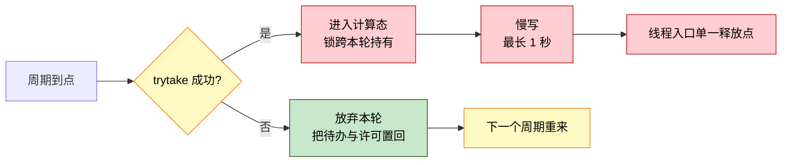
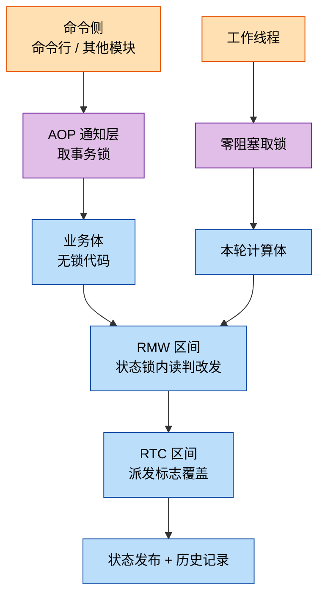

> 原文链接: [CSDN](https://blog.csdn.net/stallion5632/article/details/166361110)

> 本文已做脱敏处理：产品型号、业务领域、模块名与内部任务编号均以通用描述代替，代码片段为等价改写。文中讨论的三个机制及其失效模式，适用于任何「一个工作线程 + 多个命令入口 + 共享状态」的 MCU 服务。

**一句话结论**：状态机写错的代价最高，但"哪条边合法"容易查，难防的是**读与写之间被其他线程插入操作**。用 RMW 把判据与发布收进同一临界区、用 RTC 阻止重入、用 AOP 把锁从业务代码中分离，做完这三件事，并发正确性就从"依赖注释提醒"变成"改坏后编译失败或测试报错"。

## 一、典型场景与失效点

嵌入式固件里的周期性服务职责不复杂：按固定节拍唤醒，读硬件、计算一批系数、将结果写回设备，如此循环。它同时接受外部命令。板载命令行可手动触发一次计算或启停自动模式，另一个模块在切换工况档位时通知它重新加载数据。

于是并发面就出来了：

- 一个工作线程按节拍跑计算；
- 命令行、工况切换模块从**另外的线程**下发命令；
- 硬件写入完成后由**中断回调**通知工作线程；
- 命令、线程、中断三方共享同一份状态与参数。

这类服务常见的失效点集中在四处，都属于"平时看不出、偶发就要命"的类型：

| 问题 | 表现 |
|---|---|
| 关键等待无超时 | 等硬件响应用了无限等待，一旦响应丢失，工作线程永久卡死，周期计算静默停止 |
| 停止操作谎报成功 | 轮询若干部后直接返回成功，实际工作线程还在跑 |
| 状态写入点分散 | 状态字段有 4 处直接赋值，其中两处绕过了合法性校验 |
| 锁代码散落 | 每个长事务各自取放锁，覆盖范围由各分支作者自行决定 |

第三条和第四条是本文的重点。它们不会立即暴露，但会持续制造"只在这个时序下出错"的偶发缺陷。

## 二、RMW 与 RTC：并发正确性的两个约束

### RMW 要解决的问题：读与写之间被插入操作

一种常见的状态校验是逐状态用 `switch` 判断目标态是否可达，看起来是够的。但它只回答了一个问题：**这条转移在状态图上合法吗**。它没有回答另一个问题：**这次判断所依据的输入，在写入之前还是有效的吗**。

举个这个服务里的真实场景。有个生效值决定服务是否在跑，它由若干输入算出来：全局禁用位、局部意图槽、工况基线。计算和执行是分开的：

```
线程 A: 读快照 → 算出候选值 = 开
线程 B: 改变输入（下发禁用）        ← 插在这里
线程 A: 把候选值 = 开 发布出去      ← 发布了过期结论
```

线程 A 的快照与发布之间隔着若干毫秒（涉及一次数据重载），足够 B 干完活。结果是 A 用一个已经作废的输入，发布了一个"应该开"的结论，把 B 的禁用意图覆盖掉。

### RMW 的解法：把判据和发布圈在一起

第一层做法是把"读旧值、判条件、发布"三步圈进同一个临界区，中途不放锁：

```c
rt_mutex_take(&priv->state_mutex, RT_WAITING_FOREVER);
was_enabled = effective_enable_get();          /* 读旧值 */
if (RT_TRUE == priv->blocked) { enable = RT_FALSE; }          /* 复核一 */
if (in->gen != priv->decision_gen) { ret = MOD_DRV_BUSY; break; }  /* 复核二 */
if (gate_blocks_open(enable, priv->gated, authorized)) { enable = RT_FALSE; } /* 复核三 */
effective_enable_set(enable);                  /* 发布 */
rt_mutex_release(&priv->state_mutex);
```

这就是 RMW（Read-Modify-Write，读-改-写）：同一临界区内完成读、判、改、写。

其中复核二最关键，也最容易被忽略：它比对的不是值，是一个**版本号**。

```
计算前: 记下当前版本号 gen = 7
计算后: 若 priv->decision_gen 仍为 7 → 输入没变过，可以发布
        若已变成 8          → 中途有人改过输入，本次结论作废
```

为什么用版本号而不是直接比值？因为直接比较输入值检测不到 ABA 回绕：输入变化一圈后又回到原值，比值会判定为"未变化"，而版本号不会。这一点在布尔型输入上尤为明显，禁用位在快照与发布之间被置起又清除，值比对无法察觉。

### 状态字段同理

状态字段需要同样的纪律。把写入收敛到一个派发入口，取值、查表、发布一次做完：

```c
priv->dispatching = RT_TRUE;      /* 进入 RTC 区间 */
old_state = priv->state;          /* 读 */
/* 按 (源态, 事件) 双键匹配转换表 */
new_state = transition->target;
priv->state = new_state;          /* 改 + 写 */
record_state_history(priv, old_state, new_state);
priv->dispatching = RT_FALSE;
```

分散在 4 处的 `priv->state = ...` 收敛成 1 处之后，测试可以断言"状态字段的所有写入必须在这个函数体内"。这是一条能自动执行的约束，不再依赖 code review 时有人记得。

### RTC 要解决的问题：派发过程中到达新事件

RMW 解决的是并发写，还有一种破坏方式来自重入。RTC（Run-to-Completion，运行到完成）指单次事件的处理从开始到结束不被同类的第二次处理打断。它防的是这种情形：某次派发正在写状态指针和迁移历史，中途被中断回调或另一个线程触发的第二次派发插进来，于是历史记录里出现半成品，或者状态指针被写了两遍。

这类问题排查困难：事后查看日志，会看到一条不存在的迁移或一条重复的迁移，但没有任何日志能说明"这两条出自同一次处理"。

RTC 是 UML 状态机的既定语义，不是可选优化：单次事件的守卫、退出动作、迁移动作、进入动作，构成一个不可分割的原子步骤。违反 RTC 的典型方式也很固定，**在进入动作里再派发一个事件**，靠重入调用把第二个事件塞进第一个的处理过程。

一个流传很广的误解需要拆开：RTC 只约束"同一实例不并发处理两个事件"，它**不**要求处理过程独占 CPU。被更高优先级的任务或中断抢占是允许的，被抢占的处理会在调度回来后从断点继续、最终走完整个步骤，这仍然是 RTC。

分清这一点很实用。若误以为 RTC 要求独占 CPU，就会倾向于关中断或抬优先级去"保护"处理过程，代价是整个系统的响应性；分清之后可以让中断照常跑，只要它不碰状态机的私有数据。

实现只需要一个布尔字段，但有两个位置必须放对：

```c
if (RT_TRUE == priv->dispatching)   /* 嵌套或并发派发一律拒绝 */
{
    ret = MOD_INVALID_STATE;
    break;
}
priv->dispatching = RT_TRUE;        /* ① 必须在读旧态之前 */
/* ... 读旧态、查表、发布、写历史 ... */
priv->dispatching = RT_FALSE;       /* ② 必须在写历史之后 */
```

- **置位早于读旧态**：否则读与写之间仍可被插入第二次派发，RMW 的原子性被破坏。
- **清位晚于写历史**：否则历史记录可能被第二次派发覆盖。

这两个顺序看似显然，但属于"改动一行代码即静默失效"的约束，可以固化为测试断言：置位语句的行号必须小于读旧态的行号，清位语句必须大于写历史。

### 拒绝需要计数，但要接受信息损失

被拒绝的派发会累加一个计数器，通过诊断接口暴露出来，用于排查"命令为什么没生效"。这里有个取舍：三类拒绝（参数越界、重入检测、转换表无匹配边）合并成一个计数，非零值无法区分是哪一类，需要配合日志定位。合并的理由是计数器必须在临界区内自增，而临界区内不适合做串口输出，一次 `printf` 就可能阻塞住热路径。**宁可诊断信息粗一点，也不让日志把锁持有时间拉长**。

## 三、AOP：锁不该写在业务代码里

第三件事是横切关注点（AOP，Aspect-Oriented Programming，面向切面编程）的经典场景：**长事务需要在执行前后加锁，但这段逻辑不属于任何单个业务函数**。

这个概念 1997 年由 Xerox PARC 的 Kiczales 等人提出，本意是解决"代码散落"（scattering）与"代码纠缠"（tangling）：一个关注点散布在几十个函数里，改一处要改几十处。AOP 的术语体系是：**切面**（aspect，封装横切关注点的模块）、**连接点**（join point，可以插入行为的位置）、**通知**（advice，插入的行为，分 before / after / around）、**织入**（weaving，把切面合并进主程序的过程）。

Java 侧有一整套语言与框架做这件事（AspectJ 的编译期织入、Spring 的运行期代理）。**C 里没有织入器**，但这不妨碍用同一个思路。下面这套写法属于 AOP 里的 **around 通知**，也就是经典的 "execute around"（在调用前后执行固定动作）惯用法，用 C 的函数指针与手工分发就能实现，不需要任何额外工具。

一种常见做法是让每个长事务分支自行在片段内取放状态锁。问题有三个：

1. 覆盖范围由分支作者决定，新增命令时容易漏或覆盖不足；
2. 长事务本身可能阻塞（这类服务常有一次最长 1 秒的硬件写入），把它套进状态锁会连带阻塞诊断命令；
3. 锁的取放点分散，很难静态检查有没有漏放。

### 一个通知层与一个表项字段

做法是抽出一个通知层，业务体退化成纯函数，内部不出现任何锁代码：

```c
static module_ret_err_e svc_cmd_around(handle_t self, cmd_body_t body, const void *arg, uint32_t size)
{
    if (RT_FALSE == HANDLE_VALID(self)) { return MOD_INVALID_HANDLE; }   /* Before */
    if (RT_TRUE == priv->txn_mutex_initialized)
    {
        if (RT_EOK != rt_mutex_take(&priv->txn_mutex, rt_tick_from_millisecond(TXN_LOCK_WAIT_MS)))
        {
            return MOD_DRV_BUSY;   /* 取锁失败：未持锁，故不释放 */
        }
        held = RT_TRUE;
    }
    ret = body(self, arg, size);   /* 连接点：业务体 */
    if (RT_TRUE == held) { rt_mutex_release(&priv->txn_mutex); }   /* After：无条件 */
    return ret;
}
```

哪些命令属于长事务，由命令分发表的一个字段声明，而不是在分发器里写 `if`：

```c
{NODE_TRIGGER_CALC,     RT_TRUE,  svc_set_trigger_calc},
{NODE_START_AUTO,       RT_TRUE,  svc_set_start_auto},
{NODE_STOP_AUTO,        RT_TRUE,  svc_set_stop_auto},
{NODE_HOLD,             RT_FALSE, svc_set_hold},
```

新增命令时改一个字段即可，锁的施加由分发层保证。测试也随之变成可静态检查的：**全文件只允许一个取锁点**，也就是这个通知层。

### worker 不能用带等待的锁

这里有个反直觉的地方。通知层用的是带超时的 `take`（拿不到锁就忙等，超时返回忙），但工作线程**不能**沿用同一套：

```
工作线程在 txn_mutex 上等待 → 最长要等 1 秒 → 期间收不到停止事件
                                            → 停止命令超时报错
```

所以工作线程走的是零阻塞的 `trytake` 变体，拿不到就放弃本轮、下一个节拍重来：



**同一个锁，两类获取语义**：命令侧可以等（它有超时上限），工作线程不能等（它一等等掉的就是自己的响应能力）。这一点如果只用一个 `take` 封装会很危险。

### 为什么"工作中途阻塞"是个语义错误

上面的例子表面是"耗时过长"的性能问题，实质是语义问题。在事件驱动模型中，**每一次阻塞调用都等价于一次新事件的到达**：线程从阻塞返回的瞬间，即收到"锁获取成功"这个新事件。因此问题不在于"等待了 1 秒"，而在于：

```
处理"周期到点"事件
  ├─ 阻塞在锁上 ──────────────┐
  │                          │  ← 解锁的瞬间等价于"锁到手"事件的到达
  └─ 继续处理 ←──────────────┘     与"周期到点"这个事件的处理过程重叠
```

还有一个直接后果：线程在阻塞期间无法响应送达的事件队列，对这类服务即接收不到停止指令，硬实时截止时间同样无法满足。出路**不在于缩短锁等待，而在于不在 RTC 步骤内阻塞**，取锁失败即退出本轮，下一节拍重试。

同一理由也说明了周期定时器在这里并不必要：定时器回调再转一次唤醒，相当于在事件队列之外另开一条路径。用事件等待的超时表达节拍即可。

## 四、三者如何配合

三个机制属于三层不同粒度的保护：



一次长事务命令走完这四层：通知层取事务锁（超时则整体拒绝，不进入业务体）→ 业务体执行数据重载与决策（自身不含锁代码）→ 决策内部进状态锁完成一次 RMW 并发布生效值 → 期间若派发状态事件，RTC 标志保证这次派发不被打断。

撤掉任一层，外面的层都无法单独保证正确性：没有 AOP，两个命令可能同时做重载；没有 RMW，命令与工作线程的决策互相覆盖；没有 RTC，派发可能被中断回调打断。

## 五、数据、代价与小结

### 两种写法的实测对比

下表是同一个服务的两种写法对照：左列是不加约束直接写出来的版本，右列是套用上述三个机制后的版本。统计方式都可直接复算（同名函数计数、字段赋值点计数）。

| 项 | 直接写法 | 加约束后 |
|---|---|---|
| 状态字段写入点 | 4 处直接赋值 | 1 处派发入口 |
| 状态转换实现 | 逐状态 `switch` 校验 | 19 条边的 `const` 转换表，双键匹配 |
| 竞态防护 | 靠注释提醒的局部临界区 | 版本号比对，输入变过即作废本次结论 |
| 重入防护 | 无 | 1 个派发标志 |
| 最长函数 | 304 行（命令分发与状态迁移挤在同一函数） | 87 行 |
| 命令分发 | 20 条 `case` 集中在一个函数 | 两张 `const` 表（12 项 + 9 项） |
| 长事务锁 | 各分支自行取放 | 1 取 1 放，由通知层统一 |
| 事务锁等待上限 | 不存在该锁 | 有界 1000 ms，超时返回忙 |
| 等待硬件响应的信号量 | 无限等待 | 有界 1000 ms + 三态握手隔离迟到响应 |
| 定时器对象 | 19 处调用 | 0 处，改由事件等待的超时表达节拍 |
| 停止操作结果 | 轮询若干部后仍返回成功 | 等确认，超时如实返回超时 |

其中两处属于性质变化，不只是数量上的改进。

**并发写从"靠约定"变成"机制上不可通过"。** 状态写入点从 4 处收敛到 1 处，生效值发布点收敛到 1 处，且发布之前必须通过版本号比对。直接写法里同类保护只能写在注释里，依赖后续修改者自觉遵守。

**阻塞从无界变为有界。** 唯一等待外部事件的信号量从无限等待改为 1000 ms 上限，并配三态握手隔离迟到响应。直接写法的停止操作靠延时轮询，超时后仍返回成功；加约束后改为等待确认事件，超时如实上报。

### 代价与已知问题

上述做法并非没有代价。

**分层带来间接。** 新增命令要同时改表项与函数，读代码需要在通知层与业务体之间跳转。这部分成本只在新功能时发生，与运行期收益不冲突，但确实存在。

这份代价并非某种实现独有，AOP 自提出起即被指出：横切逻辑抽离之后，控制流变为"非局部"。仅阅读一个业务函数，无法得知它何时被施加了什么。业界对其常见批评正是"把逻辑分散并间接化，反而更难推理"。因此在 C 中只用最小的一层 around 通知（一个函数、一个表字段）即可，不必引入完整的切面框架。**采用多少，取决于收益能否覆盖这份间接成本。**

**状态锁的无限等待计数反而变多了**（从 26 处增到 36 处），因为临界区被切得更细、取放点更多。这不矛盾：这些是短临界区，等待时间由临界区长度决定，不会永久卡死；真正危险的是"等待外部事件"那类无限等待，它已经被改成有界。看代码时不要只看计数，要看**等的是锁还是外部事件**。

**有一个机制未在真机上验证。** 迟到响应的隔离与到期恢复路径，需要硬件实际丢失一次响应才会进入。当前无法主动注入该条件，这条路径仅有源码级测试覆盖，没有上机证据。此处写明是为了提示：**各路径测试覆盖不均时，不能把"测试通过"等同于"已全部验证"**。

**诊断信息做了取舍。** 三类拒绝合并成一个计数器，牺牲了区分度换取锁内不做输出。这是自觉的取舍，不是遗漏。

### 小结

这三个机制各自的成本都很低：RMW 是编码纪律，不加字段；RTC 是一个布尔加两处顺序；AOP 是一个通知层加一个表字段。

它们的共同点是把"正确性依赖人的自觉"换成"正确性由结构保证"：

- 状态只能有一个写入点，所以能断言"所有写入都在这个函数里"；
- 判据与发布在同一临界区，所以不会发布过期结论；
- 锁的施加点只有一个，所以能断言"全文件只允许一处取锁"。

能断言，就能在 CI 里自动检查。这比在注释里写"注意这里要加锁"要可靠得多，注释会过期，测试不会。

至于什么时候不上这套：如果服务只有一个线程、状态只有两三个、没有中断回调参与，那这些机制的收益不足以抵消分层的间接成本。它们是为"多入口 + 共享状态 + 中断参与"的场景准备的，先确认自己在不在这个场景里。

### 参考

- Miro Samek，*Key Concepts*（state-machine.com）：活动对象模型与 RTC 的正式定义，以及"RTC 与抢占是两件事"的反复澄清。
- Miro Samek，*A Crash Course in UML State Machines*（embedded.com）：RTC 步骤的原子性与"响应性由最长的 RTC 步骤决定"。
- QP 框架文档中关于"为什么阻塞与 RTC 不兼容"的论证：每一次阻塞返回都是一次后门事件到达。
- *Execution Semantics – How Statecharts Run and Process Events*（statecharts.online）：RTC 步骤的定义、单步与超步语义的取舍；G. Kiczales et al., *Aspect-Oriented Programming*, ECOOP 1997：切面、连接点、通知、织入的原始定义。
- 关于 AOP 可读性代价的讨论（如 anuragdulapalli.com 的 *Aspect-Oriented Programming: is it useful?*）：横切逻辑抽离后控制流非局部化。
