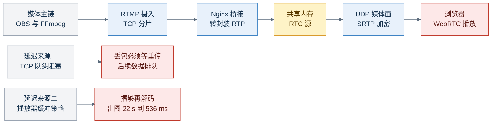

# 为什么 RTMP/HTTP-FLV 难以做到 500ms 以内：我们在 Nginx 里把媒体面重写了

> 结论先行：HTTP-FLV 的出图延迟不是带宽决定的，是播放器的缓冲策略决定的——同一路 2 Mbps 纯视频流，只改缓冲参数，出图时间就在 22 s 与 536 ms 之间切换。把媒体面从 TCP 换成 UDP/SRTP 之后，稳态帧新鲜度的中位数是 45 ms。
>
> 本文给出的数字以我们自己的实测为准：稳态帧新鲜度中位数 45 ms（修正后真值约 70 ms），首帧出图 476～560 ms。RTMP 侧我们没有做同口径实测，因此不列具体数字。

## 1. RTMP 的延迟卡在哪里

RTMP 基于 TCP，它本身就有几个与生俱来的延迟源：

- **TCP 重传与队头阻塞**：网络抖动时，丢失的包必须等待重传，后续媒体数据即使到达也会被阻塞。
- **Chunk 分片**：RTMP 将媒体数据切分成小块（默认 128 字节），头部开销大，且接收端需要重新组装。
- **播放端累积延迟**：传统播放器（如 Flash 时代遗留的逻辑）会维护一个 2～3 秒的缓冲区来对抗抖动，即使把 bufferTime 调到 0，底层 TCP 的延迟也无法消除。

我们自己没有对 RTMP 侧做同口径实测（测量方法依赖 RTP 时间戳锚点，只在我们的 WebRTC 链路上可用），所以这里只保留业界经验值：良好网络下通常在 1～2 秒，弱网下超过 3 秒。

## 2. HTTP-FLV 为什么也没好到哪去

HTTP-FLV 本质上是将 FLV 封装通过 HTTP 长连接流式传输，它虽然绕开了 RTMP 的 chunk，但依然跑在 TCP 上，并且：

- **浏览器端要靠 flv.js 做 MSE 喂入**：出图时间主要由播放器的缓冲策略决定，不是由 MSE 本身决定。
- **为了平滑播放，flv.js 会先内部缓冲再喂给 MSE**：同一页面、同一路 2 Mbps 纯视频流上的实测（Windows/Edge），默认首次缓冲阈值下 22 s 内零次喂入、不出画；把首次缓冲阈值降到 32 KB 后出图 536 ms；关掉内部缓冲则出图 553 ms。纯视频流还必须关掉音频，否则仍然不出画。
- **网络波动时播放器不断“追帧”**：TCP 重传导致的卡顿与累积延迟叠加，体验就是卡顿或越积越久。

所以 HTTP-FLV 的出图体验主要由播放器的缓冲策略决定，服务端调参帮助有限。我们用同一路 HTTP-FLV 把出图从 22 s 降到 536 ms，靠的是改播放器的缓冲参数，不是改服务端。


*图 1：从推流到播放的完整链路，以及延迟的两个来源。上排是媒体面重写后的路径，下两排标出延迟究竟从哪里来。*

## 3. 500ms 的坎：为什么 TCP 不行

实时音视频领域有一个共识：低于 500ms 的延迟必须基于 UDP。原因很简单：

- **UDP 没有重传机制，允许丢包**，配合 RTP/RTCP 的丢包恢复（NACK、FEC）和抖动缓冲（Jitter Buffer），可以把延迟控制在毫秒级。
- **WebRTC 正是基于 UDP**：用 RTP 封装媒体，DTLS 加密，SRTP 传输，配合浏览器原生的 WebRTC API，播放器端可以实现极短的缓冲（几十毫秒）。

问题随之而来：WebRTC 通常需要专门的媒体服务器（SRS、Janus、MediaSoup 之类）。对已经用 Nginx 做 RTMP 摄入和分发的团队来说，这意味着要额外部署并维护一套新服务。

## 4. 我们的解法：在 Nginx 里重写媒体面

我们开发了 nginx-rtc-module——一个纯 C 编写的 Nginx 插件，它直接把 RTMP 流“桥接”成 WebRTC 播放流，无需任何外部媒体服务器。核心思路有四条：

- **复用 Nginx 的事件驱动与进程模型**：媒体面处理跑在 Nginx 的 stream 模块中，利用 UDP 直接收发 RTP/SRTP 包。
- **RTMP 转 RTC 源**：桥接模块把 RTMP 流实时转封装为 RTP 包，送入共享内存中的 RTC 源。
- **信令与媒体分离**：HTTP 模块处理播放信令（`/rtc/v1/play/`，兼容 SRS 的请求格式）与 WHIP 上行请求，UDP 媒体面负责 SRTP 加密传输。
- **音频转码**：FFmpeg 的 libavcodec 解码 AAC，libswresample 重采样，libopus 编码成 Opus；转码放在独立线程里做，不阻塞 Nginx 事件循环。

架构简图：

```text
[OBS/FFmpeg] --RTMP--> [Nginx RTMP] --bridge--> [RTC Source] --RTP/SRTP--> [Browser WebRTC]
                       |                           ^
                       |                           |
                [HTTP 播放信令 ] <-------- [UDP ICE/STUN/DTLS]
```

*图 2：媒体面重写后的整体链路。信令与媒体分走 HTTP 与 UDP 两条路径，汇合点都在共享内存里的 RTC 源。*

## 5. 延迟实测

下面是我们在同一台机器上的实测结果，全部是我们自己的数据：

| 指标 | 实测值 | 口径 |
| --- | --- | --- |
| 稳态帧新鲜度 | p50 45 ms（修复前 173 ms） | 单机回环、1080p30、无头播放端；修正报告滞后后真值约 70 ms |
| 首帧出图 | 476～560 ms | 含 ICE/DTLS 握手与等首个 IDR |
| HTTP-FLV 浏览器出图 | 536 ms（缓冲阈值 32 KB）/ 553 ms（关内部缓冲） | Windows/Edge，2 Mbps 纯视频流 |
| 视频链路 | H264 转 RTP 761 包 / 362 KB | 含 B 帧过滤与 FU-A 分片 |
| 音频链路 | AAC 转 Opus 389 包 / 67 KB | 独立线程转码 |

稳态口径是无头播放端，真实浏览器还要叠加 100～300 ms 的播放缓冲，因此它不是用户感知延迟。弱网机制目前只有主机单测，仓库内没有丢包或乱序注入能力，所以本文不给弱网数字；RTMP 侧的延迟区间是业界经验值，不是本文实测。

## 6. 快速体验

```bash
# 编译 Nginx 并加入模块
export NGX_RTC_THIRD=/path/to/third  # 包含 libavcodec, libsrtp2 等
./configure --add-module=/path/to/nginx-rtc-module
make && make install

# 推流
ffmpeg -re -i input.mp4 -c:v libx264 -c:a aac -f flv rtmp://localhost/live/stream1

# 浏览器打开播放页（需 HTTPS）
# https://your-domain/rtc/v1/play/?stream=stream1
```

## 7. 结语

RTMP 与 HTTP-FLV 的延迟瓶颈是协议层面的，改播放器参数只能在缓冲策略这一层做文章。而 WebRTC 的低延迟能力需要媒体服务器支撑，我们选择在 Nginx 内部实现，就是为了不引入新服务，直接复用现有基础设施。

项目已开源，支持 RTMP/WHIP 摄入、WebRTC 播放、服务端 RTT 测量、静默对端闸门等特性。静默闸门只扣住不再发送的媒体并计数，不自动关闭会话；会话回收靠管理员踢除或空闲超时。欢迎试用和贡献：

- 模块代码：<https://github.com/DeguiLiu/nginx-rtc-module>
- 部署与示例：<https://github.com/DeguiLiu/nginx-rtc-example>
