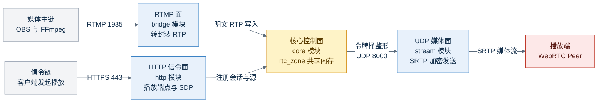
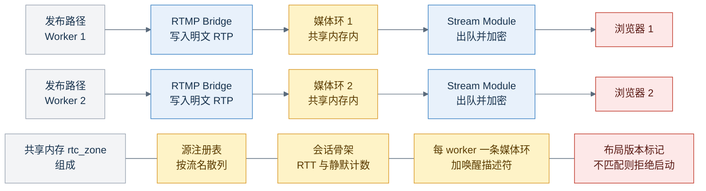

# 不接 SRS，只用 Nginx 做 WebRTC 播放：架构与踩坑

> 结论先行：已经用 Nginx 做 RTMP 摄入与分发时，为低延迟播放再引一套媒体服务器，代价是两套系统的配置、两套故障点和一路流中转。我们的做法是写一个 Nginx C 模块，让 Nginx 自己把 RTMP 流转成 WebRTC，四个模块各司其职，媒体面直接跑在 stream 模块里。
>
> 本文覆盖模块分工、编译配置，以及五类实战踩坑：UDP 端口与防火墙、音频转码开销、DTLS 握手异步化、静默对端与资源泄漏、发送节奏与突发流量。

## 1. 背景：为什么不想接 SRS

我们团队长期用 Nginx 做 RTMP 推流接收和 HLS/HTTP-FLV 分发，整体稳定。产品提出“延迟要降到 500ms 以内”时，摆在面前的选项有三个：

- **部署 SRS**：功能强大，但需要单独维护，配置两套系统（Nginx + SRS），流需要在两者之间中转，增加复杂度和故障点。
- **使用 MediaMTX 等**：同样需要额外部署。
- **直接修改 Nginx-RTMP 模块**：原版 Nginx-RTMP 对 WebRTC 支持有限。

于是我们决定：写一个 Nginx C 模块，让 Nginx 自己把 RTMP 流转成 WebRTC。

## 2. 整体架构：四个模块各司其职

nginx-rtc-module 通过 `--add-module` 一次性注册四个 Nginx 模块：

| 模块 | 类型 | 职责 |
| --- | --- | --- |
| `ngx_rtc_core_module` | core | 共享内存 `rtc_zone` 注册表，管理 RTC 源与跨 worker 会话骨架 |
| `ngx_rtmp_rtc_bridge_module` | rtmp | 将 RTMP 直播流桥接为 RTC 源（转封装 RTP） |
| `ngx_rtc_http_module` | http | 播放信令端点（`/rtc/v1/play/`）与 WHIP 上行端点，统计接口 |
| `ngx_rtc_stream_module` | stream | UDP 媒体面：处理 ICE/STUN、DTLS 握手、SRTP/SRTCP 加解密 |

数据流与信令流是两条独立的路径，汇合点都在共享内存里的 RTC 源：

```text
数据流：RTMP ingest → RTMP bridge → RTC Source (in shared memory) → UDP media plane → Browser
信令流：Browser → HTTP 播放信令 → ngx_rtc_http_module → 创建/匹配 RTC Source → 返回 SDP
```



*图 1：四个模块的分工与两条数据链。媒体主链从推流走到播放端，信令链从播放请求回到核心控制面；端口与数据流都标在连线上。*


*图 2：媒体面在 Nginx 内的两条链。接收链把四类报文分派到对应处理，发送链从共享内存取包、整形、加密后发出。*

## 3. 编译与配置示例

依赖静态库：libavcodec、libswresample、libavutil、libopus、libsrtp2，通过环境变量指定：

```bash
export NGX_RTC_THIRD=/opt/ngx-rtc-third
./configure --prefix=/usr/local/nginx \
    --add-module=/path/to/nginx-rtc-module \
    --with-http_ssl_module \
    --with-stream
make -j$(nproc)
```

nginx.conf 关键配置：

```
rtmp {
    server {
        listen 1935;
        application live {
            live on;
            # 启用 RTC 桥接
            rtc_bridge on;
        }
    }
}

http {
    server {
        listen 443 ssl;
        location /rtc/v1/play/ {
            rtc_signaling on;
        }
    }
}

stream {
    server {
        listen 8000 udp;
        rtc_media on;  # 启用 UDP 媒体面
    }
}
```

## 4. 推流与播放

```bash
# 推流（RTMP）
ffmpeg -re -i test.mp4 -c:v libx264 -c:a aac -f flv rtmp://localhost/live/stream1
```

浏览器播放需要 HTTPS 页面，使用模块自带的播放页或自行集成 WebRTC 播放器。

## 5. 踩坑实录

### 5.1 UDP 端口与防火墙

WebRTC 需要 UDP 端口进行媒体传输。我们最初只开放了 TCP 端口，导致 ICE 连通性检查失败。解决：在 stream 块中监听 UDP 端口，并确保防火墙放行。

### 5.2 音频转码性能

RTMP 常用 AAC，而 WebRTC 通常要求 Opus。我们在桥接模块中集成了 FFmpeg 的 libavcodec、libswresample 与 libopus 进行实时转码。初期发现 CPU 占用高，后来通过三件事把单路转码 CPU 降到可接受范围：

- 限制转码通道数（只转混音后的单声道）。
- 使用 libopus 的浮点优化。
- 在 Nginx worker 进程中合理分配转码任务。

### 5.3 DTLS 握手在 Nginx 中的异步处理

Nginx 的 stream 模块本身是事件驱动的，但 DTLS 握手（基于 OpenSSL）默认是阻塞的。我们给每个会话建一对内存 BIO：网络侧读到的字节写进输入 BIO，OpenSSL 要发出的字节从输出 BIO 取出后交给 socket 发送，握手全程在内存里推进，不阻塞 worker；重传定时器的期限由 OpenSSL 的超时接口给出，由 Nginx 事件循环到期触发。

session_fsm（会话状态机）只做状态判定、不执行动作。真实状态是 NEW、ICE_BOUND、DTLS_HANDSHAKE、SRTP_READY、CLOSED 五个，关闭、超时与收到上报退出三类事件挂在根状态上，从任何状态都能收敛到关闭。真正持有连接与 DTLS/SRTP 上下文的是 stream 模块，它才是执行者——这样状态机里不存指针，生命周期不会与连接脱钩。

### 5.4 静默 Peer 与资源泄漏

有些客户端建立连接后不再收发数据（如页面后台、网络中断），服务端会一直占用连接与共享内存骨架。v0.7.0 引入了静默对端闸门：默认静默阈值 10 秒，超过阈值就扣住不再发送的媒体并计数，计数会透出到统计接口。

这个闸门不关闭会话，只扣媒体。会话回收靠两条路径：管理员显式踢除，以及握手中与就绪后各自的空闲超时。v0.7.0 还补上了服务端侧的往返时延测量（按 RFC 3550，用发送报告的到达时刻减去发送时刻再减去驻留时间），结果写入共享内存供统计接口读取。

### 5.5 Pacing 与突发流量

直接转发 RTP 包可能导致瞬间发送过多，引发网络拥塞。我们用令牌桶在发送路径上内联判定：1 个令牌对应 1 字节，按目标码率随时间补充，桶容量按 100 ms 的突发窗口计算。没有独立的 pacing 定时器，也不排队，桶里没有令牌就直接丢包计数，交给客户端用 NACK/PLI 恢复。

目标码率由丢包统计调整：每 500 ms 或每 20 个包统计一次窗口丢失率，超过 5% 乘性降速，低于 2% 加性升速；接收端上报的带宽估计只作上限，且只降不升。关键帧访问单元整体豁免限速——关键帧一旦被限速，观众等的就是下一个关键帧间隔，体验损失远大于瞬时突发。



*图 3：多 worker 下的媒体投递。两条发布路径各写各的媒体环，媒体环本身就在共享内存里；第三行列出这块共享内存的组成。访问顺序只允许从池锁到环锁，禁止反向。*

## 6. 性能与稳定性

- 共享内存 `rtc_zone` 允许多个 worker 进程访问同一个 RTC 源，实现推流与播放的横向扩展。
- 纯 C 编写，无 GC 开销，媒体热路径没有协程、没有自建线程与队列，全部跑在 Nginx 单事件循环内（唯一例外是每路音频转码的独立线程）。
- 主机单元测试 183 例（默认组 158 例，另加 SRTP/DTLS/音频/音频线程四组专题 10/5/5/5），覆盖 RTP 封包、SRTP 加解密、STUN 解析与校验、DTLS 真实握手等纯 C 核心。

## 7. 适用场景

- 已有 Nginx 做 RTMP 摄入，希望快速增加 WebRTC 低延迟播放。
- 不想引入额外媒体服务器，降低运维复杂度。
- 需要嵌入式或边缘节点部署，资源受限环境。

## 8. 未来计划

- ICE 重启与重新选路、ICE over TCP，以及 TURN 回退（目前只下发一条静态主机候选，中间有 NAT 时没有兜底候选）。
- 集群化部署方案。
- 更完善的统计和监控。

项目开源地址：<https://github.com/DeguiLiu/nginx-rtc-module>
配套示例仓库（含 Docker、Lua 鉴权、播放页）：<https://github.com/DeguiLiu/nginx-rtc-example>

欢迎 Star、提 Issue 或 PR！
