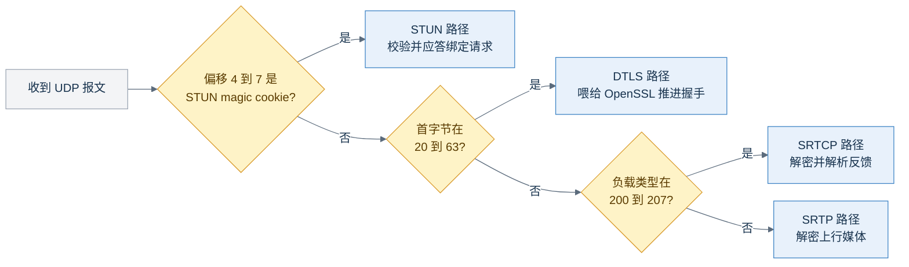
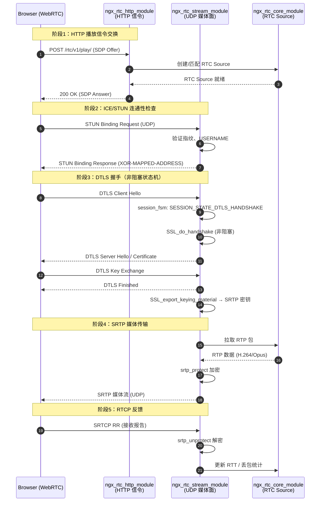
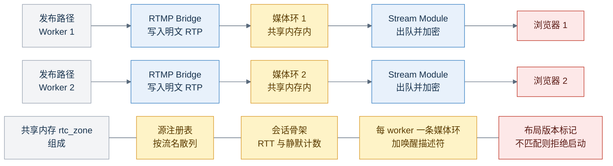

# RTPSRTP over UDP 在 Nginx 里怎么跑起来：ICE、STUN 与 DTLS 落地笔记

> 结论先行：把 WebRTC 的媒体面塞进 Nginx，难点不在能不能跑通，而在每个协议面的边界划在哪里。服务端只应答连通性请求、只下发一条静态主机候选；DTLS 用内存 BIO 把 OpenSSL 的阻塞握手改造成非阻塞；SRTP 密钥由握手结果直接导出，收发两个方向都已实现。
>
> 本文按报文分流的顺序走一遍 UDP 媒体面：STUN 应答、DTLS 握手、SRTP 收发、跨 worker 同步，最后是测试覆盖与已知缺陷。

## 1. 为什么选择 Nginx stream 模块

Nginx 的 stream 模块原生支持 TCP/UDP 代理，具备三个我们需要的条件：

- 高效的 epoll/kqueue 事件驱动。
- 多 worker 进程模型。
- 共享内存与定时器基础设施。

我们希望媒体面（UDP）能直接跑在 Nginx 内，复用它现成的收发模型、定时器与共享内存设施，避免再引入一套进程间通信。

## 2. 模块职责划分

`ngx_rtc_stream_module` 专门处理 UDP 数据报，主要功能：

- 解析 STUN 包（ICE 绑定请求/响应）。
- 处理 DTLS 握手（基于 OpenSSL）。
- 对 RTP 包进行 SRTP 加密/解密（libsrtp2）。
- 发送 SRTCP 反馈。


*图 1：媒体面报文的分流判据。STUN 靠 magic cookie，DTLS 靠首字节的内容类型范围，SRTCP 靠负载类型，其余按 SRTP 处理。*

## 3. ICE/STUN：实现 ICE Lite

WebRTC 要求 ICE 进行 NAT 穿透。我们实现了 ICE Lite：服务端在 SDP 里宣告 `a=ice-lite`，只承担被动应答这一侧，不主动发起连通性检查。

这里要划清边界：所谓 ICE Lite 在这个实现里意味着服务端只下发一条静态主机候选（地址与端口来自配置指令，未配置时回落到回环地址与默认端口），不探测、不产生 srflx 候选、不产生 relay 候选。客户端与服务端之间存在 NAT 或跨网段时，没有兜底候选可用。

### 3.1 处理流程

1. 客户端发送 STUN Binding Request 到服务端 UDP 端口。
2. 模块解析 STUN 头，验证指纹，提取 USERNAME 和 MESSAGE-INTEGRITY。
3. 生成 STUN Binding Response，包含 XOR-MAPPED-ADDRESS（客户端的公网 IP:端口）。
4. 同时，模块记录该客户端的地址用于会话匹配，但不维护候选对状态。

### 3.2 关键代码片段

```c
// 在 ngx_rtc_stream_module 的 udp_recv 回调中
if (ngx_rtc_is_stun(pkt)) {
    ngx_rtc_stun_process(s, pkt);
    return;
}
```



*图 2：一次播放的完整握手，按信令、ICE、DTLS、媒体、反馈五段推进。*

## 4. DTLS 握手：将 OpenSSL 融入 Nginx 事件循环

DTLS 基于 UDP，握手过程需要重传和状态维护。OpenSSL 的 `DTLSv1_listen` 和 `SSL_do_handshake` 默认是阻塞的，我们必须将其非阻塞化。

### 4.1 我们的做法

- 为每个 UDP 会话创建 SSL 对象，并绑定到 Nginx 的 `ngx_connection_t`。
- 设置 `SSL_MODE_ENABLE_PARTIAL_WRITE` 和 `SSL_MODE_ACCEPT_MOVING_WRITE_BUFFER`。
- 利用 Nginx 的 `ngx_add_timer` 处理 DTLS 重传定时器。
- `session_fsm` 判定状态，实际收发由 stream 模块执行。

### 4.2 状态机

```c
// 会话状态机的真实状态（ngx_rtc_session_fsm.h）
NGX_RTC_SESSION_STATE_UNKNOWN = 0,
NGX_RTC_SESSION_STATE_NEW,
NGX_RTC_SESSION_STATE_ICE_BOUND,
NGX_RTC_SESSION_STATE_DTLS_HANDSHAKE,
NGX_RTC_SESSION_STATE_SRTP_READY,
NGX_RTC_SESSION_STATE_CLOSED
```

这个状态机只判定状态、不执行动作（转移表里的动作全为空指针），关闭、超时与收到上报退出三类事件挂在根状态上，从任何状态都能收敛到关闭。持有连接与 DTLS/SRTP 上下文的 stream 模块才是执行者，这样状态机里不存指针，生命周期不会与连接脱钩。

## 5. SRTP/SRTCP：libsrtp2 的集成

DTLS 握手完成后，通过 `SSL_export_keying_material` 导出 SRTP 密钥，初始化 libsrtp2 的 `srtp_t` 上下文。

### 5.1 发送路径

- 从 RTC 源取出 RTP 包。
- 调用 `srtp_protect` 加密 RTP 负载。
- 通过 UDP socket 发送。

### 5.2 接收路径

主要用于 RTCP：

- 收到 UDP 包。
- 调用 `srtp_unprotect` 解密。
- 解析 RTCP 报告（如 RR、SR）用于 RTT 测量。

### 5.3 边界

收发两个方向都已实现。发送方向有媒体包、发送报告与关键帧请求三条路径，接收方向有上行媒体解密与上报解析两条路径，上行媒体由 WHIP 推流进入，播放场景下通常用不到。

真正缺的是上行反馈：服务端不发接收报告，也不发 NACK 与扩展报告，所以推流端拿不到丢包、抖动与往返时延，推流端的拥塞控制在链路劣化时不会降码率；应答里回显的带宽估计头扩展也没有对应的反馈编码器，协商形同虚设。

## 6. 共享内存与跨 worker 同步

RTC 源（RTP 流）可能由某个 worker 的 RTMP 模块产生，但播放请求可能落到另一个 worker。我们通过 `ngx_shm_alloc` 创建 `rtc_zone` 共享内存。

### 6.1 里面放什么

- RTC 源描述符（流名称、编码参数）。
- RTP 环形缓冲区（ring buffer）。
- Peer 会话列表。

### 6.2 同步方式

同步是分层的，不是统一走无锁：注册表与重传环用共享内存池的全局锁，每个 worker 的媒体环用环自带的独立锁，音频转码线程用线程互斥量，原子操作只用在远程订阅者计数上。加锁顺序只允许从池锁到环锁，禁止反向。



*图 3：多 worker 的媒体投递与共享内存内容。媒体环按 worker 分条，订阅方从共享内存查到会话骨架后出队加密。访问顺序只允许从池锁到环锁，禁止反向。*

## 7. 发送节奏：令牌桶

WebRTC 对发送节奏敏感。我们用令牌桶控制发送速率：1 个令牌对应 1 字节，按目标码率随时间补充，桶容量按 100 ms 的突发窗口计算，桶里没有令牌就直接丢包。

这里没有独立的 pacing 定时器，也不排队。目标码率由丢包统计调整（每 500 ms 或每 20 个包统计一次窗口丢失率，超过 5% 乘性降速，低于 2% 加性升速），接收端上报的带宽估计只作上限且只降不升。关键帧访问单元整体豁免限速。

## 8. 测试与调试

- **主机单元测试**：在 `test/` 目录下，183 例（默认组 158 例，另加 SRTP/DTLS/音频/音频线程四组专题 10/5/5/5），覆盖 RTP 封包、SRTP 加解密、STUN 解析与完整性校验、DTLS 真实握手。DTLS 那一组不是打桩：它真起一个 OpenSSL 客户端完成握手，再与独立导出的密钥材料逐字节比对。
- **集成测试**：使用 ffmpeg 推流，webrtc-internals 查看 Chrome 的 WebRTC 统计。
- **抓包分析**：Wireshark 解密 DTLS 和 SRTP（需要导出密钥）。

## 9. 开源与贡献

nginx-rtc-module 的 `src/` 目录是纯 C 核心，不依赖 Nginx 头文件，可以独立进行主机测试。我们欢迎对以下方向感兴趣的贡献者：

- QUIC/WebTransport 支持。
- 更完整的 SVC/Simulcast。
- 集群方案设计。

GitHub：<https://github.com/DeguiLiu/nginx-rtc-module>
