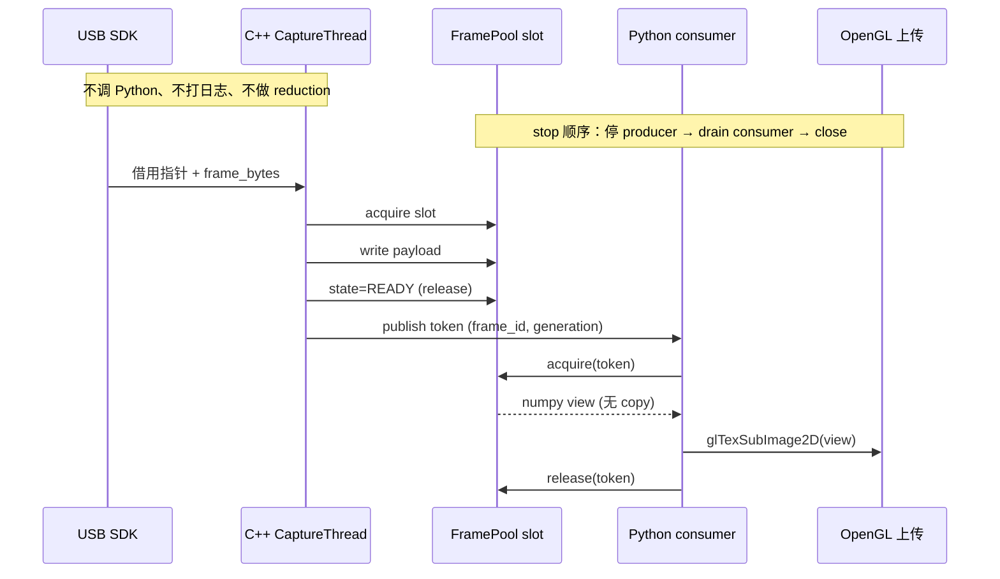

面向工业控制、相机或数据采集的 PySide6 上位机，Qt 主线程确实只能有一个，但 GIL 不是性能末日。本文围绕三条主线展开：线程与背压、零拷贝与跨语言边界、打包与解释器，每一节按"原理、证据、方案、代价"组织。结论是单个可见窗口加同进程 C++ 真线程，大帧在可证明的生命周期下只传视图，写盘与编码等无法证明所有权的环节允许一次稳定复制。

## 线程与 GIL: 主线程只有一个，真线程不止一个

PySide6 的事件循环确实只在 GUI 主线程，但 Python 的 `QThread`、`threading.Thread`、C++ 的 `std::thread` 都是真实 OS 线程。GIL 只限制同一解释器中纯 Python 字节码的并行执行；NumPy、`ctypes.CDLL` 调用（释放 GIL）、C++ worker、OpenGL 驱动、USB SDK 都能在 native 区域并行。

所以正确目标不是创建更多 `QThread`，而是缩短 Python 持有 GIL 的热路径，把大计算和大数据移动留在 native 层。

```mermaid
flowchart LR
    A["Qt GUI 主线程<br/>事件/控件/OpenGL"]:::gui
    B["CommandWorker<br/>唯一设备 owner"]:::worker
    C["FramePumpWorker<br/>采集轮询"]:::worker
    D["hcs_core.dll<br/>C++ 真线程"]:::native
    E["USB / UVC<br/>SDK"]:::device
    A --> B
    A --> C
    B --> D
    C --> D
    D --> A
    D --> E
    classDef gui fill:#1f3a5f,stroke:#7fb3ff
    classDef worker fill:#3a5a3a,stroke:#9ccc65
    classDef native fill:#5a3a3a,stroke:#ff8a80
    classDef device fill:#5a4a1f,stroke:#ffd54f
```



*图 1：线程与 native 区域的分工。GUI 主线程只管事件与 OpenGL，采集与计算下沉到 C++ 真线程。*

GUI 主线程允许：事件、控件、Qt 状态、OpenGL context、轻量 token 拉取。
GUI 主线程禁止：USB 往返、join/wait、整帧 NumPy reduction、编码、写盘。

## 线程拓扑与四类 QoS 队列

把实时数据、可丢数据、可靠数据、控制消息分别给不同 QoS：

```mermaid
flowchart TB
    subgraph data["数据面（大帧 / 低延迟）"]
        USB["USB 30 fps"]:::device
        CAP["C++ CaptureThread<br/>高优先级"]:::native
        PAR["C++ Parse/Normalize<br/>Y16 + 信息行"]:::native
        FC{"FrameChannel<br/>token + generation"}:::native
    end
    subgraph ctrl["控制面（小消息 / 强顺序）"]
        GUI["GUI Qt 主线程"]:::gui
        CW["CommandWorker<br/>串行 + 优先级 + coalesce"]:::worker
        ABI["hcs_core Control/AsyncBus"]:::native
        CMD["设备命令通道"]:::device
    end
    DISP["DisplayPump"]:::worker
    ANA["AnalyticsPool<br/>温度/直方图"]:::worker
    REC["RecorderQueue"]:::worker
    GUI --> CW
    CW --> ABI
    ABI --> CMD
    USB --> CAP
    CAP --> PAR
    PAR --> FC
    FC --> DISP
    FC --> ANA
    FC --> REC
    GUI -.-> FC
    GUI -.-> DISP
    classDef gui fill:#1f3a5f,stroke:#7fb3ff
    classDef worker fill:#3a5a3a,stroke:#9ccc65
    classDef native fill:#5a3a3a,stroke:#ff8a80
    classDef device fill:#5a4a1f,stroke:#ffd54f
```



*图 2：控制面与数据面分离。控制面走串行命令，数据面走 FrameChannel 的 token 流。*

```mermaid
flowchart LR
    Q1["Capture SPSC<br/>可靠有界"]:::reliable
    F1["Fault"]:::fault
    Q2["Display latest slot<br/>最新帧胜出"]:::latest
    OK1["继续"]:::ok
    Q3["Recorder 可靠队列"]:::reliable
    WARN["显式停止"]:::warn
    Q4["Analytics coalescing<br/>按 task key 合并"]:::coalesce
    OK2["继续"]:::ok
    Q5["Command 优先级<br/>HIGH/NORMAL/LOW"]:::priority
    OK3["继续"]:::ok
    Q1 --> F1
    Q2 --> OK1
    Q3 --> WARN
    Q4 --> OK2
    Q5 --> OK3
    classDef reliable fill:#1f4f7a,stroke:#4fc3f7
    classDef fault fill:#7a1f1f,stroke:#ef5350
    classDef latest fill:#7a4f1f,stroke:#ffb74d
    classDef ok fill:#1f4f1f,stroke:#66bb6a
    classDef warn fill:#7a5a1f,stroke:#ffd54f
    classDef coalesce fill:#4f7a1f,stroke:#aed581
    classDef priority fill:#7a1f4f,stroke:#f48fb1
```



*图 3：四类 QoS 的过载行为。可靠队列故障即报错，latest slot 丢旧帧，coalescing 与优先级队列只做合并与排序。*

要点：

- **采集线程（C++）** 只做"拿一帧、盖章、发布"。不调 Python、不打日志（异步）、不进 Python GIL。
- **Python FramePump**：`QObject` 放到长驻 `QThread`，每 tick 只发 latest descriptor 加 dirty flag。不发 `Signal(object)` 携带每帧 ndarray，否则 Qt posted-event 队列会积压。
- **CommandWorker**：唯一设备 owner，串行执行 `get/set/exec`，按 HIGH/NORMAL/LOW 优先级，滑块按 `(panel, key)` coalesce；GUI 只 enqueue，绝不直接同步调真实设备。
- **PySide6 的 `QThread` 易踩点**：`QThread` 对象本身仍属于创建它的线程（一般是 GUI），只有 `worker.moveToThread(thread)` 之后 worker 才在新线程里跑。

## 零拷贝契约与复合帧对齐

"零拷贝"不是"哪里都不复制"，而是大帧在可证明的 slot lease（代数、引用计数、显式 release）下只传递视图；写盘、编码、跨生命周期或无法证明所有权时允许一次稳定复制。



*图 4：帧 token 的零拷贝时序。生产者写入 slot 并发布 token 后，消费者只拿 numpy 视图直接上传 OpenGL；停止顺序是停 producer、排空 consumer、再 close。无法证明生命周期时允许一次稳定复制，代价计入 `copy_bytes`。*

```mermaid
flowchart TB
    A["callback string_at"]:::copy
    B["UvcCameraBackend.read"]:::copy
    C["FrameWorker.snapshot"]:::copy
    D["Recorder.write_frame"]:::copy
    E["PNG/写盘 staging"]:::copy
    F["整帧复制账本<br/>单帧可达 5 次"]:::warn
    OK["一次性安全回退"]:::ok
    NG["同一 payload<br/>重复复制"]:::ng
    A --> B
    B --> C
    C --> D
    D --> E
    E --> F
    A -.-> OK
    B -.-> OK
    E -.-> OK
    C -.-> NG
    D -.-> NG
    classDef copy fill:#5a3a3a,stroke:#ff8a80
    classDef ok fill:#1f4f1f,stroke:#66bb6a
    classDef ng fill:#7a1f1f,stroke:#ef5350
    classDef warn fill:#7a5a1f,stroke:#ffb74d
```



*图 5：整帧复制账本。单帧最多被复制 5 次，其中三处属于允许的一次性安全回退，两处属于同一 payload 的重复复制。*

**允许的复制**：C ABI callback 指针没有稳定生命周期时的安全回退；写盘、PNG、编码必须拥有独立 buffer 时的一次复制；小型 metadata 转为 `bytes`；用户主动请求的快照。

**禁止的复制**：同一 payload 在 callback、GUI slot、recorder 入队、display publish 上重复复制；为了"线程安全"给 SHM view 加 Python `Lock`；把 4 MiB ndarray pickle 进 `multiprocessing.Queue` 或 Qt queued signal；在 GUI 线程做状态栏 reduction。

token 加引用计数的契约如下：

```cpp
struct FrameToken {
    uint64_t frame_id;
    uint64_t generation;   // 防止 ring wrap 后误读
    uint32_t slot_index;
    uint32_t payload_bytes;
    uint32_t width, height, format;
    uint64_t capture_ns;
};

struct FrameSlotHeader {
    std::atomic<uint32_t> state;     // FREE / WRITING / READY
    std::atomic<uint32_t> ref_count;
    uint64_t generation, frame_id;
    uint32_t payload_bytes, metadata_bytes;
};
```

Python 侧只能调 `acquire(token) / view(token) / release(token)`，不能直接改 `state` 与 `ref_count`。如果不引入引用计数，至少给 display 和 recorder 各预留独立的 staging 双缓冲或三缓冲，并明确降级、把 `copy_bytes` 计入指标。

录制端再省一刀：

```python
raw_file.write(memoryview(frame).cast("B"))   # 0.005 ms vs tobytes 1.73 ms
```

约束：frame 必须是连续、小端、生命周期稳定；非连续或字节序不匹配时允许显式复制。

### 复合帧必须共享 frame_id

工业相机常传复合帧：1920×1080 图像加 2 行原始信息行（带温度、状态、checksum）。最常见的 bug 是"GUI 拉一帧、统计延迟两秒、结果贴错帧"。

```mermaid
flowchart LR
    RAW["raw payload<br/>1920 × 1082 × 2"]:::raw
    CHK{"校验<br/>payload_bytes<br/>stride<br/>endianness"}:::check
    IMG["image = rows 0:1080"]:::img
    INF["info = rows 1080:1082<br/>保留原始 bytes"]:::meta
    PAR["versioned parser"]:::parse
    T["temperature<br/>frame_id=X"]:::temp
    D["display<br/>frame_id=X"]:::disp
    N["不覆盖新帧"]:::ng
    FLAG["标记 metadata_error<br/>图像仍可显示"]:::warn
    RAW --> CHK
    CHK --> IMG
    CHK --> INF
    INF --> PAR
    PAR --> T
    IMG --> D
    T -.-> N
    CHK --> FLAG
    classDef raw fill:#3a3a5a,stroke:#9fa8da
    classDef img fill:#1f4f7a,stroke:#4fc3f7
    classDef meta fill:#4f7a1f,stroke:#aed581
    classDef parse fill:#7a4f1f,stroke:#ffb74d
    classDef temp fill:#7a1f4f,stroke:#f48fb1
    classDef disp fill:#1f3a5f,stroke:#7fb3ff
    classDef warn fill:#5a4a1f,stroke:#ffd54f
    classDef check fill:#3a3a5a,stroke:#9fa8da
    classDef ng fill:#7a1f1f,stroke:#ef5350
```



*图 6：复合帧的对齐。图像与 metadata 用同一个 frame_id，旧结果不覆盖新帧，解析失败只标记而不猜温度。*

图像和 metadata 必须用同一个 `frame_id` 对齐；旧结果不能覆盖新帧；解析失败只标记 `metadata_error`，图像仍可显示，绝不能猜温度。这一条直接服务于前面的零拷贝契约：只有当 slot 把 image、infoline、metadata 放在同一 token 上、消费者按 `frame_id` 校验代际时，跨语义的"同一帧"才有保证。

## OpenGL 上传与 NumPy 归一化

帧数据最终要落到屏幕。工业上位机常跑老 Intel 集显。`GL_R16` 与 `GL_R16UI` 是 16-bit 单通道纹理最干净的接口，但实测在多个 Intel 驱动下上传后屏幕全黑。

```mermaid
flowchart LR
    Y16["Y16 frame<br/>uint16"]:::data
    PICK{"启动时探测<br/>GL version<br/>RG8 + shader<br/>驱动白名单"}:::probe
    RG8["GL_RG8 + UNSIGNED_BYTE<br/>low→R high→G"]:::ok
    SH["fragment shader<br/>重建 16-bit<br/>查伪彩 LUT"]:::shader
    OUT["screen"]:::out
    R16["GL_R16 / GL_R16UI<br/>Intel 黑屏"]:::ng
    CPU["CPU fallback<br/>CPU LUT→RGBA staging"]:::warn
    Y16 --> PICK
    PICK --> RG8
    RG8 --> SH
    SH --> OUT
    PICK --> R16
    PICK --> CPU
    CPU --> OUT
    classDef data fill:#3a3a5a,stroke:#9fa8da
    classDef ok fill:#1f4f1f,stroke:#66bb6a
    classDef shader fill:#1f4f7a,stroke:#4fc3f7
    classDef out fill:#1f3a5f,stroke:#7fb3ff
    classDef ng fill:#7a1f1f,stroke:#ef5350
    classDef warn fill:#7a5a1f,stroke:#ffb74d
    classDef probe fill:#1f4f7a,stroke:#4fc3f7
```



*图 7：纹理格式的探测与回退。默认走 RG8 加 shader 重建，R16 在 Intel 驱动上不可用，CPU LUT 只作为兜底。*

我们改用 `GL_RG8 + GL_UNSIGNED_BYTE` 双通道：把 little-endian Y16 的低字节与高字节分别送 R 与 G，fragment shader 内重建 16-bit 值再查伪彩 LUT。这条路在 Intel、NVIDIA、AMD 上都能跑。

PBO（pixel buffer object）异步上传在 OpenGL 教科书里几乎是必须，但在 PySide6 6.11.1 的 `glTexImage2D` 与 `glTexSubImage2D` 绑定上有真实约束：

- 绑定的 `pixels` 参数只接收 buffer 对象；
- `None`、`0`、`ctypes.c_void_p(0)` 分别被拒绝或直接崩溃；
- 不是配置问题，是绑定层根本不支持"null 或整数偏移"惯用法。

```python
# 不再是可选项：首次使用即永久回落直传
def _disable_pbo_upload(self):
    self._pbo_enabled = False   # glTexSubImage2D 直传是既定出货路径
```

CPU fallback 不是性能验收路径：必须单独记录帧率和 P95/P99，不能用它证明硬件 GPU 路径的预算达标。

### NumPy LUT 与归一化

GPU 拿到的是归一化后的 uint8 纹理。归一化本身是热路径，必须先在 NumPy 内优化再下沉 native：

```python
# 65536 项 LUT（约 64 KiB），只在下限/上限变化时重建
codes = np.arange(65536, dtype=np.float32)
lut = np.clip((codes - lo) * (255.0 / (hi - lo)), 0, 255).astype(np.uint8)

# 预分配 gray8，禁止每帧创建
np.take(lut, frame_y16, out=gray8)
```



```mermaid
flowchart LR
    A["Y16 frame<br/>1920×1080 uint16"]:::data
    B{"LUT 缓存命中<br/>且窗口未变?"}:::check
    C["预分配 gray8"]:::buf
    D["重建 64 KiB LUT<br/>一次 float32"]:::lut
    E["np.take LUT<br/>out=gray8"]:::work
    F["显示 / 编码"]:::out
    S("统计<br/>1.5 s 节拍<br/>保持原始 Y16 计数"):::stats
    A --> B
    B --> C
    B --> D
    D --> C
    C --> E
    E --> F
    A --> S
    classDef data fill:#3a3a5a,stroke:#9fa8da
    classDef buf fill:#4f7a1f,stroke:#aed581
    classDef lut fill:#7a4f1f,stroke:#ffb74d
    classDef work fill:#1f4f7a,stroke:#4fc3f7
    classDef out fill:#1f3a5f,stroke:#7fb3ff
    classDef check fill:#1f4f7a,stroke:#4fc3f7
    classDef stats fill:#4f7a1f,stroke:#aed581
```

*图 8：归一化热路径。LUT 只在窗口变化时重建，gray8 预分配，统计走独立的原始 Y16 计数。*

几条经验：

1. LUT 只在窗口变化时重建，禁止每帧重建；
2. `gray8` 用固定预分配，禁止每帧 `np.empty`、`np.zeros`、`np.array`；
3. raw Y16 录制完全绕过归一化，保留原始计数用于测温换算；
4. 统计和归一化必须独立输出，禁止两个线程写同一 ndarray 区间；
5. `Y16 >> 8` 虽然便宜，但丢动态范围、破坏低对比度显示，且后续温度换算直接算错，不允许作为优化手段；
6. 测温状态使用原始 Y16 计数的 min/max/mean，不能用右移后的 uint8 代入。

并行归一化：先测单 worker 的 `np.take(out=...)` P95；只有仍超预算才用 `ThreadPoolExecutor(max_workers=2)` 按行切成互不重叠区间。因为 NumPy native 操作通常释放 GIL，能拿到真并行；但若双 worker 没有降低 P95 就恢复单 worker，不能凭"多线程一定更快"下结论。

## 默认架构与跨语言硬约束

把前面所有设计拼起来，就是这张默认架构图：

```mermaid
flowchart TB
    subgraph MAIN["唯一可见窗口"]
        UI["hcs_client.exe<br/>PySide6 GUI"]:::gui
        FWP["FramePumpWorker<br/>moveToThread"]:::worker
        CW["CommandWorker<br/>唯一 owner"]:::worker
        RW["Recorder worker<br/>可靠 raw"]:::worker
    end
    subgraph CORE["hcs_core.dll 同进程 C++ 真线程"]
        CAP["CaptureThread<br/>USB 拉流"]:::native
        PAR["Parse/Normalize<br/>Y16 + 信息行"]:::native
        ANA["AnalyticsPool<br/>直方图/温度/LUT"]:::native
    end
    subgraph OPT["可选"]
        CPU["无窗口 CPU worker<br/>仅 GIL 重任务"]:::opt
    end
    UI --> FWP
    UI --> CW
    UI --> RW
    FWP --> CAP
    CAP --> PAR
    PAR --> ANA
    CW --> CORE
    CORE -.-> CPU
    classDef gui fill:#1f3a5f,stroke:#7fb3ff
    classDef worker fill:#3a5a3a,stroke:#9ccc65
    classDef native fill:#5a3a3a,stroke:#ff8a80
    classDef opt fill:#3a3a5a,stroke:#9fa8da
```



*图 9：默认架构。一个可见窗口、同进程 C++ 真线程、至多一个按需 CPU worker。*

各节点的设计来源：

- **GUI 与 FramePump** 对应前面的 dirty 与 token 流；
- **FrameChannel** 是零拷贝总线，所有大帧都走 token；
- **CaptureThread 与 ParseThread** 共同保证复合帧的 `frame_id` 对齐；
- **AnalyticsPool** 与归一化紧密耦合，归一化结果直接喂给 OpenGL；
- **CommandWorker** 加 `ctypes` 释放 GIL 是线程模型的具体落地；
- **可选 CPU worker** 的开关标准是"代价与收益"。

一个窗口、同进程 C++ 真线程、至多一个按需 CPU worker，这是性能、故障隔离和工程复杂度三者最均衡的位置。

### 跨语言硬约束 E1 到 E5

整套设计能否成立，取决于几条跨语言硬约束不被破坏。下图把每一类事故对应到原始规则：

```mermaid
flowchart TB
    A["NumPy 视图"]:::py
    B{"C++ 段<br/>仍存活?"}:::check
    OK["安全使用"]:::ok
    UAF["悬垂访问<br/>UAF / 撕裂"]:::ng
    C["Python Lock"]:::py
    D["保护 C++ SHM"]:::ng
    E["锁语义错配<br/>跨进程/跨语言不成立"]:::ng
    F["耗时 ctypes 调用<br/>未释放 GIL"]:::py
    G["GUI 线程卡顿"]:::ng
    H["重复 close / 半初始化<br/>不幂等清理"]:::ng2
    I["句柄/SHM/view 残留"]:::ng
    A --> B
    B --> OK
    B --> UAF
    C --> D
    D --> E
    F --> G
    H --> I
    classDef py fill:#1f3a5f,stroke:#7fb3ff
    classDef ok fill:#1f4f1f,stroke:#66bb6a
    classDef ng fill:#7a1f1f,stroke:#ef5350
    classDef ng2 fill:#7a1f1f,stroke:#ef5350
    classDef check fill:#1f4f7a,stroke:#4fc3f7
```



*图 10：每一类事故对应的原始约束。视图越界、锁错配、GIL 未释放、清理不幂等都会立刻让前面的优化失效。*

- **E1**：NumPy 视图生命周期不得超过 C++ 共享段加 slot lease。
- **E2**：ctypes 结构体、宽度、packing、常量集中定义并有 ABI 测试。
- **E3**：C++ 内存只走 C ABI 原子原语与 FrameChannel 头尾，Python Lock 不能保护 C++ SHM。
- **E4**：昂贵 native 调用必须释放 GIL，且不能从 Qt GUI 线程调用。
- **E5**：中断、半初始化、拔插、重复 close 都是正常输入；清理必须幂等。
- **设备 handle 单 owner**：一个设备 handle 只能有一个串行 owner；`hcs_stop`、callback drain、`hcs_close` 必须按顺序完成。

E1 与 E3 是零拷贝契约的底线；E4 是线程拓扑能够成立的前提；E5 是默认架构在拔插、崩溃下仍然稳定的根因。任何一条被破坏，前面的所有优化都会立刻失效。
