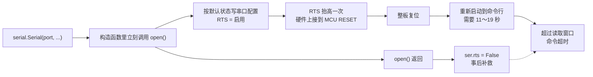
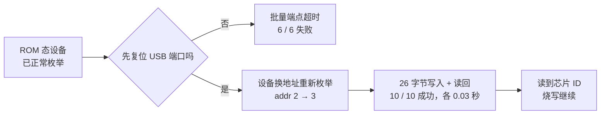

串口 `open()` 不是无副作用操作：驱动会在函数返回前应用 DTR/RTS 默认状态。若其中一根控制线接到 MCU 复位脚，每次打开串口都可能产生一次复位脉冲；`open()` 返回后再拉低已经无法撤销该边沿。解决方法是先构造未打开的串口对象，在打开前设置低电平，并将所有打开动作收敛到同一入口。

## 故障场景与共同根因

自动化“烧写 + 验收”流水线需要依次完成三件事：通过串口命令让板卡进入 USB 更新模式，经 USB bulk 端点擦写并回读 Flash，再通过 USB 转串口下发命令、采集启动日志。串口桥片和板卡自身枚举的 USB 设备是两条独立通路，但打开串口引起的硬件复位会同时改变板卡状态。

| 现象 | 具体表现 | 影响 |
| --- | --- | --- |
| 串口命令时好时坏 | 同一命令有时正常返回，有时读取超时 | 验收结论不可信 |
| 烧写时灵时不灵 | 有时完成烧写，有时读芯片 ID 都超时 | 阻塞整条流水线 |

问题难查有三个原因：同一代码、线材和板卡会偶发成功；故障跨越应用脚本、串口库、USB 协议栈和硬件接线；重试可能恢复，容易被误判成线材或硬件不稳定。两个现象最终都指向“打开设备会改变硬件状态”。

## open 内部的控制线时序

DTR（Data Terminal Ready，终端就绪）和 RTS（Request To Send，请求发送）不承载串口数据，而由主机控制电平。现代板卡常把它们复用为 MCU 复位、bootloader 选择、供电控制或通道切换信号。本例中，USB 转串口桥片的 RTS 连接 MCU RESET，RTS 抬高就会整板复位。

最初代码在构造对象时直接传入端口：

```python
ser = serial.Serial(port, baud, timeout=timeout)
```

pyserial 3.5 的执行链如下：`SerialBase.__init__` 将 `self._rts_state` 和 `self._dtr_state` 默认设为 `True`；传入 `port` 后，构造函数立即调用 `open()`；Windows 后端 `_reconfigure_port()` 在 `open()` 内按状态写入串口配置：`fRtsControl = RTS_CONTROL_ENABLE if self._rts_state else RTS_CONTROL_DISABLE`，DTR 同理。



复位脉冲发生在 `open()` 内部，调用者只能在函数返回后执行 `ser.rts = False`。这能恢复最终电平，却不能取消已经发生的复位。板卡重新进入命令行需要 11～19 秒，而命令读取窗口只有数秒；成功与否取决于命令发送时板卡是否完成启动，并非随机故障。

## USB bulk 死锁的对照实验

ROM 状态下还观察到另一组现象：控制端点用于读状态、切接口时瞬时响应，耗时 0.00 秒；bulk 端点写 `0x02`、读 `0x81` 时，在 1 s、2 s、5 s、20 s 超时配置下全部失败，清除 halt 也无效。

控制端点正常说明固件仍在运行、设备未挂起；bulk 端点全超时则指向链路状态。对照实验结果如下：



同一个 USB 后端在复位端口后立即恢复，排除了驱动错误。根因是 ROM 状态 USB 链路间歇性死锁，端口复位使设备以新地址重新枚举后解除。数据链路经过两级级联 USB hub，即“主机 → hub → hub → 设备”，进一步放大了时序问题。

## 正确打开方式与验证纪律

必须在 `open()` 前设置控制线状态：

```python
ser = serial.Serial()
ser.port = port
ser.baudrate = baud
ser.timeout = timeout
ser._rts_state = False
ser._dtr_state = False
ser.open()
ser.rts = False
ser.dtr = False
```

不向构造函数传入 `port`，就不会自动打开；在调用 `open()` 前将内部状态设置为低，驱动首次应用配置时不会产生预期外边沿。后两行作为兜底，保证打开后的最终电平为低。这里使用了 pyserial 私有属性，升级库版本时必须通过测试确认其行为。

ROM 状态的会话开始前也先执行一次 USB 端口复位：`dev.reset()` 后重新查找并打开设备，随后由同一进程立即烧写，不跨进程、不留下长间隔。

工程上还需落实两条纪律：所有串口打开动作必须走同一个 helper，避免遗漏某处重新引入复位；测试必须断言 `open()` 瞬间的电平，而不是只检查打开后的状态。用贴近 pyserial 状态机的替身对象即可让“先打开再拉低”的旧写法失败，并验证新写法在第一次配置时已保持低电平。
