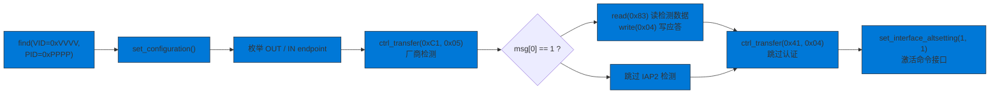
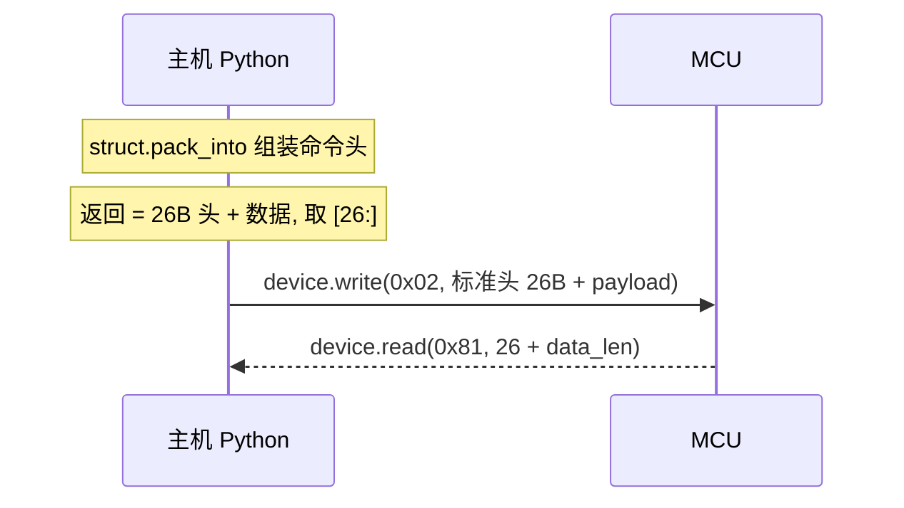

可靠的 USB 固件烧写工具应把职责分成主流程、指令封装和底层收发三层：主流程编排下载、擦写、校验和重启；指令层映射 Flash 操作与 `subcmd`；收发层处理 vendor 命令头和 bulk 端点。本文保留具体的 `mode` 分区、Flash ID 容量表、认证握手、26 字节命令头和 4K 回读校验规则。

## 三层架构与烧写主流程

```mermaid
flowchart TB
    A["下载工具<br/>SFTP 下载固件"]:::app
    B["烧写主流程<br/>读 bin → 擦写 → 校验"]:::mid
    C["指令封装层<br/>flash 指令"]:::mid
    D["底层收发层<br/>vendor 命令 + ctypes 结构体"]:::mid
    E["MCU<br/>VID 0xVVVV / PID 0xPPPP"]:::dev
    A --> B
    B --> C
    C --> D
    D --> E
    classDef app fill:#0078D7,stroke:#1D2B3A
    classDef mid fill:#26384A,stroke:#0078D7
    classDef dev fill:#C62828,stroke:#8E0000
```



烧写主流程 `flash_firmware(mode, bin_path)` 依次打开 USB 设备，读取 Flash ID，按低字节确定 ROM 容量，根据 `mode` 计算擦写区间，设置更新模式，读取擦写基地址，加载 bin，擦除、按 4K 分块写入、按 4K 分块回读、比较数据，最后重启设备。

```mermaid
flowchart TB
    S["开始"]
    O["open_device()<br/>打开并初始化 USB 设备"]:::step
    I["flash_get_id()<br/>读 Flash ID (4B)"]:::step
    R["get_rom_size(idx)<br/>ID → ROM 容量"]:::io
    M["mode → erase_offset / erase_max"]:::io
    U["flash_update_mode_set(mode)<br/>设置更新模式"]:::step
    B["flash_get_update_base()<br/>读擦写基地址"]:::step
    L["读 bin 文件 → numpy 数组"]:::step
    E["flash_erase(base, size+256)<br/>擦除 Flash"]:::erase
    W["按 4K 循环<br/>flash_write_4k 写入"]:::step
    RD["按 4K 循环<br/>flash_read_4k 回读"]:::step
    V{"numpy.array_equal<br/>读回 == 预期 ?"}
    OK["reboot_device()<br/>重启设备"]:::ok
    ERR["定位首个差异字节<br/>assert 失败"]:::err
    DONE["完成"]
    S --> O
    O --> I
    I --> R
    R --> M
    M --> U
    U --> B
    B --> L
    L --> E
    E --> W
    W --> RD
    RD --> V
    V --> OK
    V --> ERR
    OK --> DONE
    ERR --> DONE
    classDef step fill:#26384A,stroke:#0078D7
    classDef io fill:#0078D7,stroke:#1D2B3A
    classDef erase fill:#F57C00,stroke:#E65100
    classDef ok fill:#2E7D32,stroke:#1B5E20
    classDef err fill:#C62828,stroke:#8E0000
```



`mode` 决定擦写区间：

| mode | 含义 | erase_offset | erase_max |
| --- | --- | --- | --- |
| 0 | 更新 app code | `0xD000` | `ROM_MAX - 0xD000` |
| 1 | 更新 patch code | `0x2000` | `0x6FFF - 0x2000` |
| 2 | 更新全片 Flash | `0` | `ROM_MAX` |
| 3 | 更新 mfi code | `0` | `0x1FFF` |
| 4 | 更新 app manage info | `0xB000` | `0xCFFF - 0xB000` |
| 5 | 更新 cfg code | `0x7000` | `0xAFFF - 0x7000` |

ROM 总容量按 Flash ID 的低字节 `idx & 0xFF` 映射：

| idx & 0xFF | ROM 容量 |
| --- | --- |
| `0x14` | 1 MB |
| `0x15` | 2 MB |
| `0x16` | 4 MB |
| `0x17` | 8 MB |
| `0x18` | 16 MB |
| `0x19` / `0x39` | 32 MB |
| `0x1A` / `0x20` | 64 MB |
| `0x1B` / `0x21` | 128 MB |
| 其它 | 无法确定 |

## USB 初始化与命令协议

设备上电默认进入厂商认证流程（MFI / IAP2），初始化时先激活命令接口：



认证握手才使用控制传输 `ctrl_transfer`；后续固件数据使用 bulk 端点。标准命令头用 ctypes 定义，并设置 `_pack_ = 1`：

```
VDCMD_STANDARD_HDR_INFO  (26 bytes, _pack_=1)
+----------+-----------+---------+------------+------+-----------+-----------+--------+-------+-----------+
| CmdIdx   | CmdStatus | CmdType | SubCmdType | RSVD | Paramters0| Paramters1| Length | CRC16 | CRC16_HDR |
| u32      | u32       | u16     | u8         | u8   | u32       | u32       | u16    | u16   | u16       |
| 4B       | 4B        | 2B      | 1B         | 1B   | 4B        | 4B        | 2B     | 2B    | 2B        |
+----------+-----------+---------+------------+------+-----------+-----------+--------+-------+-----------+
```

命令通过 `0x02` OUT 端点写入，响应通过 `0x81` IN 端点读取：



写操作还带有 `flag`：`erase` 需要等待擦除完成，超时为 `240000ms`；`reboot` 只写不读，因为设备会直接重启。

## Flash 指令与回读校验

所有 Flash 指令使用 `cmd = 0x0201`，通过 `subcmd` 区分具体操作：

| 函数 | subcmd | 读写 | flag | 说明 |
| --- | --- | --- | --- | --- |
| `flash_update_mode_set` | `0x46` | write | - | 设置更新模式 |
| `reboot_device` | `0x47` | write | `reboot` | 回卷代码并重启 |
| `flash_get_update_base` | `0x85` | read | - | 读擦写基地址 |
| `flash_erase` | `0x44` | write | `erase` | 擦除 Flash |
| `flash_write_4k` | `0xC1` | write | - | 写 4K 数据 |
| `flash_read_4k` | `0x82` | read | - | 读 4K 数据 |
| `flash_get_id` | `0x81` | read | - | 读 Flash ID (4B) |
| `reset_device` | `0x0101/0x41` | write | - | 复位到 ROM |

写入和回读统一以 `ROM_SIZE_4K = 4096` 为粒度循环。回读数据使用 `numpy.array_equal` 全量比较，不执行 Python 逐字节循环；不一致时用 `np.where` 定位首个差异偏移，打印预期和实际字节后通过 `assert` 失败。
