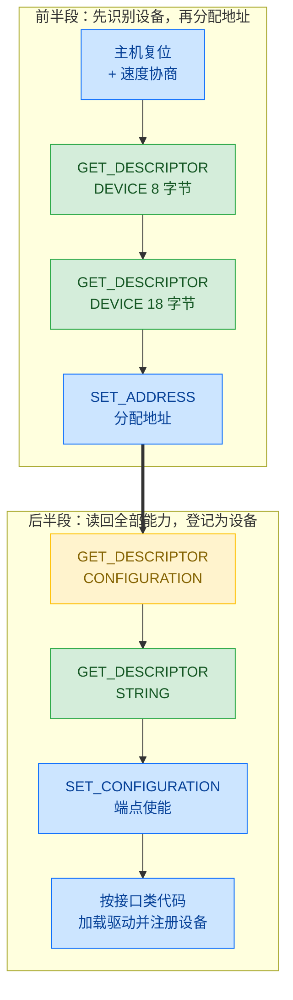
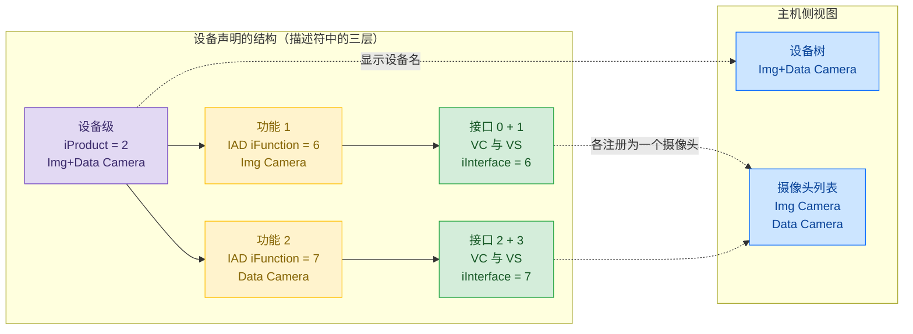
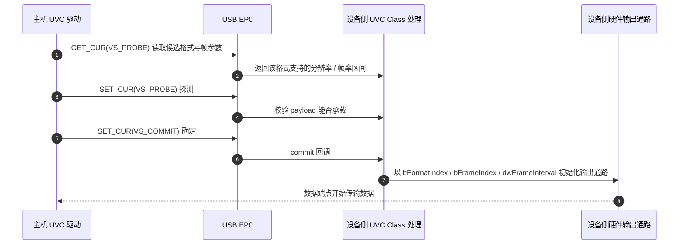

> 原文链接: [CSDN](https://blog.csdn.net/stallion5632/article/details/165884013)

> 结论先行：主机能够枚举一颗从未见过的芯片，并非因为主机预先识别了该芯片，而是因为设备按 USB 规范**用描述符描述自身**。描述符说明设备的身份与接口数量，Probe/Commit 协商确定输出格式。

## 1. 基础：协议分层、双方角色与通信方式

要理解这套过程，先分清两层规范，它们叠加在一起，职责不同：

| 层 | 规范 | 负责内容 |
|---|---|---|
| 总线层 | USB（Universal Serial Bus，通用串行总线） | 电气连接、寻址、数据包的收发、四种传输类型 |
| 设备类层 | UVC（USB Video Class，USB 视频类） | 摄像头的描述符格式、控制请求、数据格式 |

UVC 建立在 USB 之上。USB 只负责把字节送到某个端点，不关心这些字节承载的是视频还是其他内容；UVC 才规定摄像头的描述符格式与可用的控制请求。

**双方的角色分工是理解后续流程的前提：**

- **主机**（PC 上的操作系统与驱动）：发起所有请求、为设备分配地址、决定加载哪个驱动、决定取数据的时机。
- **设备**（MCU 加摄像头固件）：只负责应答。设备不能主动向主机发送数据，视频数据同样由主机发起读取：主机查询端点是否有数据，设备才返回数据。

设备侧要能完成应答，以下三项都是必需的：

| 前提 | 作用 |
|---|---|
| USB 设备控制器（含 PHY 物理层） | 电气层收发，D+ 上拉，端点 FIFO |
| 设备协议栈 | 解析标准请求，管理地址、端点与状态机 |
| 一份自描述的描述符表 | 设备身份的唯一信息源 |

USB 定义了四种传输类型，本文涉及前三种，第四种是视频流的可替代方案：

| 传输类型 | 用在哪 | 特点 |
|---|---|---|
| 控制传输（Control），固定使用 EP0 | 枚举、协商、读状态 | 每条请求都保证送达并回执 |
| 批量传输（Bulk） | 视频数据 | 不丢包，但带宽与时延不保证 |
| 中断传输（Interrupt） | UVC 的事件通知 | 周期轮询，延迟有上限 |
| 等时传输（Isochronous） | 视频数据的另一种选择 | 保带宽与时延，出错不重传 |

端点（endpoint）是设备内部的数据出入口，每个端点有地址和方向。主机的每一次通信都发往设备上的某个端点，而不是发往设备的某个功能。枚举与协商都经由 0 号端点（EP0），视频数据使用独立的端点。

设备侧只要按同样格式应答描述符，更换芯片后主机同样能够识别。以下从设备插入开始，依次描述这八个步骤。

## 2. 枚举流程：关键信息集中在第 5 步

设备插入后，主机会按固定顺序执行八个步骤，整体分为两段：前段识别设备并分配地址，后段读回全部能力并登记进系统。



前两步为什么要分两次读取设备描述符？因为主机尚不知道该设备的端点能够接收多大的数据包，首次只读取 8 字节以取得 `bMaxPacketSize0`，再读取完整的 18 字节。

这八个步骤中，主机与设备各自的动作：

| 步 | 主机侧 | 设备侧 |
|---|---|---|
| 1 | 检测到接入，复位设备，协商是全速还是高速 | 接受复位 |
| 2 | 读取 8 字节设备描述符 | 返回设备描述符的前 8 字节 |
| 3 | 读取完整 18 字节 | 返回完整设备描述符，含 VID / PID / 配置数量 |
| 4 | 分配一个新地址 | 记录地址，此后仅以该地址应答 |
| 5 | **读取配置描述符集合** | **返回全部能力**，即第 3 节所列结构 |
| 6 | 读取字符串描述符 | 返回厂商 / 产品 / 序列号等文本 |
| 7 | 选定配置 | 按配置内容使能各端点 |
| 8 | 按接口类代码加载驱动，将设备注册进系统 | 此后等待主机协商输出格式 |

**第 5 步是全部信息的来源。** 一次 `GET_DESCRIPTOR(CONFIGURATION)` 取回整个配置描述符集合（configuration descriptor set），按固定顺序排列：

```
Configuration
├── IAD（Interface Association Descriptor，接口关联描述符）
├── VC 接口 + 一串 CS_INTERFACE 描述符 + 中断端点
└── VS 接口 + 若干 format 描述符 + 若干 frame 描述符 + 数据端点
```

主机侧看到的设备能力，全部来自这一次读取的字节。这批字节的结构是固定的，下文以 UVC 摄像头为例说明。

## 3. UVC 的描述符：命名的三个层次与 IAD 关联

UVC 设备的标准结构是**一对接口**：一个 VideoControl（VC，视频控制接口，负责控制）加一个 VideoStreaming（VS，视频流接口，负责数据）。接口类代码（`bInterfaceClass`）固定为 `0x0E`，子类 `0x01` 为 VC、`0x02` 为 VS。主机读到 `0x0E` 即判定这是摄像头，加载系统自带的 UVC 驱动。

一对 VC 与 VS 构成一个**功能（function）**，由 **IAD** 将两个接口关联并声明为一个整体，否则系统会将它们视为两个互不相关的设备。当一台设备要提供多路视频时，就在一个 configuration 下放置多组 `IAD + VC + VS`。

由此形成命名的三个层次。左侧是设备**声明**的结构，右侧是主机**据此建立**的结构：



固件中的字符串表就是这三层的原始形式，节点中的下标数字对应这张表的行号：

```c
static const char *ustring[] =
{
    "Language",           /* 0  语言 ID            */
    "<Vendor> Co.,Ltd",   /* 1  iManufacturer      */
    "Img+Data Camera",    /* 2  iProduct     ← 设备级 */
    serialId,             /* 3  iSerialNumber      */
    "Configuration",      /* 4  iConfiguration     */
    "Interface",          /* 5                     */
    "Img Camera",         /* 6  功能 1 的 iFunction / iInterface */
    "Data Camera"         /* 7  功能 2 的 iFunction / iInterface */
};
```

设备描述符中 `iProduct = 2`，第一组 IAD/VC/VS 的 `iFunction` 与 `iInterface` 为 6，第二组为 7。这几个字段本身都是字符串描述符的索引号。

将这份字节按层级展开，就是主机在第 5 步读取到的结构：

```text
Configuration 1
├─ IAD #1                                    iFunction = 6 → "Img Camera"
│  ├─ Interface 0（VC）   class 0x0E / subclass 0x01
│  │  ├─ CS_INTERFACE : Header
│  │  ├─ CS_INTERFACE : Input Terminal   （相机终端）
│  │  ├─ CS_INTERFACE : Processing Unit
│  │  ├─ CS_INTERFACE : Output Terminal
│  │  └─ Endpoint 0x87   中断传输 IN
│  └─ Interface 1（VS）   class 0x0E / subclass 0x02   iInterface = 6
│     ├─ VS Input Header
│     ├─ Format 1..6     未压缩（NV12 / YUY2 / Y16 / Y8 / RGB888 / RGB565）
│     │  └─ 每种格式包含若干 Frame 描述符
│     ├─ Format 7        MJPEG
│     │  └─ 若干 Frame 描述符
│     └─ Endpoint 0x81   批量传输 IN
└─ IAD #2                                    iFunction = 7 → "Data Camera"
   ├─ Interface 2（VC）   class 0x0E / subclass 0x01
   │  ├─ CS_INTERFACE : Header / Terminal / Unit …
   │  └─ Endpoint 0x88   中断传输 IN
   └─ Interface 3（VS）   class 0x0E / subclass 0x02   iInterface = 7
      ├─ VS Input Header
      ├─ Format 1        未压缩
      │  └─ 6 组 Frame：每组 = 数据帧 + 高度多 2 行的信息帧
      └─ Endpoint 0x82   批量传输 IN
```

`CS_INTERFACE` 是类特定接口描述符（class-specific interface descriptor），VC 内部的终端与处理单元都由它定义。

接口编号在固件中写作 `USB_DYNAMIC`，由协议栈在枚举时分配，因此上文的 0/1/2/3 是典型结果而非硬编码值。

主机据此建立的设备树，同一台设备会同时出现在两个位置：

```text
设备管理器
├─ 通用串行总线控制器
│  └─ USB 复合设备
│     └─ <Vendor> Co.,Ltd  Img+Data Camera     ← iProduct（设备级，只有一个）
└─ 摄像头（Imaging Devices）
   ├─ Img Camera                                ← 功能 1 的 iFunction
   └─ Data Camera                               ← 功能 2 的 iFunction
```

两个位置描述的是同一份数据，区别只在于主机把它放在设备树的哪一层。

**两个功能承载的数据形态不同**，这是分成两路的原因：

| | 功能 1（Img Camera） | 功能 2（Data Camera） |
|---|---|---|
| 内容 | 图像帧 | 结构化数据帧 |
| 格式数 | 6 种未压缩 + 1 种压缩（MJPEG） | 1 种未压缩 |
| 帧组织 | 每种格式若干组独立的图像帧参数 | 成对：数据帧 + 高度多 2 行的信息帧 |
| 尺寸 | 图像分辨率 | 6 档：640×512、384×288、256×192、160×120、320×240、512×384 |

第二路的 6 档尺寸各自成对，信息帧始终比同档的数据帧多 2 行，对应「传感器矩阵 + 元信息（帧头 / 量程 / 时间戳）」这类数据的常见组织方式。

## 4. 枚举完成识别，能力由 Probe/Commit 协商确定

描述符已向主机提供格式清单，但主机尚未选定使用其中哪一项，帧率也未确定。这一步要用 UVC 的**类特定控制请求**（class-specific request）再协商一轮，全程同样经由 EP0。这类请求由 UVC 定义，只是借用了 USB 的控制传输：



`VS_PROBE` 用于探测，`VS_COMMIT` 用于确定。关键在于最后三步：**Commit 之前硬件通路尚未启动**。回调取得 `bFormatIndex`、`bFrameIndex`、`dwFrameInterval` 三个下标，组成一份帧参数，才去初始化封装硬件与输出接口。因此相机已插入但未打开预览时，设备不会向数据端点发送像素。

协商完成后即与 EP0 无关：像素经由独立的 Bulk IN 或 Isochronous IN 端点传输，由主机按期读取。此后主机侧负责接收，设备侧按协商结果输出。

## 5. 三个最容易混淆的地方

以下三处名称相近，实际调试时最容易误判：

1. **端点号 ≠ 内部通道号**。`0x81`、`0x82` 是 USB 端点地址，设备固件内部可能另有「通道 1/2/3」编号，两套编号之间没有数值对应关系，仅表示固件在配置中把某路内部通道映射到了某个端点。

2. **设备名不是摄像头名称**。设备树读取 `iProduct`，摄像头列表读取各 function 的 `iFunction`，两者本就是不同的字段，因此同一台设备会出现在两个位置。

3. **IAD 不可省略**。缺少 IAD 时，VC 与 VS 会被视为两个独立接口，Windows 下常表现为「识别到 USB Video 设备但无法打开」，因为 UVC 驱动需要依靠配对关系才能确定控制接口与数据接口属于同一路视频。

> 一句话：USB 的即插即用建立在设备按规范描述自身的基础上。主机发起请求、设备应答，这一交互贯穿三个阶段：枚举时交换描述符确定身份，协商时用 Probe/Commit 确定格式，开始传输后设备向端点输出数据。
