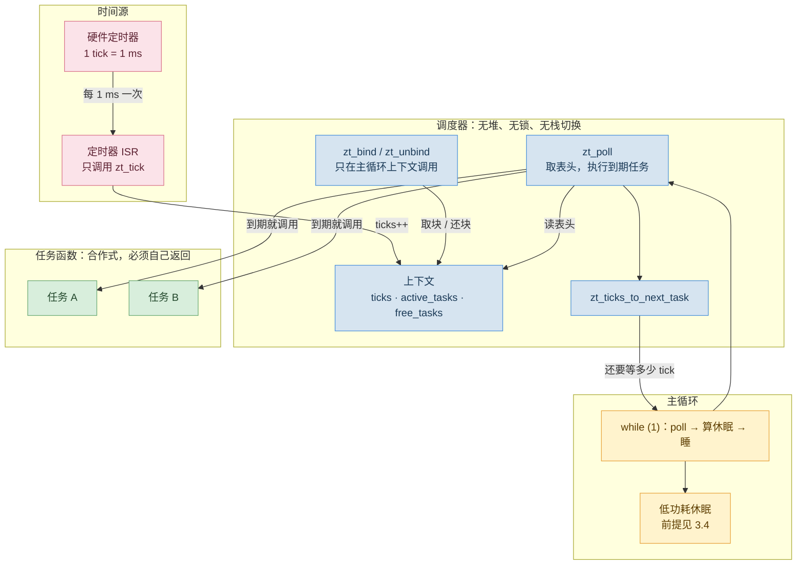
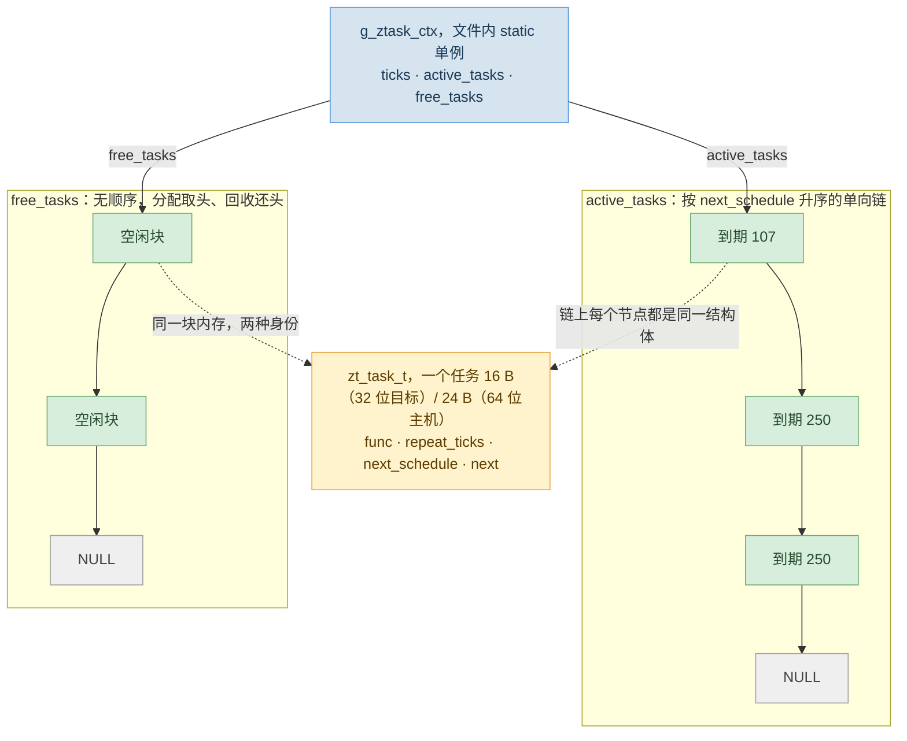
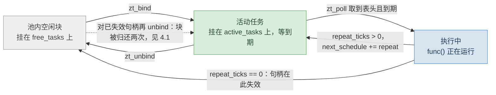
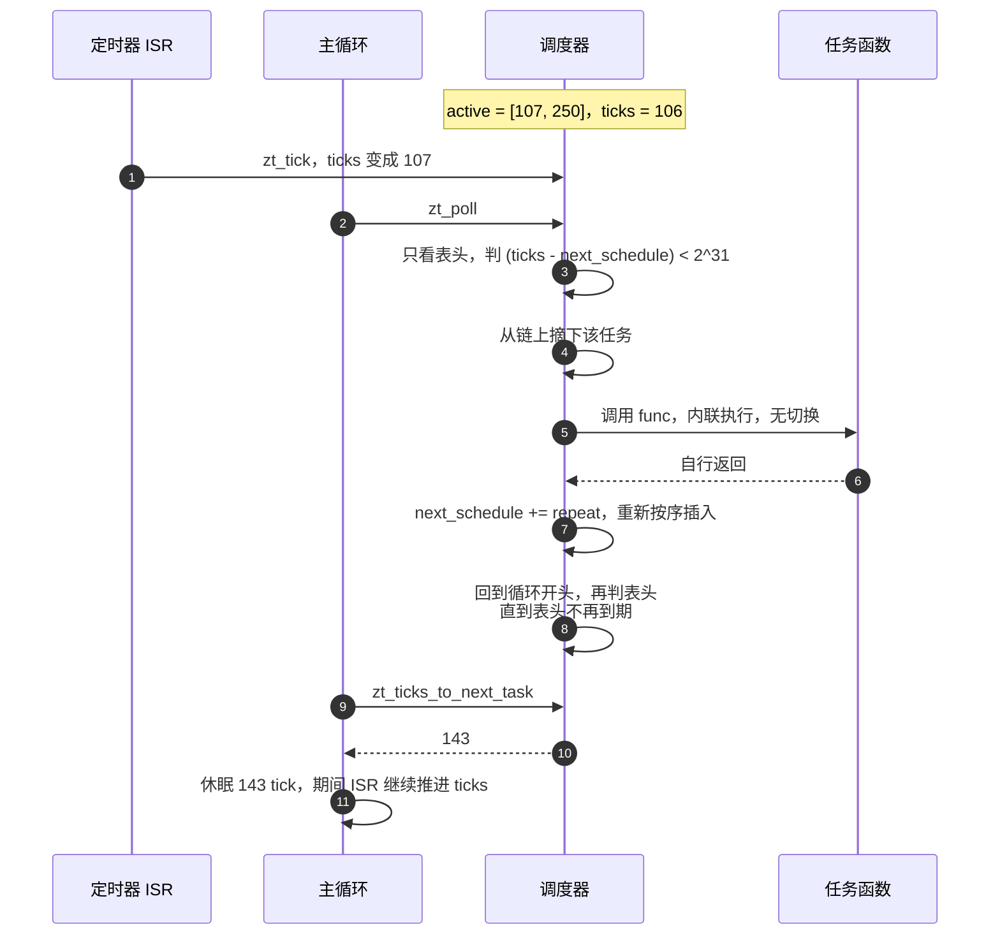
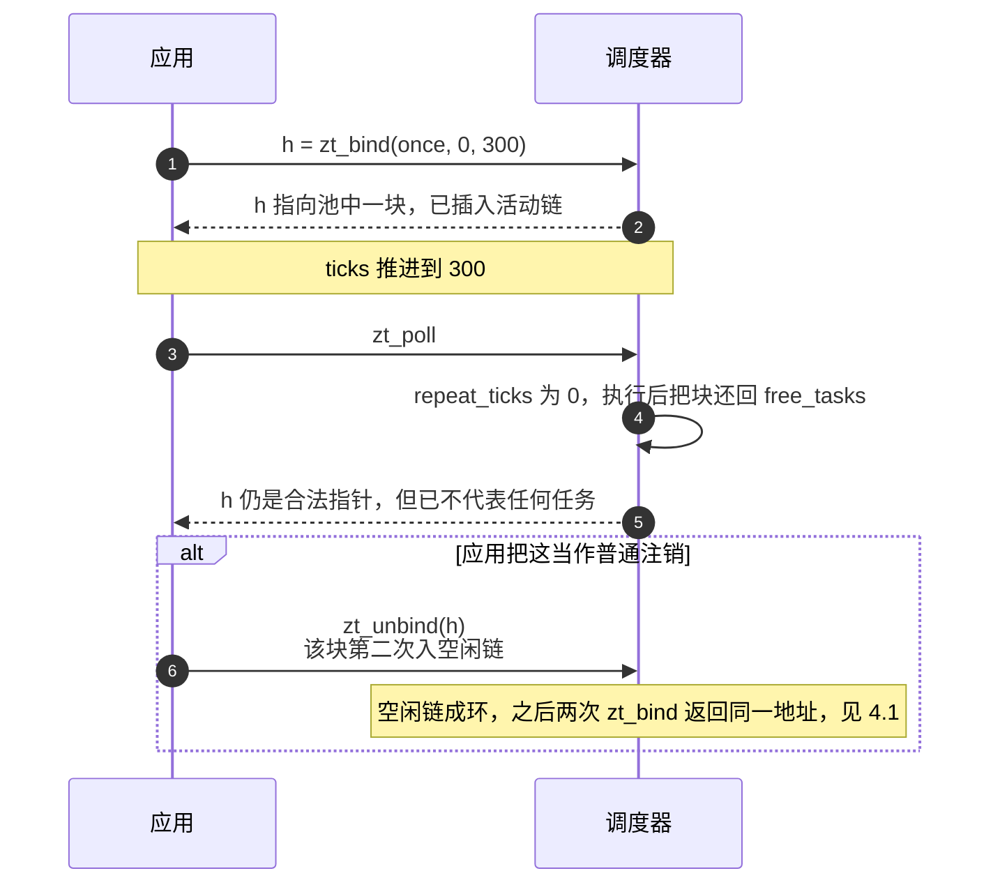

> 结论先行：ztask 的全部机制是「一条按到期时刻升序的单向链表，加一个只看表头的轮询函数」。注册按插入排序入链（O(n)），轮询只判表头是否到期（O(1)），与任务总数无关；不需要堆、不需要栈切换、不需要动态内存。代价集中在四件事上：任务持续超期会让 `zt_poll` 不再返回；一次性任务的句柄在执行完即刻失效，此后调用 `zt_unbind` 会把空闲链破坏；32 位 tick 回绕时，三处时间比较用了两种口径，排序与休眠时长会算错；同一 tick 到期的任务，执行顺序由插入时的比较符决定。这四条是这套设计换来的余量，不是实现漏洞。

## 1. 定位

ztask 把「哪个函数在哪个 tick 执行」记在一张静态表里，由主循环反复调用一个轮询函数来分发。任务在主循环线程里被内联调用，整条链路上没有上下文切换，也没有可抢占点。

| 维度 | 提供 | 不提供 |
|---|---|---|
| 并发模型 | 主循环内联执行任务，任务自行返回 | 抢占、优先级、时间片 |
| 时间 | 单调 tick、周期任务、一次性任务、下次到期时刻 | 绝对时间、日历、超时取消保证 |
| 依赖 | 无，一个 .h 加一个 .c | 内核对象、锁、信号量 |
| 中断 | 只有 `zt_tick` 允许在 ISR 中调用 | 在 ISR 中注册/注销任务、在 ISR 中 poll |

适用范围由四条同时成立的假设划出来：任务数在几十个以内，注册与注销是低频事件；每个任务的执行时间远小于周期且不阻塞；只需要周期与一次性两种语义；主循环在两次到期之间能休眠。任务数只有个位数时，固定数组线性扫描比维护链表更划算；上百个任务时该换跳表或时间轮。第二条是硬边界，违反它的后果最严重，见 4.1。



*图 1：执行拓扑。ISR 只推进 `ticks`；任务函数在主循环线程里被内联调用，所以整条链路上没有一次上下文切换，也没有可抢占点。*

## 2. 数据结构与内存布局

### 2.1 一个上下文、两条链表



*图 2：数据关系。池就是这块内存切成的等长块数组，块在两条链之间来回移动，内容不做二次拷贝。*

三条不变量：`active_tasks` 沿 `next` 链按 `next_schedule` 非递减，表头是最近的到期时刻（只在当前 tick 前后各 2^31 的窗口内成立）；一块 TCB 在任一时刻只能挂在两条链之一上，`free_tasks` 是分配和回收的唯一来源；`ticks` 只由 `zt_tick` 递增，`next_schedule` 只在任务执行后按 `repeat_ticks` 前进。

### 2.2 静态池：池子大小算不出来

`zt_init` 把调用方给的内存按 `sizeof(zt_task_t)` 切块、串成 `free_tasks`，返回块数；`zt_bind` 从头取块，`zt_unbind` 和一次性任务结束后还块，全程没有分配器。但头文件里 `struct zt_task_s` 是不完整类型，调用方既不能 `sizeof` 它，也不能声明它的数组：原文档给的示例 `static uint8_t zt_mem[MAX_TASKS * sizeof(struct zt_task_s)];` 实测报错 `invalid application of 'sizeof' to incomplete type 'struct zt_task_s'`，按字面抄下来跑不起来。最小修法是公开一个「一块任务存储」的类型（附录 A 的 `ztask.h` 里的 `zt_task_store_t`），尺寸随指针宽度自动伸缩，并在 .c 里用两条静态断言把类型的尺寸与对齐锁死；把该类型里的 `raw` 改小，编译立刻失败（实测 `static assertion failed: "ztask: task pool too small"`），不会等到运行时才发现。用 union 而不是 `uint8_t` 数组做池，还顺带给出了对齐保证。


### 2.3 任务的生命周期



*图 3：状态流转。虚线那条边是错误路径：块已经在空闲链上，再归还一次就成环。*

## 3. 调度过程

### 3.1 注册

`zt_bind` 三步：取空闲链头、填 `func` / `repeat_ticks` / `next_schedule = ticks + delay_ticks`、按序插入活动链。首执行时刻由相对延时决定，相位锚定在绑定那一刻：绑定时 tick 为 7、周期 100，就在 107、207、307 执行。插入是线性扫描，成本 O(n)，n 是活跃任务数而不是池容量。落点用严格小于比较：新任务停在第一个到期时刻不早于它的节点之前，因此同一 tick 到期的任务会插到已有同到期任务前面，按绑定顺序倒序执行（实测绑定 A、B、C 得到 A C B）。

### 3.2 轮询



*图 4：一轮调度。判定与执行在一起，所以「判到到期」之后必然执行。*

到期判定用差值 `(ticks - next_schedule) < UINT32_MAX / 2`：把差值当有符号数看，非负即到期，因此对回绕安全，代价是周期必须小于 2^31 tick（1 ms tick 下约 24.8 天）。检查只碰表头，成本与任务总数无关，代价转移到了插入与注销。一次 `zt_poll` 会把所有到期任务执行完（退出条件是表头不再到期），而任务执行期间 ISR 仍在推进 `ticks`，3.3 的追帧现象由此而来。

### 3.3 时间语义：锚定在计划时刻

周期任务重排用的是 `next_schedule += repeat_ticks`，另一类实现（含 tomzbj 原版）记的是「上次执行时刻」：

| | 锚定上次执行时刻（`last = ticks`） | 锚定计划时刻（`next += repeat`，本文） |
|---|---|---|
| 实际周期 | repeat 加执行时间再加轮询延迟，逐周期累积 | 恒等于 repeat，与执行时间无关 |
| 落后之后 | 最多补跑一次，丢掉的周期不再补 | 连续补跑直到追上 |

追帧有多直接：周期 100、停滞 350 tick 不 poll，随后一次 `zt_poll` 会把 3 个周期全部补上，下次到期在 50 tick 之后（见附录 C 的 V1 输出）。任务不适合补跑时，把 `next_schedule += repeat_ticks` 改成 `next_schedule = ticks + repeat_ticks`，代价是周期变成 repeat 加执行时间，且逐周期累积。

### 3.4 休眠链路

主循环三段：`zt_poll`、算休眠、睡。`zt_ticks_to_next_task` 返回 `next_schedule - ticks`（已到期返回 0），没有任务时返回 `UINT32_MAX`，这个哨兵值要单独处理。省电能否兑现取决于三点：tick 源在休眠期间必须继续计数（Stop 模式要选 LPTIM、RTC 这类低功耗下仍在跑的定时器，否则 `ticks` 与真实时间脱钩）；休眠粒度就是一个 tick，真实设备上唤醒只会晚不会早，晚醒只是延后执行，不会漏执行；在 RTOS 上休眠要让出 CPU，而不是空转。

### 3.5 一次性任务与句柄

`zt_bind` 返回的句柄就是池中那块 TCB 的地址，没有槽号，也没有序号：一次性任务执行完由 `zt_poll` 直接还块，句柄在同一刻失效；周期任务被 `zt_unbind` 摘除后还块，句柄同样失效。



*图 5：句柄在任务结束同时失效。指针合法，语义已死。*

## 4. 加固：把边界变成拒绝与计数

上面四类失效加上句柄误用，都能用很少的代码从「偶发、难复现、靠看门狗兜底」改成「当场拒绝，计数器可见」。加固动的是 4.1 列出的几处，任务池类型与 TCB 布局一个字没动；完整清单、演示程序与验证脚本见文末附录。

### 4.1 加固机制

| 机制 | 原版行为 | 加固后 | 实测 |
|---|---|---|---|
| 派发重入 | 回调里再调 `zt_poll`，同一个函数重入改写链表 | `in_poll` 守卫，重入直接拒绝并计数 | 3 次重入全部被拒，随后派发照常 |
| 本轮时间基准 | 每轮判断都重读 `ticks`，任务执行期间新到期的任务在本轮内继续执行 | 进入时冻结 `now`，本轮只派发进入时已到期的任务 | 一轮的派发集合与进入时一致 |
| 回调内绑定 | 回调里 `zt_bind` 的新任务可能在本轮就被派发 | 回调内且 `delay_ticks == 0` 时首执行落在 `ticks + 1` | 当轮 0 次、下一轮 1 次 |
| 一轮预算 | 表头一直到期就不返回 | `ZT_POLL_BUDGET`（默认 8），打满即返回并计数 | 原版一次 poll 连跑 100 001 次；加固版每轮最多 8 次，每次 poll 都返回 |

中间两条针对同一件事：一次回调从开始执行到返回，中间不应该再插进第二个任务的执行。派发循环会接着取下一个到期任务，回调里新注册的任务也可能立刻被执行（该约束的完整论述见 5 节参考）。

| 防护 | 做法 | 实测 |
|---|---|---|
| 野句柄 | 用 `uintptr_t` 做池范围与块边界校验，不用跨对象指针关系比较 | 池外、未对齐、非块起点三类各拒 1 次，调度器仍自洽 |
| 陈旧句柄 | 块不在活动链上就不归还 | 拒绝 1 次；随后两次 `zt_bind` 返回不同块 |
| 自注销 | 记录正在执行的块，回调里 `zt_unbind` 自身句柄时把 `repeat_ticks` 置 0，本轮结束由 `zt_poll` 还块 | 第 3 次运行后停止，块被回收 |
| 超期 | 单次执行不短于周期即记一次 | 369 次，从「看门狗复位」变成可上报的计数器 |

### 4.2 代价与语义变化

| 项 | 原版 | 加固版 |
|---|---|---|
| 代码（Cortex-M4，`-Os`，arm-none-eabi-gcc） | 312 B | 508 B |
| 常驻数据（同上） | 12 B | 52 B |
| 每任务 RAM（32 位目标） | 16 B | 16 B，未变 |
| 空表的 `zt_poll` 调用（x86-64，`-O1`） | 1.0 ns | 2.1 ns |

多出的 40 字节是守卫标志、池边界和 6 个计数器，一次性占用，每任务多 0 字节；加固没有引入锁、没有关中断、没有动态内存。替换原版时，这四条要写进接口约定：

1. 回调内 `zt_bind(func, repeat, 0)` 的首执行落在下一轮 poll，不再可能落在当轮。
2. 一轮最多派发 `ZT_POLL_BUDGET` 个任务；打满时主循环应立刻再调一次 `zt_poll`，此时 `zt_ticks_to_next_task` 返回 0，不会误睡。
3. `zt_unbind` 遇到不合法句柄的行为从「破坏链表」变成「拒绝并累加 `rejected_unbinds`」，调用方可以据此判定手里的句柄已失效。
4. 自注销要求任务保存自己的句柄；不保存句柄的任务只能用 `repeat_ticks == 0` 的一次性形式。

## 5. 参考

| 主题 | 来源 |
|---|---|
| 单次处理不被打断的完整论述（重入约束） | 本博客《MCU 周期任务服务的并发三件套：RMW、RTC 与 AOP》 |
| 原始实现（固定数组 + 线性扫描） | tomzbj/ztask，github.com/tomzbj/ztask |
| 无符号差值比较的写法 | Linux 内核 `include/linux/jiffies.h` 的 `time_before()` |
| 按到期时刻排序的定时器链表 | FreeRTOS `timers.c` |
| 用跳表组织定时器 | RT-Thread `src/timer.c` |
| 时间轮 | Linux 内核 `kernel/time/timer.c` |

## 附录

### 附录 A：完整清单

`ztask.h`：

```c
#ifndef ZTASK_H
#define ZTASK_H

#ifdef __cplusplus
extern "C" {
#endif

#include <stdint.h>
#include <stdbool.h>
#include <stddef.h>

/**
 * @brief Opaque handle to a task structure.
 */
struct zt_task_s;
typedef struct zt_task_s* zt_task_handle_t;

/**
 * @brief Function pointer type for a task.
 */
typedef void (*zt_func_t)(void);

/**
 * @brief Storage for one task. Callers define their pool as an array of this
 * type: the size follows the pointer width of the target (16 bytes on a
 * 32-bit MCU, 24 bytes on a 64-bit host) and the union supplies alignment.
 */
typedef union zt_task_store_u {
    struct zt_task_s *next;
    void             *p;
    uint32_t          u32;
    uint8_t           raw[2u * sizeof(void *) + 8u];
} zt_task_store_t;

/**
 * @brief Diagnostic counters. Read-only for the caller.
 */
typedef struct {
    uint32_t dispatches;          /**< Task dispatches completed. */
    uint32_t overruns;            /**< Dispatches whose run time reached the period. */
    uint32_t budget_hits;         /**< Poll calls that stopped on the per-call budget. */
    uint32_t rejected_polls;      /**< Re-entrant zt_poll calls refused. */
    uint32_t rejected_unbinds;    /**< zt_unbind calls refused (foreign/stale handle). */
    uint32_t deferred_first_runs; /**< Tasks bound inside a callback, first run deferred. */
} zt_stats_t;

/** Maximum number of tasks one zt_poll call may dispatch. */
#ifndef ZT_POLL_BUDGET
#define ZT_POLL_BUDGET 8u
#endif

int32_t zt_init(void *zt_mem, uint32_t size);
zt_task_handle_t zt_bind(zt_func_t func, uint32_t repeat_ticks, uint32_t delay_ticks);
void zt_unbind(zt_task_handle_t task);
void zt_poll(void);
void zt_tick(void);
uint32_t zt_ticks_to_next_task(void);
uint32_t zt_get_ticks(void);

/** Counters snapshot. Never NULL. */
const zt_stats_t *zt_stats(void);

/** Clears the counters. */
void zt_stats_reset(void);

#ifdef __cplusplus
}
#endif

#endif /* ZTASK_H */
```

`ztask.c`：

```c
/*
 * ztask.c - Cooperative periodic-task scheduler, with dispatch guards and
 * handle validation.
 *
 * What the hardening buys, per mechanism:
 *   re-entry guard   - a callback may not call zt_poll again; refused and
 *                      counted.
 *   frozen time base - one pass dispatches from one time base; tasks that come
 *                      due *during* the pass wait for the next call.
 *   deferred bind    - a task bound inside a callback is not dispatched in the
 *                      same pass (its first run lies past the frozen base).
 *   budget           - a pass dispatches at most ZT_POLL_BUDGET tasks, so an
 *                      overrunning task can no longer own the main loop.
 *   overrun counter  - a dispatch that took at least one period is counted.
 *   handle checks    - a foreign, misaligned or stale handle is refused instead
 *                      of being linked into the free list twice.
 *   self-cancel      - a task may unbind itself from inside its own callback.
 *
 * The task control block keeps its four 32-bit fields; every addition lives in
 * the scheduler context, so per-task RAM is unchanged at 16 bytes (32-bit).
 */

#include "ztask.h"

typedef struct zt_task_s {
    zt_func_t func;
    uint32_t  repeat_ticks;
    uint32_t  next_schedule;
    struct zt_task_s *next;
} zt_task_t;

_Static_assert(ZT_POLL_BUDGET > 0u, "ztask: poll budget must be non-zero");
_Static_assert(sizeof(zt_task_t) <= sizeof(zt_task_store_t), "ztask: task pool too small");
_Static_assert(_Alignof(zt_task_t) <= _Alignof(zt_task_store_t), "ztask: task pool misaligned");

static struct {
    volatile uint32_t ticks;
    zt_task_t *active_tasks;
    zt_task_t *free_tasks;
    zt_task_t *running;        /* block of the callback in progress, else NULL */
    const uint8_t *pool_base;
    const uint8_t *pool_end;
    uint8_t    in_poll;
    zt_stats_t stats;
} g_ztask_ctx;

/* --- Internal helpers --- */

/* Modular order: true when a lies before b within half of the tick range.
 * This is the only comparison the scheduler is allowed to use on tick values;
 * plain < and > mis-sort the list and mis-compute the sleep length across the
 * 32-bit wrap. */
static bool zt_before(const uint32_t a, const uint32_t b)
{
    return ((int32_t)(a - b) < 0);
}

/* A handle is usable when it points at the start of a block inside our pool. */
static bool zt_handle_ok(const zt_task_t *task)
{
    const uintptr_t handle = (uintptr_t)task;
    const uintptr_t base   = (uintptr_t)g_ztask_ctx.pool_base;

    if ((handle < base) || ((handle - base) % sizeof(zt_task_t) != 0u)) { return false; }
    if (handle + sizeof(zt_task_t) > (uintptr_t)g_ztask_ctx.pool_end) { return false; }
    return true;
}

static void zt_insert_task(zt_task_t * const task)
{
    if ( (g_ztask_ctx.active_tasks == NULL) ||
         zt_before(task->next_schedule, g_ztask_ctx.active_tasks->next_schedule) )
    {
        task->next = g_ztask_ctx.active_tasks;
        g_ztask_ctx.active_tasks = task;
    }
    else
    {
        zt_task_t *current = g_ztask_ctx.active_tasks;
        while ( (current->next != NULL) &&
                zt_before(current->next->next_schedule, task->next_schedule) )
        {
            current = current->next;
        }
        task->next = current->next;
        current->next = task;
    }
}

/* Unlinks task from the active list. Returns false when it is not there. */
static bool zt_list_remove(zt_task_t * const task)
{
    if (g_ztask_ctx.active_tasks == task)
    {
        g_ztask_ctx.active_tasks = task->next;
        return true;
    }
    else
    {
        zt_task_t *current = g_ztask_ctx.active_tasks;
        while ((current != NULL) && (current->next != task))
        {
            current = current->next;
        }
        if (current == NULL)
        {
            return false;
        }
        current->next = task->next;
        return true;
    }
}

static void zt_release_block(zt_task_t * const task)
{
    task->next = g_ztask_ctx.free_tasks;
    g_ztask_ctx.free_tasks = task;
}

/* --- Public API --- */

int32_t zt_init(void * const zt_mem, const uint32_t size)
{
    uint32_t num_tasks;
    uint8_t *mem_ptr;
    zt_task_t *current;
    uint32_t i;

    if ( (zt_mem == NULL) || (size < sizeof(zt_task_t)) )
    {
        return -1;
    }

    mem_ptr   = (uint8_t *)zt_mem;
    num_tasks = size / (uint32_t)sizeof(zt_task_t);

    g_ztask_ctx.ticks        = 0U;
    g_ztask_ctx.active_tasks = NULL;
    g_ztask_ctx.free_tasks   = (zt_task_t *)mem_ptr;
    g_ztask_ctx.running      = NULL;
    g_ztask_ctx.pool_base    = mem_ptr;
    g_ztask_ctx.pool_end     = mem_ptr + (num_tasks * sizeof(zt_task_t));
    g_ztask_ctx.in_poll      = 0U;
    zt_stats_reset();

    current = g_ztask_ctx.free_tasks;
    for (i = 0U; i < (num_tasks - 1U); ++i)
    {
        mem_ptr += sizeof(zt_task_t);
        current->next = (zt_task_t *)mem_ptr;
        current = current->next;
    }
    current->next = NULL;

    return (int32_t)num_tasks;
}

void zt_tick(void)
{
    g_ztask_ctx.ticks++;
}

uint32_t zt_get_ticks(void)
{
    return g_ztask_ctx.ticks;
}

const zt_stats_t *zt_stats(void)
{
    return &g_ztask_ctx.stats;
}

void zt_stats_reset(void)
{
    g_ztask_ctx.stats.dispatches          = 0U;
    g_ztask_ctx.stats.overruns            = 0U;
    g_ztask_ctx.stats.budget_hits         = 0U;
    g_ztask_ctx.stats.rejected_polls      = 0U;
    g_ztask_ctx.stats.rejected_unbinds    = 0U;
    g_ztask_ctx.stats.deferred_first_runs = 0U;
}

zt_task_handle_t zt_bind(zt_func_t const func, const uint32_t repeat_ticks, const uint32_t delay_ticks)
{
    zt_task_t *new_task;
    uint32_t first_delay = delay_ticks;

    if (func == NULL)
    {
        return NULL;
    }

    new_task = g_ztask_ctx.free_tasks;
    if (new_task == NULL)
    {
        return NULL;                      /* pool exhausted */
    }
    g_ztask_ctx.free_tasks = new_task->next;

    /* A task bound from inside a callback must not be dispatched in the same
     * pass: its first due time is pushed past the pass's frozen base. */
    if ( (g_ztask_ctx.in_poll != 0U) && (first_delay == 0U) )
    {
        first_delay = 1U;
        g_ztask_ctx.stats.deferred_first_runs++;
    }

    new_task->func          = func;
    new_task->repeat_ticks  = repeat_ticks;
    new_task->next_schedule = g_ztask_ctx.ticks + first_delay;
    zt_insert_task(new_task);

    return new_task;
}

void zt_unbind(zt_task_handle_t const task)
{
    zt_task_t * const to_remove = (zt_task_t *)task;

    if (task == NULL)
    {
        return;
    }
    if (!zt_handle_ok(to_remove))
    {
        g_ztask_ctx.stats.rejected_unbinds++;   /* foreign or misaligned pointer */
        return;
    }

    /* Self-cancellation from inside the callback: the block is not on the active
     * list at this moment (zt_poll already popped it). Marking it as one-shot
     * makes zt_poll return it to the pool once the callback has returned. */
    if (to_remove == g_ztask_ctx.running)
    {
        to_remove->repeat_ticks = 0U;
        return;
    }

    /* A stale handle - one whose block was already returned - is refused; the
     * block is never linked into the free list twice. */
    if (!zt_list_remove(to_remove))
    {
        g_ztask_ctx.stats.rejected_unbinds++;
        return;
    }

    zt_release_block(to_remove);
}

void zt_poll(void)
{
    uint32_t now;
    uint8_t  budget = (uint8_t)ZT_POLL_BUDGET;

    if (g_ztask_ctx.in_poll != 0U)
    {
        g_ztask_ctx.stats.rejected_polls++;     /* re-entry guard */
        return;
    }
    g_ztask_ctx.in_poll = 1U;

    now = g_ztask_ctx.ticks;                    /* one time base for the pass */

    while (budget > 0U)
    {
        zt_task_t *task = g_ztask_ctx.active_tasks;
        uint32_t started;

        if (task == NULL)
        {
            break;
        }
        if (zt_before(now, task->next_schedule))
        {
            break;                              /* head is not due yet */
        }

        g_ztask_ctx.active_tasks = task->next;
        task->next = NULL;

        g_ztask_ctx.running = task;
        started = g_ztask_ctx.ticks;
        task->func();                           /* the callback must return */
        g_ztask_ctx.running = NULL;

        g_ztask_ctx.stats.dispatches++;

        if (task->repeat_ticks > 0U)
        {
            if ((g_ztask_ctx.ticks - started) >= task->repeat_ticks)
            {
                g_ztask_ctx.stats.overruns++;   /* the task did not complete in time */
            }
            task->next_schedule += task->repeat_ticks;
            zt_insert_task(task);
        }
        else
        {
            zt_release_block(task);
        }

        budget--;
    }

    if ( (budget == 0U) && (g_ztask_ctx.active_tasks != NULL) &&
         (!zt_before(now, g_ztask_ctx.active_tasks->next_schedule)) )
    {
        g_ztask_ctx.stats.budget_hits++;        /* more due work waits for the next call */
    }

    g_ztask_ctx.in_poll = 0U;
}

uint32_t zt_ticks_to_next_task(void)
{
    const zt_task_t *task = g_ztask_ctx.active_tasks;
    uint32_t next_event_in;

    if (task == NULL)
    {
        next_event_in = UINT32_MAX;
    }
    else
    {
        const uint32_t now    = g_ztask_ctx.ticks;
        const uint32_t remain = task->next_schedule - now;

        /* Same convention as the due test in zt_poll: a remainder below 2^31
         * means "still ahead", anything else means "already due". */
        next_event_in = (remain < (UINT32_MAX / 2U)) ? remain : 0U;
    }

    return next_event_in;
}
```

### 附录 B：演示程序与实测输出

主循环的三段结构都在：推进 ticks（模拟 1 ms 中断）、poll、按算出的时长休眠。ticks 从 0 开始，与真实设备一致；时钟源用单调时钟，避免把系统时间直接当 tick 总数喂进去，否则绑定时的 100 tick 延时早就过期，第一个 `zt_poll` 会先补跑上千万个周期。

```c
#include <stdio.h>
#include <time.h>
#include "ztask.h"

#define ZT_MAX_TASKS 8
static zt_task_store_t  zt_pool[ZT_MAX_TASKS];
static zt_task_handle_t h_report;
static zt_task_handle_t h_sample;
static uint32_t         t0_ms;

static uint32_t now_ms(void)
{
    struct timespec ts;
    clock_gettime(CLOCK_MONOTONIC, &ts);
    return (uint32_t)(ts.tv_sec * 1000u + ts.tv_nsec / 1000000u);
}

static void task_sample(void) { printf("[%4u] sample\n", zt_get_ticks()); }
static void task_report(void) { printf("[%4u] report\n", zt_get_ticks()); }
static void task_once(void)   { printf("[%4u] once\n",   zt_get_ticks()); }
static void task_stop(void)
{
    printf("[%4u] stop: unbind report\n", zt_get_ticks());
    zt_unbind(h_report);
    h_report = NULL;                       /* the handle is dead after this */
}

int main(void)
{
    t0_ms = now_ms();
    zt_init(zt_pool, sizeof(zt_pool));     /* ticks start at 0, as on a real MCU */

    h_sample = zt_bind(task_sample, 100, 100);
    h_report = zt_bind(task_report, 250, 250);
    zt_bind(task_once, 0, 300);            /* one-shot, handle not kept */
    zt_bind(task_stop, 0, 800);

    while (zt_get_ticks() < 1000u) {
        const uint32_t elapsed = now_ms() - t0_ms;
        while (zt_get_ticks() < elapsed) { zt_tick(); }   /* stand-in for the 1 ms ISR */

        zt_poll();

        const uint32_t sleep_ticks = zt_ticks_to_next_task();
        if (sleep_ticks == UINT32_MAX) { printf("no task left\n"); break; }
        if (sleep_ticks > 0u) {
            struct timespec req = { 0, (long)sleep_ticks * 1000000L };
            nanosleep(&req, NULL);
        }
    }

    zt_unbind(h_sample);
    printf("[%4u] unbind sample, ticks_to_next_task = %u (UINT32_MAX = %u)\n",
           zt_get_ticks(), zt_ticks_to_next_task(), UINT32_MAX);
    return 0;
}
```

编译运行 `gcc -std=gnu11 -Wall -Wextra -O1 -o demo demo.c ztask.c && ./demo`，实测输出（记录自一次运行；tick 打印值随主机调度有 1 到 2 tick 的浮动，任务顺序不变）：

```text
[ 101] sample
[ 200] sample
[ 250] report
[ 300] sample
[ 300] once
[ 400] sample
[ 500] report
[ 500] sample
[ 600] sample
[ 700] sample
[ 750] report
[ 800] sample
[ 800] stop: unbind report
[ 901] sample
[1000] sample
[1000] unbind sample, ticks_to_next_task = 4294967295 (UINT32_MAX = 4294967295)
```

### 附录 C：验证脚本与两版对照

下面这段不依赖时钟，手工推进 tick，复现 3.3 的追帧（V1）与 4.1 提到的重复归还（V4）；同一份脚本分别链原实现与加固版，输出如下。

```c
#include <stdio.h>
#include <stdint.h>
#include "ztask.h"

#define ZT_MAX_TASKS 8
static zt_task_store_t  zt_pool[ZT_MAX_TASKS];

static int  runs;
static void task_periodic(void) { runs++; }
static void task_noop(void) {}

int main(void)
{
    /* V1: a 350-tick stall against a 100-tick period */
    zt_init(zt_pool, sizeof(zt_pool));
    zt_bind(task_periodic, 100, 100);
    while (zt_get_ticks() < 350U) { zt_tick(); }
    zt_poll();
    printf("V1  stall 350 ticks, period 100 -> runs in one poll = %d, next due in %u ticks\n",
           runs, zt_ticks_to_next_task());

    /* V4: unbinding a one-shot task again after it has run */
    zt_init(zt_pool, sizeof(zt_pool));
    zt_task_handle_t h = zt_bind(task_noop, 0, 1);
    zt_tick(); zt_poll();            /* runs once, the block goes back to the pool */
    zt_unbind(h);                    /* the handle is stale */
    zt_task_handle_t p = zt_bind(task_noop, 0, 1000);
    zt_task_handle_t q = zt_bind(task_noop, 0, 1000);
    printf("V4  two binds after the stale unbind -> %s\n",
           (p == q) ? "same block (aliased)" : "two distinct blocks");
    return 0;
}
```

```text
V1  stall 350 ticks, period 100 -> runs in one poll = 3, next due in 50 ticks
V4  two binds after the stale unbind -> same block (aliased)
```
```text
V1  stall 350 ticks, period 100 -> runs in one poll = 3, next due in 50 ticks
V4  two binds after the stale unbind -> two distinct blocks
```
