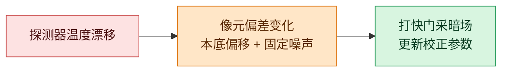
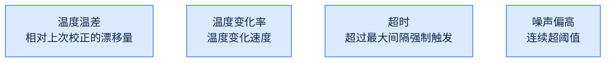
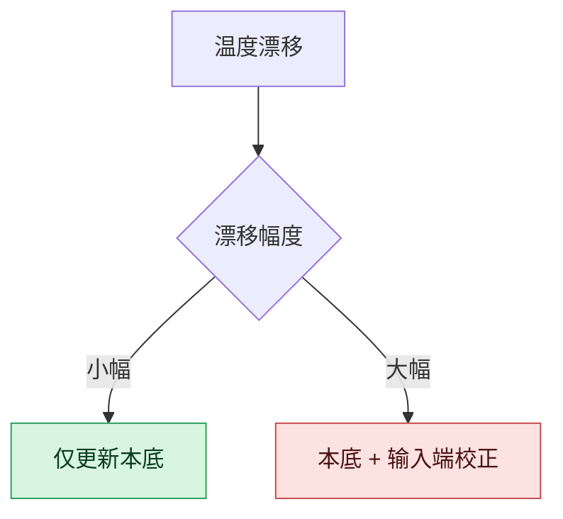
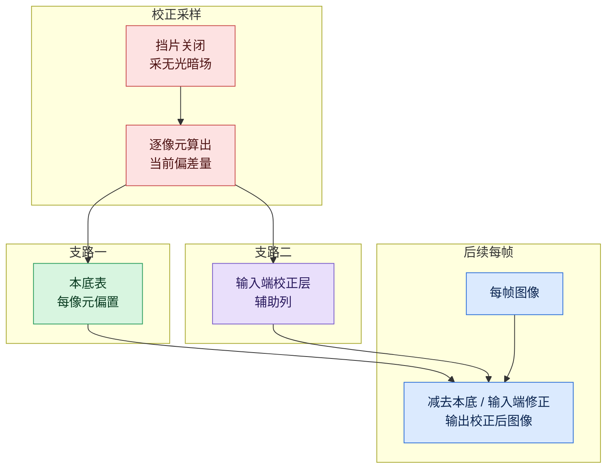
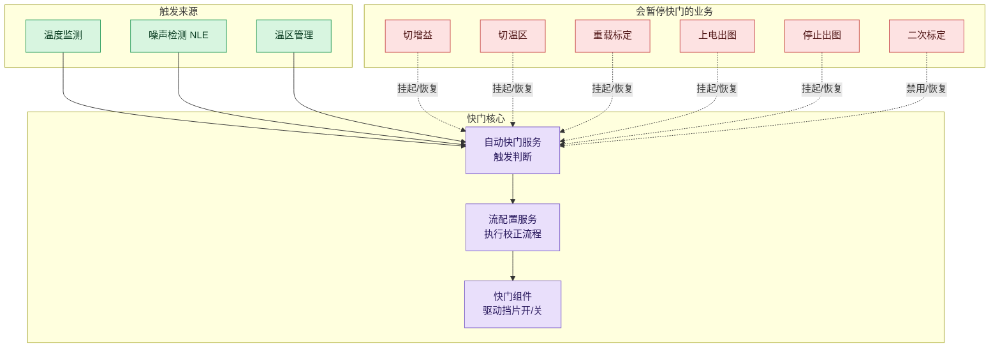
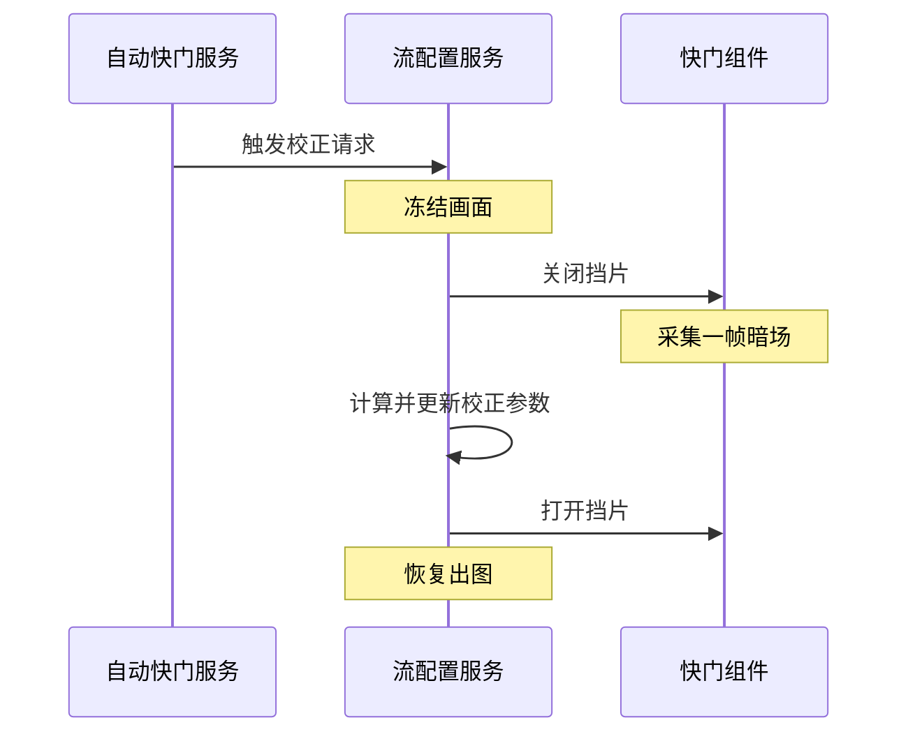
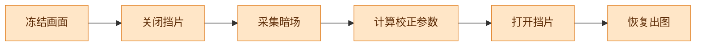
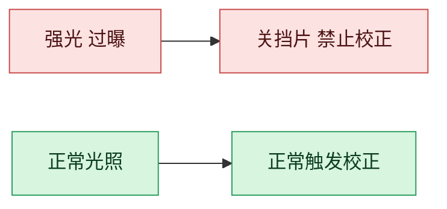

# 快门校正（打快门）机制说明

本文说明红外相机中「打快门」机制，包括其必要性、触发条件、关联业务及协同方式。文中专业术语首次出现时以括号说明。

## 一、结论

「打快门」并非机械相机的曝光，而是红外成像中的**平场校正（FFC，Flat Field Correction）**：驱动镜头前的挡片短暂遮挡入射光，探测器在无光状态下采集一帧「暗场」作为参考，据此修正各像元因温度漂移产生的偏差，以维持成像与测温精度。

## 二、原理

红外探测器为焦平面阵列（FPA），阵列由大量感光像元组成。各像元对相同输入的响应本就不完全一致（即非均匀性），且该非均匀性随**探测器温度**漂移。

温度变化时，同一目标呈现不同灰度，画面产生本底偏移与固定图案噪声，测温精度随之下降。

打快门的本质是**定期采集无光暗场，测得各像元当前的偏差并将该偏差减去**。

## 三、触发条件

自动快门服务周期性检查若干信号，满足任一条件即触发一次校正。触发来源如下：

| 触发来源 | 说明 |
|---|---|
| 温度温差 | 探测器温度相对上次校正的变化量超过门限 |
| 温度变化率 | 温度变化速度超过门限 |
| 超时 | 距上次校正超过最大间隔，强制触发 |
| 噪声偏高 | 画面噪声水平连续超过门限 |

其中，温度信号是主要依据之一，但并非唯一依据，超时与噪声同样可触发。

### 分档触发

触发时按漂移幅度分两档处理：

- **小幅漂移**：仅修正本底。
- **大幅漂移（长迁）**：本底与输入端校正两项均需更新。

### 两类校正项的差异

校正背后是「每个像元一套系数」的模型，包含两类系数：

- **本底（偏置）**：各像元无光时的偏置值，相当于一条基准线。温度小幅漂移时，本底整体平移，仅更新本底即可。
- **输入端校正（OOC）**：探测器输入侧更精细的一层校正，配合每行末尾的辅助列，校正像元间更细的差异。

两者的关系：

- 温度小幅漂移：变化集中在本底平移，仅修本底。
- 温度大幅漂移（长迁）：本底与像元间相对差异、非线性均改变，须将输入端校正一并更新。

校正模型如下，探测器各像元均有一套校正系数，分两条支路参与校正。

校正模型分三层：

1. **采样**：挡片遮挡光线，探测器采集一帧暗场，得到各像元无光时的偏差。
2. **写入系数**：将偏差分别写入本底表与输入端校正层。
3. **逐帧应用**：后续每帧依次减去本底、执行输入端修正，输出校正后图像。

温度小幅漂移仅刷新本底表；温度大幅漂移则本底表与输入端校正层均刷新。

该分档设计在保证校正效果的前提下降低开销：小幅漂移频繁，采用轻量的仅本底更新；大幅漂移较少，采用更完整的本底 + 输入端校正更新。

## 四、关联业务

打快门并非独立动作，与多个业务模块存在联动，其整体关联拓扑如下：

联动关系如下：

1. 触发来源将信号交给自动快门服务，由其判断是否触发。
2. 触发成立后，由流配置服务执行校正流程。
3. 校正流程最终作用于快门组件，驱动挡片开、关。
4. 切增益、切温区、重载标定等会改变温度或图像状态的业务，在执行期间暂停自动快门以避免误触发，结束后恢复。

## 五、校正流程

校正流程要点为：先冻结画面，再执行挡片校正，最后恢复。

关键步骤：

## 六、过曝保护

当镜头正对强光，为避免探测器受损，系统立即关闭挡片，并禁止再次打开与触发校正，直至强光条件解除。

## 七、控制接口

对外控制能力分两类：

| 类别 | 能力 |
|---|---|
| 挡片控制 | 开/关挡片、查询挡片状态 |
| 自动快门 | 启用/停用自动校正、查询下次触发时刻、查询是否被暂停 |

业务与自动快门的暂停与恢复，统一通过一组通知接口实现：业务开始前暂停，结束后恢复；若无其他业务占用，自动快门继续工作。二次标定等流程则直接禁用并恢复自动快门。

## 八、总结

1. 打快门即平场校正，利用无光暗场修正温度漂移引起的像元偏差。
2. 触发来源包括温度温差、温度变化率、超时、噪声，分普通与长迁两档。
3. 关联业务包括流配置、温区管理、增益/温区切换、重载标定、二次标定等，拓扑见第四节。
4. 各业务通过暂停/恢复协议与自动快门协同，避免执行业务期间误触发。
