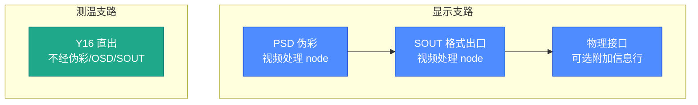
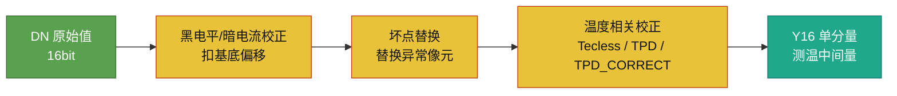
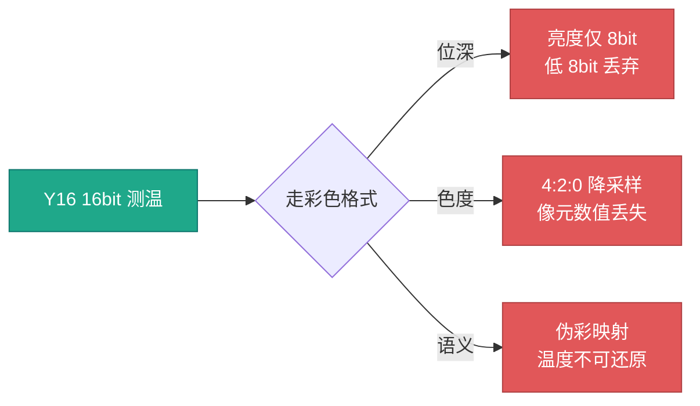
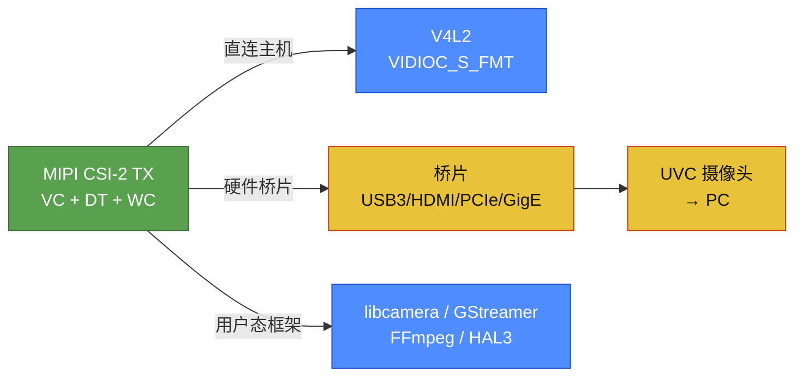

# 红外测温与显示的双路径链路设计

红外机芯的出图链路,常被画成一条直线:「传感器 → ISP → 显示」。这个画法漏掉了红外与可见光相机的结构差异:**测温与显示对数据的要求相反,必须在链路中途分流**。测温要 14/16bit 位深保精度,显示要 8bit 彩色格式省带宽;一个不能丢信息,一个必须降采样。

## 1. 链路总体结构

传感器到 ISP 是测温与显示**共用**的前段;ISP 出口处分流:上支过伪彩变彩色用于显示,下支直接保留 Y16 用于测温。

### 链路总览图(SVG)

<svg width="760" viewBox="0 0 760 380" xmlns="http://www.w3.org/2000/svg" font-family="sans-serif" font-size="13">
  <defs><marker id="ar" viewBox="0 0 10 10" refX="9" refY="5" markerWidth="9" markerHeight="9" orient="auto-start-reverse"><path d="M0 0 L10 5 L0 10 z" fill="#666"/></marker></defs>

  <rect x="15" y="60" width="110" height="60" rx="8" fill="#4e79a7"/>
  <text x="70" y="85" fill="#fff" text-anchor="middle" font-weight="bold">传感器</text>
  <text x="70" y="104" fill="#dfe7f0" text-anchor="middle" font-size="11">RAW 温度值</text>
  <line x1="125" y1="90" x2="155" y2="90" stroke="#666" marker-end="url(#ar)"/>

  <rect x="158" y="40" width="150" height="100" rx="8" fill="#59a14f"/>
  <text x="233" y="62" fill="#fff" text-anchor="middle" font-weight="bold">ISP 流水线</text>
  <text x="233" y="80" fill="#e8f5e6" text-anchor="middle" font-size="11">黑电平 · 坏点 · 温度校正</text>
  <text x="233" y="100" fill="#e8f5e6" text-anchor="middle" font-size="11">输出 Y16</text>
  <text x="233" y="118" fill="#cfe8cb" text-anchor="middle" font-size="10">（单通道 16bit）</text>
  <line x1="308" y1="90" x2="338" y2="90" stroke="#666" marker-end="url(#ar)"/>

  <circle cx="345" cy="90" r="4" fill="#666"/>
  <line x1="345" y1="90" x2="360" y2="50" stroke="#666" marker-end="url(#ar)"/>
  <line x1="345" y1="90" x2="360" y2="130" stroke="#666" marker-end="url(#ar)"/>

  <rect x="363" y="15" width="120" height="72" rx="8" fill="#e15759"/>
  <text x="423" y="38" fill="#fff" text-anchor="middle" font-weight="bold">伪彩查表</text>
  <text x="423" y="55" fill="#fbe3e3" text-anchor="middle" font-size="11">温度→颜色</text>
  <text x="423" y="72" fill="#fbe3e3" text-anchor="middle" font-size="10">（PSD 节点）</text>
  <line x1="483" y1="51" x2="513" y2="51" stroke="#666" marker-end="url(#ar)"/>

  <rect x="516" y="15" width="105" height="72" rx="8" fill="#edc949"/>
  <text x="568" y="38" fill="#5a4f05" text-anchor="middle" font-weight="bold">SOUT</text>
  <text x="568" y="55" fill="#6b5d0a" text-anchor="middle" font-size="11">格式转换</text>
  <text x="568" y="72" fill="#6b5d0a" text-anchor="middle" font-size="10">NV12/YU16</text>
  <line x1="621" y1="51" x2="651" y2="51" stroke="#666" marker-end="url(#ar)"/>

  <rect x="654" y="10" width="95" height="82" rx="8" fill="#b07aa1"/>
  <text x="701" y="33" fill="#fff" text-anchor="middle" font-weight="bold">MIPI</text>
  <text x="701" y="50" fill="#f1e6ef" text-anchor="middle" font-size="11">CSI-2</text>
  <text x="701" y="67" fill="#f1e6ef" text-anchor="middle" font-size="10">桥片/V4L2</text>
  <text x="701" y="81" fill="#f1e6ef" text-anchor="middle" font-size="9">上位机</text>

  <rect x="363" y="95" width="120" height="55" rx="8" fill="#f28e2b"/>
  <text x="423" y="117" fill="#fff" text-anchor="middle" font-weight="bold">测温路径</text>
  <text x="423" y="136" fill="#fde4cc" text-anchor="middle" font-size="11">保 Y16 · 16bit</text>

  <rect x="20" y="200" width="720" height="150" rx="8" fill="#f7f8fa"/>
  <text x="40" y="225" fill="#333" font-weight="bold">阅读要点</text>
  <circle cx="45" cy="245" r="6" fill="#59a14f"/>
  <text x="60" y="249" fill="#444" font-size="12">共用前段：传感器→ISP（测温/显示共用）</text>
  <circle cx="45" cy="268" r="6" fill="#e15759"/>
  <text x="60" y="272" fill="#444" font-size="12">上支（显示）：过伪彩上色 → SOUT 转 NV12/YU16 → MIPI</text>
  <circle cx="45" cy="291" r="6" fill="#f28e2b"/>
  <text x="60" y="295" fill="#444" font-size="12">下支（测温）：不过伪彩，直接保 Y16 16bit</text>
  <circle cx="45" cy="314" r="6" fill="#edc949"/>
  <text x="60" y="318" fill="#444" font-size="12">SOUT 是格式出口：NV12(4:2:0)/YU16(4:2:2) 由 SOUT 节点转出</text>
</svg>

*图 1:链路总览(横排 SVG 版)。上支显示经伪彩、SOUT 到 MIPI;下支测温直接保 Y16。*

### 文字版管线

```text
[传感器] → [ISP流水线] ──→ [伪彩] → [SOUT] → [MIPI] ──→ 上位机(显示)
 采RAW     黑电平/坏点    温度→颜色  NV12/YU16   CSI-2    桥片/V4L2
   │        温度校正          (PSD)    格式转换    传输
   │        输出Y16 16bit      │
   ├──────────────────────────┘  (只走一条, 见下)
   ▼
 测温路径: 不过伪彩, 直接保 Y16 16bit → 上传/分析
```

### 节点职责分工

显示支路内部,「伪彩」和「SOUT」是相邻但职责不同的两个节点:伪彩是数据语义的转折点,SOUT 是数据格式的出口。



*图 2:节点职责分工。伪彩管语义(温度→颜色),SOUT 管格式(→NV12/YU16);测温支路两者都不经过。*

### 总览图的五个要点

1. **共用前段**:传感器 → ISP(黑电平/坏点/温度校正)是测温与显示两路的公共部分
2. **分流点**:ISP 出口处分叉,显示走伪彩,测温直接保留 Y16
3. **伪彩(PSD 节点)**:温度值 → 颜色,是「从单通道变彩色」的转折
4. **SOUT 节点**:转成 NV12(4:2:0) / YU16(4:2:2) 紧凑格式
5. **MIPI + CSI-2**:经桥片转 USB 或直连主机 V4L2 到上位机

这五个要点对应后续各节:第 2 节展开共用前段,第 3 节讲分流为什么必要,第 4、5 节分别讲两条支路的关键节点,第 6 节落到传输出口。

## 2. 前段处理:传感器数据到 Y16 的转换

传感器(IRFPA)逐行扫描、逐列读出,输出 16bit DN 值。**DN 是探测器采样值,不等于灰度,更不等于温度**,同时受目标辐射、探测器状态、环境透过率、发射率、距离和湿度影响。

ISP 流水线在前段做三类校正:



*图 3:前段校正链。DN 依次经三类校正成为 Y16 测温中间量,这一段为两条支路共用。*

| 处理 | 作用 | 说明 |
|---|---|---|
| 黑电平/暗电流校正 | 扣除无光照时的基底偏移 | DC 模块 |
| 坏点替换 | 检测并替换响应异常的像元 | DPC 模块 |
| 温度相关校正 | 逐步把 DN 换算到测温中间量 | Tecless、TPD、TPD_CORRECT 等 |

前段的输出是 Y16 单分量数据。此后分出 PIC 与 TEMP 两种**流语义**:

- **PIC 流**:服务于观察与显示,后级串伪彩、OSD、SOUT
- **TEMP 流**:服务于单分量测温数据传递,常见 Y16 容器,不经这些后级

**Y16 是容器格式,不是温度本身。** 数值是工程定义的测温中间量,不自动等于摄氏度。从 DN 到温度码要经过标定表、Tecless、TPD 一整条链,不是一个线性公式。

这个结构在定位问题时很直接:前段任一校正环节出错,两条支路同时异常;只有 PIC 或只有 TEMP 异常时,问题限定在对应的后级支路里。前段查共因,支路查各自。


## 3. 测温数据不宜采用彩色格式的原因

把 Y16 测温数据塞进彩色格式送出去,有三重代价。

**位深塌缩。** YUV 类格式的亮度分量只有 8bit,而测温需要 14/16bit。16bit 量化到 8bit,丢掉的低 8 位是温度分辨率的主体。这个损失不可逆,接收端拿到的已经是残量。

**色度降采样。** NV12 是 4:2:0 采样,色度在水平和垂直方向各降一半。对显示,这是合理压缩,人眼对色度不敏感;对测温,每个像元的数值都有物理含义,丢掉的不是「人眼看不出」的部分,是「温度算不准」的部分。

**语义污染。** 彩色格式里没有「温度」这个概念。测温数据经过伪彩映射后,温度信息被揉进颜色里,接收端拿到的只剩亮度和色度,没有逆变换可以还原。



*图 4:测温数据走彩色格式的三重代价。*

结论:**测温支路绕开伪彩,以 Y16 容器输出;显示支路走「温度值 → 颜色」的伪彩映射。** 两条支路是同一份数据的两种交付形态。「一根传感器、两个出口」是红外机芯的常态,由数据本身的两种用途决定。


## 4. 显示路径:伪彩的温度映射

伪彩(Pseudo-color)由视频处理侧的 PSD 节点完成,不在 ISP 内。它做一件事:**把 Y16 单分量映射为颜色**。查表方式由伪彩表类型决定:

| 表类型 | 机制 | 可调项 |
|---|---|---|
| YUV | Y16 → YUV 查表 | 亮度 / 对比度 / 饱和度 |
| RGB | Y16 → RGB 查表 + 3×3 矩阵 + 偏置 | 色彩矩阵 |

场景模式覆盖常规 AGC、等温(ISOTHERM)、黑热、灰度、USER 等;表文件、温度上下限、附加信息行由配置下发。等温模式按温度区间做高低阈值着色,把「哪里热、哪里冷」的梯度直接画出来,是红外特有的可视化需求。

对显示,伪彩是有损压缩的开始,但这个损失是故意的:人眼对 16bit 灰度的分辨能力远低于 8bit,把温度分布转成颜色分布反而利于观察。要点不在「伪彩有没有损」,而在**伪彩只服务显示,不碰测温**。

NV12、YU16 这些传输格式由 SOUT 节点负责,测温支路也在同一个节点上与显示支路会合。

## 5. SOUT 出口:显示路径转换格式,测温路径保持原样

两条支路都汇到 SOUT(Stream Out)这个节点上,但用法不同。

SOUT 做三件事:

| 职责 | 说明 |
|---|---|
| 格式转换 | YUV/RGB → NV12/NV21、NV16/NV61、YU16/YV16 等,及 24→16bit、16→8bit 位深压缩 |
| 尺寸裁剪 | 输出宽高可裁剪,可叠加附加信息行(帧号、宽高、焦距、测温标志等) |
| 二级 DMA 搬运 | 乒乓/三缓冲搬运,把重排后的帧送往物理接口 |

SOUT 是「数据格式」与「传输协议」之间的边界:之前,格式是内部的、可变的;之后,格式被声明给接收端,接收端按声明解包。

两条支路在 SOUT 层的分工:

- **显示支路**:完整经过伪彩 → SOUT,SOUT 把彩色数据转成 NV12/YU16 送显示。NV12 要求宽高为 4 的倍数。
- **测温支路**:不经伪彩、不经 OSD,SOUT 只保持 Y16 容器原样输出(或最小重排),位深不降、色度不采样。

同一个节点,两种用法:**显示支路在这里改变格式,测温支路在这里保持格式**,靠流入的流语义区分。


## 6. 输出接口:MIPI 的标识与声明

两条支路最终汇入物理接口。以 MIPI CSI-2 为例,每个包靠三个字段说明「这一包是什么、给谁」:

| 字段 | 全称 | 作用 |
|---|---|---|
| VC | Virtual Channel | 同一条物理链路上区分多路流的逻辑通道 |
| DT | Data Type | 声明像素类型,如 YUV422 8-bit(`0x1E`)、Y16(`0x2E`) |
| WC | Word Count | 包负载长度,接收端据此分配缓冲 |

接收端的几种方式:



*图 5:CSI-2 数据的三种接收方式。无论哪种,都要核对 lane 数、时钟模式、VC、data type、word count 与发送端一致。*

| 方式 | 路径 | 说明 |
|---|---|---|
| MIPI 直连主机 | V4L2(`VIDIOC_S_FMT` 四字符码与 TX 一致) | 标准路径,格式码不匹配即失败 |
| 硬件桥片 | MIPI → USB3/HDMI/PCIe/GigE | 对 PC 呈现为 UVC 摄像头 |
| 用户态框架 | libcamera、GStreamer/FFmpeg、Android HAL3 | 内核之上再封装 |

内核层替代还有裸机/DMA、FPGA、厂商私有驱动。无论哪种接收方式,核对的东西不变:**lane 数、时钟模式、VC、data type、word count 与发送端匹配**。

链路上每一处「声明」都可能与实际负载脱节:SOUT 声明输出格式,CSI-2 包头声明 DT,UVC 描述符声明帧格式。声明与负载不一致,接收端就按错误的方式解包,画面错位、颜色错乱,甚至不认。所以在任何协议出口,先确认「声明的东西」和「实际的东西」是同一个,再去查数据。这条原则与「测温保 Y16、显示走伪彩」的分流一样,是红外链路设计的底线。
